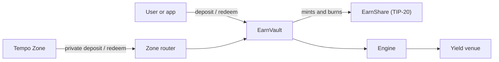

<br>
<br>

<p align="center">
  <a href="https://tempo.xyz">
    <picture>
      <source media="(prefers-color-scheme: dark)" srcset=".github/assets/tempo-wordmark-white.svg">
      
    </picture>
  </a>
</p>

<br>
<br>

# Tempo Earn

[](https://github.com/tempoxyz/earn/actions/workflows/pull-request.yml)
[](https://github.com/tempoxyz/earn/actions/workflows/local-zone.yml)
[](docs/audit/README.md)

Tempo Earn is vault-backed stablecoin yield for [Tempo](https://tempo.xyz). Users deposit a
stablecoin into a persistent `EarnVault` and receive EarnShare, a non-rebasing
[TIP-20](https://docs.tempo.xyz/protocol/tip20/overview) token whose redemption value grows with the
yield. An engine contract holds the vault's position in its yield venue (an ERC-4626 vault, Veda, or
a PropAMM pool), and EarnShare can also be held and used privately inside a Tempo Zone.



New to the terms? See the [glossary](docs/glossary.md). The
[system architecture](docs/architecture/system.md) explains the design and its invariants.

## Use it

`viem/tempo` exposes the Earn ABIs, reads, writes, and call builders. This reads the
[`app-moderato`](profiles/app-moderato/deployment.json) EarnVault, an open PATHUSD vault on the
Moderato testnet:

```ts
import { createClient, http } from 'viem/tempo'
import { tempoModerato } from 'viem/tempo/chains'

const client = createClient({
  chain: tempoModerato,
  transport: http(),
})

const earnVault = await client.earn.getVault({
  vault: '0x46b81bdFA3f184CC1c02BBbd45eaa3E3dAa25cD9',
})

console.log(earnVault.assetToken, earnVault.engine.totalAssets)
```

This needs viem 2.55.10 or later; the repository pins viem 2.57.4.

- [Client integration](docs/integrations/client.md): deposits, redemptions, quotes, simulation, and
  revert handling.
- [Tempo Zones](docs/modules/zone-router.md): private deposits and redemptions.
- [Deployment](docs/operations/deployment.md): deploy your own stack from a reviewed
  [profile](profiles/README.md) with `pnpm earn deploy`.

Tempo is EVM compatible with payment-specific differences; review
[EVM compatibility](https://docs.tempo.xyz/quickstart/evm-compatibility) before deploying contracts
or building transaction infrastructure.

## Contribute

[CONTRIBUTING.md](CONTRIBUTING.md) covers setup, per-area commands, and pull requests;
[development](docs/development.md) owns the toolchain, checks, and CI. The
[documentation index](docs/README.md) lists the canonical page for every topic.

## Repository layout

| Path              | Purpose                                                                          |
| ----------------- | -------------------------------------------------------------------------------- |
| `src/core/`       | Factory, persistent EarnVault, isolated fees, and fee math.                      |
| `src/engines/`    | Single-EarnVault [yield engines](docs/integrations/engines.md), one per kind.    |
| `src/router/`     | Canonical ownerless, deployment-scoped private router.                           |
| `src/rewards/`    | Optional contribution orchestration and EarnShare-only Merkle reward settlement. |
| `src/interfaces/` | Public interfaces grouped by core, engines, and external integrations.           |
| `src/demo/`       | Test-only venues, fixture funders, and par-oracle pool periphery.                |
| `deployments/`    | Earn profile reconciliation, strict generated records, and runtime registries.   |
| `profiles/`       | Authored deployment profiles, generated records, and hosted test fixtures.       |
| `app/`            | React application and Hono Cloudflare Worker.                                    |
| `script/`         | Foundry deployment scripts the shared profile lifecycle runs.                    |
| `e2e/`            | Shared local and hosted integration cases and profile-derived requirements.      |
| `localnet/`       | Disposable local Tempo L1 and Zone lifecycle.                                    |
| `test/`           | Tests mirroring the Solidity production domains.                                 |
| `docs/`           | Architecture, integration, operations, and development documentation.            |

## Project status

- The contracts, viem integration, application, deployment tooling, and local E2E suite are
  implemented, and Sigma Prime's two audits are complete ([Audits](#audits)).
- Tempo Zones are early infrastructure; private flows are experimental.
- `Simple4626Vault`, fixture minting, demo par pools, and permissive test policies are demo
  infrastructure. Production deployments bind an existing external venue and conversion pool.
- Hosted test deployments are listed in [hosted environments](docs/operations/hosted-environments.md).

## Audits

[Sigma Prime](https://sigmaprime.io) completed two security reviews in August 2026, the Zones & Earn
Review v1.1 and the PropAMM & Earn Review v2.0, and every finding that affects Earn is resolved. The
[audits page](docs/audit/README.md) lists each report's scope, commits, and findings, and every
contract changed or added since, including the experimental `PropAMMEngine`. `src/demo/` and the app
are outside both reports.

## Security

Report vulnerabilities privately as described in [SECURITY.md](SECURITY.md). The
[security and privacy model](docs/architecture/security-and-privacy.md) documents privileged roles,
external dependencies, accounting protections, Zone visibility, and the production-readiness
checklist.

## License

Files carry their own SPDX license identifier, which governs that file. The repository is
available under either the [MIT License](LICENSE-MIT) or the [Apache License 2.0](LICENSE-APACHE),
at your option.

---

Working with an AI agent? Integrators start at [SKILL.md](SKILL.md); contributors' agents follow
[AGENTS.md](AGENTS.md).
