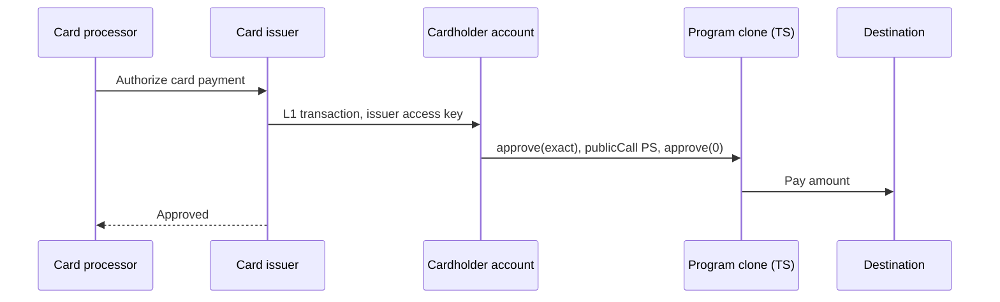
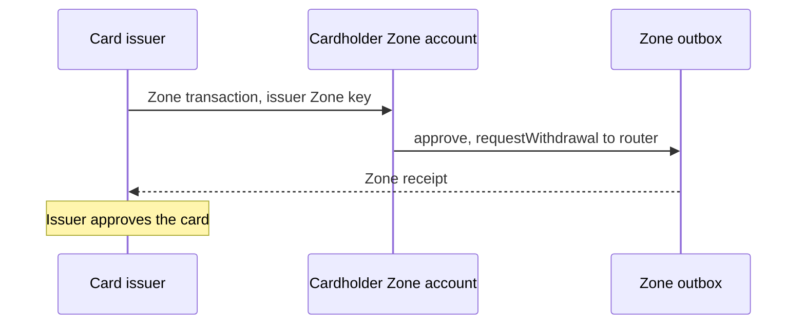
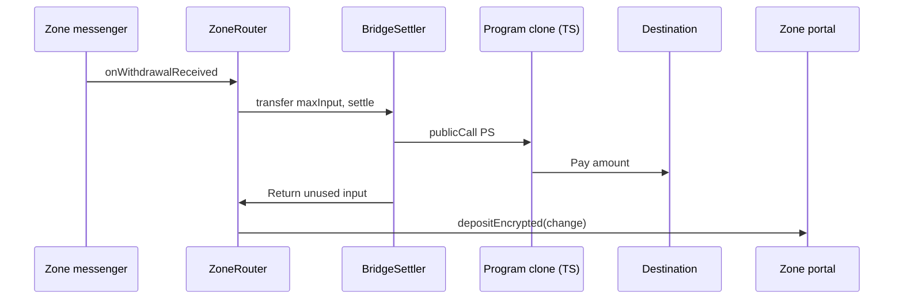

# Design

How cards pay from funds a cardholder keeps on Tempo, and the contracts that do it: what each one
does, who controls it, what it checks and what can go wrong. This page is the single design and audit
reference for the card integration. The card issuer runs card programs in the card spender contracts
and holds the cardholders' access keys; the card processor asks it to authorize each payment. The
issuer's side of the integration is in [bridge-integration.md](bridge-integration.md).

## Purpose

A card can pay from funds that a cardholder keeps on Tempo. The funds can be in a Tempo
account (public) or in a Zone account (private). The funds can be stablecoin or Tempo Earn vault
shares.

The design follows these requirements:

- **The cardholder keeps custody.** Funds move only when a spend pays a card program destination. A
  Zone balance is also held by the Zone's operator, which can move or freeze it.
- **The issuer keeps control.** The spender factory sets the destinations, roles and pause for each program.
- **Fast approval.** The issuer must answer a card authorization in approximately 2 seconds. A private
  spend must not wait for the L1.
- **One mechanism.** Public and private spends both use a Tempo access key that the issuer holds.
- **Minimal.** The contracts add no signatures, nonces or on-chain records that the issuer does not need.

### Principles

The contracts keep the three principles of the issuer's existing card contract, for public and private
spends:

- **Customer funds are never mixed.** Public funds stay in the cardholder account until the spend.
  Private funds pass through the router and the settler in one transaction, and the change goes back
  to the Zone.
- **One program cannot use the approval of another program.** Each clone, settler and access key
  belongs to exactly one program.
- **Funds go only to an authorized destination.** The destination must be on the program's allowlist
  for each spend. The one exception is a leaked Zone key ([accepted risks](#accepted-risks)).

## Components

| Contract                                                             | Where it runs                                   | Admin                                             | Function                                                                                                       |
| -------------------------------------------------------------------- | ----------------------------------------------- | ------------------------------------------------- | -------------------------------------------------------------------------------------------------------------- |
| [`SpenderTempoSpend`](../../bridge/src/SpenderTempoSpend.sol) ("TS") | Tempo L1, by delegatecall in each program clone | spender factory governance (Earn vault list only) | Pays a spend to a program destination from stablecoin, Earn shares, or both.                                   |
| [`ZoneRouter`](../../zone-router/src/ZoneRouter.sol) (Spend op)      | Tempo L1, one for each Zone and mode            | None. The mode is fixed at deployment.            | Receives a Zone withdrawal callback, sends `maxInput` to a listed settler, and returns the change to the Zone. |
| [`BridgeSettler`](../../bridge/src/BridgeSettler.sol)                | Tempo L1, one for each program                  | None                                              | Pays the spend through the program clone, checks the destination, and returns unused input to the router.      |
| [`ZoneRouterFactory`](../../zone-router/src/ZoneRouterFactory.sol)   | Tempo L1                                        | None                                              | Deploys each router at a CREATE2 address from its mode.                                                        |

No contract runs inside a Zone. `ZoneRouter` also has Earn Deposit and Redeem ops
([Zone router](../zone-router/zone-router.md)); they use the same callback checks, and this page
describes the Spend op only.

The contracts convert nothing: a spend settles in the stablecoin that funds it.

## Actors

| Actor                                   | What it can do                                                                                   |
| --------------------------------------- | ------------------------------------------------------------------------------------------------ |
| Cardholder                              | Owns the funds. Gives the issuer an access key with a spend limit.                               |
| The issuer backend                      | Holds the access keys. Sends each spend and pays its gas. Removes duplicate spends off chain.    |
| Spender factory governance and managers | Add destinations, pause programs, enable handlers and allow Earn vaults.                         |
| Zone operator and sequencer             | Order Zone transactions and post withdrawal batches to the L1. Can move or freeze Zone balances. |
| Any Zone user                           | Can send a withdrawal to the router with any callback data.                                      |
| Any L1 account                          | Can call `publicCall` on a clone and `settle` on a settler.                                      |

## Setup

### Program setup

1. **The issuer admin (timelock).** Registers handler "TS" in the factory and adds the program to the TS
   allowlist.
2. **Governance.** Calls `governorCall("UV", vault, allowed)` for each Earn vault the program can
   spend from. This also sets the clone's standing EarnShare approval to the vault. Disallowing
   clears it.
3. **Tempo.** Deploys the program's `BridgeSettler` (`factory`, `spenderId`) with
   [Bridge Release](../deployment/deployment.md#bridge-releases).
4. **Tempo.** Deploys the Zone's `ZoneRouter` with a fixed settler list through `ZoneRouterFactory`.
5. **Zone admin.** Gives the router its gateway role. Admits the program's `refundRecipient` and
   program wallet.
6. **Anyone (once for each token).** Calls `router.warm(token)` and `settler.warm(token)`, sends 1
   EarnShare unit to the clone and 1 unit of each token to the settlement wallet
   ([deploy](deploy.md#5-prepare-the-program-for-low-callback-gas)).

### Card enrollment

The cardholder authorizes a Tempo access key that the issuer holds. Tempo enforces the scope, spend limit
and expiry of the key in the protocol. The cardholder can revoke the key at any time.

- **Tempo account.** Scope: `token.approve(recipient = clone)` and `clone.publicCall`.
- **Zone account.** Scope: `zoneToken.approve(recipient = outbox)` and `outbox.requestWithdrawal`.
- **Limits.** Each key has a periodic limit for each token and an expiry. The issuer uses one key for
  each program. Limits count gross debits.

## Public spend

1. The card processor asks the issuer to authorize a card payment.
2. The issuer sends one L1 transaction from the cardholder account, signed with the issuer access key.
   The transaction approves the clone for the exact amount, calls `publicCall "PS"`, and sets the
   approval back to zero.
3. The TS handler checks the program and the destination, then pays the destination from
   stablecoin, from Earn shares, or from both.
4. The handler checks that the destination balance increased by exactly the amount.
5. The issuer approves the authorization when it gets the L1 receipt.



Before it sends a public spend, the issuer reads `factory.paused()`, the TS handler permissions for the
clone, `isAuthorizedDestination`, `availableBalance` and the remaining key limit. For Earn, the issuer
sets `maxShares = previewWithdraw(fromVault) × 1.005`.

## Private spend

A Zone token's `transfer` reverts with `Unauthorized()` while `approve` and the outbox work, so
funds leave a Zone only by withdrawal to the L1. A private spend is therefore a Zone withdrawal with
a callback to the router. The program clone has no fallback, so it cannot take the callback itself.

### Approval (in the Zone)

1. The issuer sends a Zone transaction from the cardholder's Zone account, signed with the issuer Zone
   key. The transaction approves the Zone outbox and requests a withdrawal to the router.
2. The callback data holds the settler, `maxInput`, the `Spend` and the instructions for the change.
3. The issuer approves the authorization when it gets the Zone receipt. The issuer does not wait for the L1.



### Settlement (on the L1)

1. The Zone posts its batch to the L1. The Zone messenger calls `onWithdrawalReceived` on the router.
2. The router checks the caller, the Zone and the portal. It transfers `maxInput` to the listed
   settler and calls `settle`.
3. The settler calls `publicCall "PS"` on the clone as the payer. The handler pays the destination.
4. The settler checks that the destination got exactly the amount, then returns the unused input to
   the router.
5. The router sends the change back to the cardholder's Zone account as an encrypted deposit.



If settlement reverts after approval, the portal returns the full withdrawal to the cardholder's
Zone account (the fallback recipient), and the issuer's reserve pays the card network.

A private spend uses one input token: the stablecoin or the vault's EarnShare. If neither covers the
spend alone, the issuer sends two withdrawals in the same Zone transaction, and each settles
independently.

### Withdrawal parameters

- `inputToken`: the stablecoin (`fromVault = 0`) or the EarnShare (`fromVault = amount`). One token
  for each withdrawal.
- `maxInput`: `amount` for stablecoin, `maxShares` for Earn.
- `input`: `maxInput` plus change. When anything goes back, the change must be at least
  `depositFee + bouncebackFee + 1`, plus a margin for fees that rise before the batch. This applies
  on an access-enforced Zone and on each Earn spend.
- `callbackGas`: 600,000 for stablecoin and 1,400,000 for Earn ([callback gas](#callback-gas)).
  `fallbackRecipient` is the cardholder.
- Fees: the issuer sponsors gas on the L1 and in the Zone. The outbox takes its withdrawal fee from
  the issuer's fee payer, in `inputToken`. The portal deposit fee comes from the change, up to
  `maxDepositFee`.

### Settlement outcomes

- **Settled.** `WithdrawalProcessed(callbackSuccess = true)`, `Spent` and `SpendSettled` occur in
  the same transaction. The issuer matches the spend by the `senderTag` from its Zone receipt.
- **Bounced.** `WithdrawalProcessed(callbackSuccess = false)` and no `Spent`. The full input goes back
  to the fallback recipient in the Zone; the withdrawal fee does not. The issuer uses its reserve and
  records the cardholder debt.
- **Pending.** No `WithdrawalProcessed` before the timeout, for example because the portal is paused
  or batches stop. The issuer holds the exposure and tells the Zone operator.

A spend bounces when the factory is paused, TS is disabled, the destination is removed, the vault is
disallowed, deposits are paused, a deposit or bounce-back fee is more than the change or
`maxDepositFee`, the router role is removed, TIP-403 blocks a party, `maxShares` is exceeded, or a
venue is illiquid.

### Example

A $50.00 stablecoin spend from a Zone balance on an access-enforced Zone, with 0.05 change (fees are
examples):

- **Zone.** The cardholder sends 50.05 to the outbox. The issuer's fee payer pays the withdrawal
  fee.
- **Tempo.** The portal sends 50.05 to the router. The router sends 50.00 to the settler. The settler
  pays 50.00 through the clone to the destination.
- **Back to the Zone.** The router deposits 0.05, encrypted. The portal keeps the deposit fee. The
  cardholder's Zone balance increases by 0.05 minus the deposit fee.

## Data structures

```solidity
struct Spend {
    bytes32 spenderId;
    address token;
    uint256 amount;
    address destination;
    address vault;
    uint256 fromVault;
    uint256 maxShares;
    bytes32 ref;
}

struct SpendData {
    Op op; // 2 = Spend
    address settler;
    uint128 maxInput;
    bytes settlerData; // abi.encode(Spend)
    SpendReturn zoneReturn;
}

struct SpendReturn {
    uint256 keyIndex;
    EncryptedDepositPayload encrypted;
    address refundRecipient;
    uint128 maxDepositFee;
}
```

## What each contract checks

### SpenderTempoSpend

- `publicCall` accepts only "PS". `publicGetCall` accepts only "GV", which reads the status of a
  vault.
- `spenderId` must be the ID that `createSpender` deployed this clone for. The handler calculates
  this from the CREATE2 address. Other IDs on the same clone cannot spend, so a clone migrated from
  another factory cannot use TS.
- `destination` must be authorized for `spenderId` in the spender factory. The clone checks the pause.
- `amount` must be more than zero. `fromVault` must not be more than `amount`.
- `amount - fromVault` comes from the caller in `token`. `fromVault` comes from an allowed Earn vault
  whose asset is `token`. The vault burns at most `maxShares` (zero means no limit). Unused shares go
  back to the caller.
- The destination balance of `token` must increase by exactly `amount`. Fee-on-transfer and rebasing
  tokens revert.
- `transferToDestination` and `transferToDestinationStrict` always revert, so no standing allowance
  can be pulled. Wallets that cannot use access keys stay on the EA and TF handlers.
- Governance action "UV" (factory only) allows or disallows a vault, and sets or clears the clone's
  share approval to that vault.
- `availableBalance` reports the payer's balance of `token` plus the value of its shares in an
  allowed vault that holds `token`.
- Storage is at an ERC-7201 slot (`tempo.spend.SpenderTempoSpend`), so it cannot collide with the
  clone's storage.

### ZoneRouter (Spend op)

- The caller must be the Zone messenger. The source Zone must be `allowedZoneId`. The source portal
  must be the Zone factory's portal for that Zone.
- The settler must be in the router's fixed list (`UnknownSettler`).
- `maxInput` must be more than zero and not more than the withdrawn amount (`InvalidMaxInput`).
- The router transfers `maxInput` to the settler. It gives the settler no allowance.
- After `settle`, the router must hold less input than before, and the used amount must not be more
  than `maxInput` (`InvalidSettlement`).
- The router sends the change to the source portal with `depositEncrypted`. It reverts if the
  portal's deposit fee is more than `maxDepositFee` (`DepositFeeTooHigh`).
- At the end, the router's input balance must equal its balance before the withdrawal
  (`ResidualBalance`). A transient lock stops reentry (`ReentrantCall`).

### BridgeSettler

- The `Spend` must be for the settler's program (`WrongProgram`).
- The input must be the spend token when `fromVault` is zero, or the vault's EarnShare when
  `fromVault` equals `amount` (`WrongInputToken`).
- The settler must hold at least `maxInput`. It uses its balance minus `maxInput` as its baseline.
- After the clone call, some input must be used (`NothingSettled`), and the destination must get
  exactly `amount` (`DestinationNotPaid`).
- The settler returns the unused input to the caller and must end at its baseline
  (`ResidualBalance`).
- `settle` is permissionless. A transient lock stops reentry (`Reentrancy`).
- `warm(token)` sets the settler's standing maximum approval to the clone before the first spend.
- It emits `SpendSettled(ref, inputToken, inputConsumed, inputReturned)`, with no cardholder address
  or `senderTag`.

### ZoneRouterFactory

- The factory deploys a router at a CREATE2 address from the hash of its mode. The mode sets the
  Zone, the ops and the settler list. To change the list, deploy a new router.

## Trust boundaries

- The spender factory controls each program: destinations, pause, roles and handler routing. Only
  governance can allow an Earn vault, because a vault's `withdrawExact` decides where redeemed value
  goes.
- Only the Zone messenger can call the router. The router accepts only its one Zone and the canonical
  portal of that Zone.
- Any Zone user can send a withdrawal to the router with any callback data. That user can only pay a
  program destination through a listed settler, from their own funds, up to their `maxInput`.
- The router and the settler have no owner, no setters and no sweep. They must keep no balance after
  a callback.

The contracts assume this behavior from code outside the [audit scope](#audit-scope):

- The Zone messenger is the only caller of `onWithdrawalReceived` and passes the true source Zone and
  portal.
- `EarnVault.withdrawExact` burns at most `maxEarnShares` and sends exactly `assets`.
- The spender factory authorizes destinations per program, pauses every clone, and routes `publicCall`
  to a handler by its 2-byte prefix.
- TIP-20 tokens revert on failure and need no return-value handling beyond what the handler's
  `SafeTransferLib` and the settler's own call check handle.

## Invariants

1. A spend pays only an authorized destination of the clone's own program.
2. The destination gets exactly `amount`.
3. A spend from Earn burns no more than `maxShares` when it is set. Unused shares go back to the
   payer.
4. The router and the settler hold no input token after a callback.
5. The settler can use at most `maxInput`, which the cardholder's Zone transaction sets. A replaced
   handler can take at most the spend, never the change.
6. A callback that moves nothing, or returns more than it got, does not settle.
7. The portal keeps no more deposit fee than `maxDepositFee`.
8. No event from these contracts contains a cardholder address or the Zone `senderTag`. The change
   goes back as an encrypted deposit.
9. The handler storage cannot collide with the clone storage.
10. The issuer's pull pipeline is off for TS.
11. A settler serves only one program and accepts only the spend token or its vault's EarnShare.

## Accepted risks

- A leaked Zone access key can withdraw a cardholder's Zone balance, up to the key limit, to any
  address in an open Zone or any admitted account in a closed-loop Zone. The issuer uses one key for
  each program, so one leak affects all cardholders of that program. The withdrawer also chooses
  where the change goes.
- A leaked public access key can call the public actions of all handlers that the program can use,
  because its scope names `publicCall`, not a prefix. None of these actions move funds; gating a
  handler closes it.
- There is no on-chain idempotency. The issuer removes duplicate spends off chain by its pull ID.
- The issuer approves a private spend on the Zone receipt. If L1 settlement fails after approval,
  the issuer's reserve pays.
- Spend events are not proof of payment. Anyone can emit one with any `ref`. The issuer reconciles with
  its own transactions and the portal's `WithdrawalProcessed` event.
- Tokens sent to the router outside a callback cannot be recovered. Tokens sent to the settler
  outside a callback can be spent by the next `settle` caller, but only to a program destination.
- A vault that cannot report its asset, shares or redemption value makes `availableBalance` report
  the stablecoin alone. The deploy scripts refuse a vault without exact withdrawals or redeem
  previews.

## Refunds

Refunds use no contract of the integration. The issuer's program wallet sends them, as the issuer does
today.

- **Public.** The program wallet transfers the token to the cardholder.
- **Private.** The program wallet, admitted on the Zone, approves the portal and calls
  `depositEncrypted` for the cardholder. The cardholder gets the amount minus the deposit fee.
- **Rejected return.** If the Zone rejects a change or refund deposit, the funds go to
  `refundRecipient` (`DepositBounceBack`, or `DepositBounceBackPending` and then `claimRefund`).
  The issuer matches by token, amount and time, and pays again.

## Decisions

Tests and other pages cite these by number.

1. Card spend on Tempo is a spender handler, governed by the spender factory, so the issuer keeps its roles,
   destinations and pause.
2. Access keys only, public and private. No standing-allowance pull path in TS: it cannot reach a
   Zone.
3. No signatures and no on-chain action IDs. The issuer submits every spend and dedupes off chain.
4. Refunds are stablecoin through the issuer's orchestration: public to the wallet, private into the Zone
   through the portal's own `depositEncrypted`.
5. A spend settles in the stablecoin it is funded from. The issuer accepts any stablecoin, so there is no
   conversion pool.
6. One `BridgeSettler` per program, with no owner. A Zone's router lists the settlers of the programs
   it serves; changing that list means deploying a new router through the factory.
7. The Zone key is scoped to the outbox, which cannot pin a withdrawal's recipient, and its
   leaked-key risk is accepted.
8. Private spend settles on the L1, not inside the Zone, because funds leave a Zone only by
   withdrawal while Zone token transfers are disabled.
9. The issuer uses one access key per program, shared by its cardholders, so a leaked key reaches every
   cardholder of that program up to each one's limit.
10. The issuer sponsors every spend's gas as fee payer, on the L1 and in the Zone. The outbox takes its
    withdrawal fee from the fee payer, in the input token; the portal's deposit fee comes out of the
    change.
11. Each program's `refundRecipient` is a dedicated issuer-controlled account, admitted on the Zone.
12. TS pays only for the ID a clone was created for, so a manager cannot add destinations to a live
    program by registering a second ID. Only governance allows Earn vaults, for the same reason.
13. The program wallet that pays private refunds is admitted on the Zone, since it deposits into the
    portal directly.
14. A spend from Earn settles in the vault's asset.
15. A private spend uses Earn shares if they cover it, otherwise stablecoin, otherwise both as two
    withdrawals in the same Zone transaction, otherwise the issuer declines. The two settle
    independently: if one bounces after approval, the reserve covers its part.
16. The settler checks the destination was paid, and the router caps the settler at `maxInput` and
    caps the portal's deposit fee, so neither a replaced handler nor a raised Zone fee can take a
    spend's value or its change while it looks settled.
17. No contract emits the Zone's `senderTag`. The issuer matches a private spend by the portal's
    `WithdrawalProcessed` event in the settlement transaction.

## Timing and gas

### Latency

Neither path waits on more than one block before the issuer can approve:

| Path                                    | What the issuer waits for                              | Measured (`e2e/bridge`)                            |
| --------------------------------------- | ------------------------------------------------------ | -------------------------------------------------- |
| Public, local                           | One L1 transaction, submit to receipt                  | 461 to 508 ms (median 494, 5 runs)                 |
| Private, local                          | The Zone transaction, request to receipt               | 469 ms                                             |
| Private, local, after approval          | Zone receipt to L1 settlement                          | 1,058 ms                                           |
| Public, testnet                         | One L1 transaction over the public testnet RPC         | 400 to 1,070 ms (medians 455 and 502, 2 runs of 5) |
| Private, testnet Zone 3                 | Zone transaction through Tempo API, request to receipt | 581 and 684 ms (2 runs)                            |
| Private, testnet Zone 3, after approval | Zone receipt to L1 settlement                          | 1,483 and 1,677 ms (2 runs)                        |
| Private, mainnet Zone 2                 | Zone request to receipt                                | 0.50 s p50, 0.77 s p90, 2.30 s max (100 runs)      |
| Private, mainnet Zone 2, after approval | Zone request to the L1 block that processes it         | 6.46 s p50, 6.83 s p90, 8.24 s max (100 runs)      |

Local rows use a local L1 and Zone with 500 ms blocks. Mainnet rows are timed on an Earn router
withdrawal, which takes the same Zone path as a spend; most of the time after approval (5.4 s at
p50) is the wait for Zone 2 to post its batch.

### Callback gas

The outbox charges a withdrawal fee of `(50,000 + callbackGas)` times the Zone's gas rate, on the gas
requested, up to the outbox's 10M. The Spend callback data is 864 of the outbox's 1,024 bytes.
Measured on a mainnet fork against the production OUSD Earn vault and Zone 2's portal, with change
returned to the Zone ([`PrivateSpendForkGas.t.sol`](../../bridge/test/fork/PrivateSpendForkGas.t.sol)):

| Spend      | Program     | First spend (empty settlement wallet) | Later spend |
| ---------- | ----------- | ------------------------------------- | ----------- |
| Earn       | As deployed | 1.98M                                 | 1.22M       |
| Stablecoin | As deployed | 1.19M                                 | 0.44M       |
| Earn       | Prepared    | 1.23M                                 | 0.98M       |
| Stablecoin | Prepared    | 0.69M                                 | 0.44M       |

Most of the cost is Tempo's charge for each storage slot that goes from zero to nonzero (TIP-1000).
So the router hands the settler its input by transfer, not approval; the settler's approval to the
clone, the router's to the portal and the clone's to an allowed vault are standing maximum approvals;
and the reentrancy locks are transient. The settler's own balance slot is created and cleared on
every spend (about 250k); seeding it would not help, because `settle` is permissionless and counts
what the settler holds as the caller's input.

The Zone sequencer packs withdrawals into a 10M gas batch, reserving 0.5M per transaction and 1.75M
plus the requested callback gas per spend:

| Callback gas requested | Spends per 10M batch |
| ---------------------- | -------------------- |
| 3M                     | 2                    |
| up to 1.42M            | 3                    |
| up to 0.63M            | 4                    |

With a prepared program whose settlement wallet already holds each token, the issuer requests about 0.6M
for a stablecoin spend (4 per batch) and 1.4M for an Earn spend (3 per batch). The Earn figure also
covers the vault approval the TF handler may have cleared. A settlement wallet with no balance
needs about 250k more.

## Audit scope

### In scope

- [`bridge/src/SpenderTempoSpend.sol`](../../bridge/src/SpenderTempoSpend.sol)
- [`bridge/src/BridgeSettler.sol`](../../bridge/src/BridgeSettler.sol)
- [`zone-router/src/ZoneRouter.sol`](../../zone-router/src/ZoneRouter.sol), focused on the Spend op
- [`zone-router/src/ZoneRouterFactory.sol`](../../zone-router/src/ZoneRouterFactory.sol)

### Out of scope

- The card spender contracts and the Zones contracts (`ZonePortal`, `ZoneMessenger`, `Verifier`),
  vendored unchanged at the commits in [`VENDORED.md`](../../bridge/vendor/VENDORED.md).
- Tempo Earn ([`earn/src/`](../../earn/src/)), audited separately
  ([Earn audits](../earn/audit/README.md)).
- Tests, fixtures, the deploy scripts, `e2e/` and `localnet/`.

A bug in how the in-scope code integrates with out-of-scope code is in scope. The
[trust boundaries](#trust-boundaries) list what the in-scope code assumes from it. Report findings
as the [security policy](../../SECURITY.md) describes.

### Areas to examine most

- **Arbitrary callers of the Spend path.** Any Zone user can call it with any callback data. It must
  only pay a program destination, from that user's own funds.
- **Rounding on the Earn path.** `previewWithdraw`, `withdrawExact`, the `maxShares` check and the
  return of unused shares to the Zone.
- **Change and portal fees.** A deposit back to the Zone must be at least the portal's deposit and
  bounce-back fees, or the spend bounces after approval. The issuer adds this margin; the contracts do
  not enforce it.
- **Reentrancy** through tokens or the vault during `onWithdrawalReceived` and `settle`.
- **Standing approvals.** The settler approves the clone, the router approves the portal, and the
  clone approves each allowed vault, all at the maximum. Nothing they can reach may stay in these
  contracts between spends, and `maxInput` must still bound a spend.

### Test evidence

| Suite                                                                                          | What it covers                                                                                                                                   |
| ---------------------------------------------------------------------------------------------- | ------------------------------------------------------------------------------------------------------------------------------------------------ |
| `bridge/test/unit/`: `SpenderTempoSpend`, `BridgeSettler`, `PrivateSpend`, `PrivateEarnChange` | Handler, settler and router Spend behavior, every revert, events, approvals, hostile callback data, Earn change under portal fees, fuzzed spends |
| `zone-router/test/ZoneRouter.t.sol`                                                            | Router modes and the Spend op: callback authentication, settler list, `maxInput` cap, deposit fee cap, reentry                                   |
| `zone-router/test/BridgeSettler.t.sol`                                                         | The settler's own checks against a mock factory and clone                                                                                        |
| `bridge/test/unit/`: `Roles`, `AccessKeySecurity`, `DeployScripts`                             | Factory roles, what a leaked key can do, and the deploy scripts                                                                                  |
| `bridge/test/e2e/Matrix.t.sol`                                                                 | 35 card scenarios against 11 setups ([matrix](matrix.md))                                                                                        |
| `e2e/bridge`                                                                                   | A real L1 and Zone, locally and on testnet, including an Earn spend                                                                              |

Build and test: run `pnpm deps` at the repository root, then `forge build` and
`FOUNDRY_PROFILE=ci forge test` in `bridge/` and `zone-router/`.
