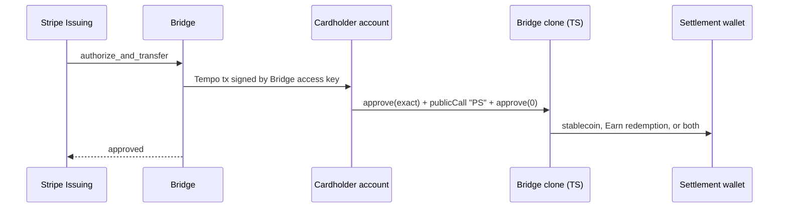
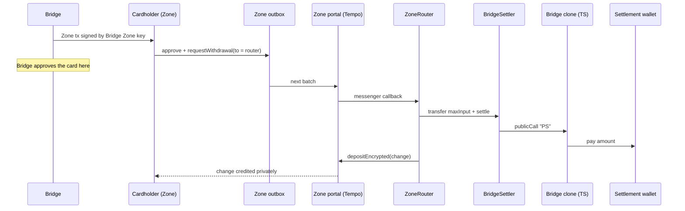

# Design

How Bridge/Stripe Issuing cards spend from balances a cardholder keeps on Tempo: in their own
account or privately in a Zone, in stablecoin or in Tempo Earn shares.

## Goal and constraints

- **The cardholder keeps custody.** Funds stay in the cardholder's account, or their Zone account,
  until a card spend pays a program destination. A Zone balance is also held by the Zone's
  operator, which can move or freeze it.
- **One experience, public and private.** A Zone account can only be spent from by a Tempo access
  key, so card spend on Tempo always uses access keys, and public spend works the same way.
- **Reuse Bridge.** Bridge's factory, clones, roles, destinations and pause govern card spend on
  Tempo.
  Bridge's backend submits spends the way it submits pulls today.
- **Card timing.** Bridge has about 2 seconds to answer an authorization, including its own
  processing. For a private spend Bridge approves on the Zone receipt, so a spend waits on one Zone
  request and never on the L1.
- **Minimal.** No signatures, nonces or on-chain bookkeeping that Bridge does not need today.

## The design

Two Tempo contracts work inside Bridge's system, both on the L1; nothing is deployed inside a Zone:
`SpenderTempoSpend`, the one contract in [`bridge/`](../../bridge/README.md), and `BridgeSettler`, one of
the [Zone router](../zone-router/zone-router.md)'s settlers in `zone-router/src/settlers/`. Both settle
the same `Spend` struct, defined once beside the settler and imported by the handler.

### `SpenderTempoSpend` (the "TS" handler)

A Bridge spender handler, registered in Bridge's factory like EA or TF. It runs by delegatecall in
the program's clone. It has one public action, `publicCall "PS"`, which pays a `Spend` from the
caller:

```text
spenderId, token, amount, destination, vault, fromVault, maxShares, ref
```

- **Program and destination.** `spenderId` must be the ID `createSpender` deployed this clone for,
  which the handler checks against the clone's CREATE2 address, and `destination` one of its
  authorized destinations. A manager can register more IDs on an existing clone, each with its own
  destinations, and those cannot spend. So a clone migrated from another factory cannot use `TS`.
  Pause is checked by the clone.
- **Funding.** `amount - fromVault` is paid in `token`. `fromVault` is redeemed from an allowed Earn
  vault whose asset is `token`, burning at most `maxShares` (zero accepts the live price, but Bridge
  always sets it, since it also sizes the share approval or withdrawal). Unused
  shares go back to the payer.
- **Settlement token.** A spend settles in the stablecoin the funds are held in: an OUSD vault
  pays OUSD, a DLUSD balance pays DLUSD. Bridge accepts any stablecoin, so nothing is converted.
- **Reference.** `ref` is Bridge's own reference. It is emitted for reconciliation and never
  enforced.

The one governance action, `"UV"`, allows or disallows an Earn vault. A vault's `withdrawExact`
decides where redeemed value goes, so allowing one is as strong as adding a destination, and only
governance does either. `availableBalance` reports the
payer's balance of `token`, plus the value of its shares in an allowed vault that holds `token`.

Bridge's pull pipeline (`transferToDestination`) reverts. It needs a standing allowance and cannot
reach a Zone. Wallets that cannot use access keys stay on Bridge's EA and TF handlers.

### `BridgeSettler` and the Zone router

Bridge's clone has no fallback, so it cannot receive a Zone withdrawal callback itself. Private
spends go to a [`ZoneRouter`](../zone-router/zone-router.md) deployed in Spend mode, which hands the
withdrawal to [`BridgeSettler`](../../zone-router/src/settlers/BridgeSettler.sol), one per program, with no
owner, released by [Zone Router Release](../deployment/deployment.md#zone-router-releases). The router:

- accepts callbacks only from the Zone messenger, for its Zone and that Zone's canonical portal;
- transfers the callback's `maxInput` to a settler from its fixed list, calls it, and measures
  what the settler used;
- returns the rest to the Zone as an encrypted deposit, which closed-loop Zones require, and
  reverts if the portal's deposit fee is above the `SpendReturn`'s `maxDepositFee`.

The settler ([specified with the Zone router](../zone-router/zone-router.md#bridgesettler)):

- requires the `Spend` to be for its program and the input to be the spend's token (its stablecoin,
  or the shares of the vault that funds all of it);
- requires the `maxInput` the router sent, approves it to the clone and calls `publicCall "PS"`,
  so the handler sees the settler as the payer;
- checks the destination received exactly `amount`, so a replaced handler cannot look settled, and
  that the handler used something;
- returns the unused input to the router.

Any revert bounces the input to the withdrawal's fallback recipient in the Zone. Because the
cardholder's Zone transaction sets `maxInput`, a replaced handler can take at most the spend, never
the change. Neither contract emits the Zone's `senderTag` or a cardholder address; Bridge matches a
spend by the portal's own `WithdrawalProcessed` event in the same transaction.

## Flows

### Public spend



### Private spend



Bridge approves the card once the Zone accepts the request. If the callback later reverts (pause,
a disabled handler, a removed destination, price move, illiquid venue), the input bounces to the
withdrawal's fallback recipient, the cardholder's Zone account, and the platform reserve
pays the network. A callback that deposits anything back must
deposit at least the portal's deposit and bounce-back fees. A closed-loop Zone always requires a
return, and an Earn spend always returns its unused shares. So for either, Bridge withdraws the
input plus change of at least `depositFee + bouncebackFee + 1`, with a margin for fees that rise
before the batch, and the change returns to the cardholder net of the deposit fee.

### Latency

Bridge has about 2 seconds to answer an authorization, including its own processing. Neither path
waits on more than one block before Bridge can approve:

| Path                                    | What Bridge waits for                                    | Measured (`e2e/bridge`)                            |
| --------------------------------------- | -------------------------------------------------------- | -------------------------------------------------- |
| Public                                  | One L1 transaction, submit to receipt                    | 461 to 508 ms (median 494, 5 runs)                 |
| Private                                 | The Zone transaction, request to receipt                 | 469 ms                                             |
| Private, after approval                 | Zone receipt to L1 settlement                            | 1,058 ms                                           |
| Public, Moderato                        | One L1 transaction over the public testnet RPC           | 400 to 1,070 ms (medians 455 and 502, 2 runs of 5) |
| Private, Moderato                       | Zone 3 transaction through Tempo API, request to receipt | 581 and 684 ms (2 runs)                            |
| Private, Moderato, after approval       | Zone receipt to L1 settlement                            | 1,483 and 1,677 ms (2 runs)                        |
| Private, mainnet Zone 2                 | Zone request to receipt                                  | 0.50 s p50, 0.77 s p90, 2.30 s max (100 runs)      |
| Private, mainnet Zone 2, after approval | Zone request to the L1 block that processes it           | 6.46 s p50, 6.83 s p90, 8.24 s max (100 runs)      |

The local rows use a local L1 and Zone with 500 ms blocks and no network distance. The Moderato rows
are the testnet and its hosted Zone 3, and the mainnet rows are Zone 2, timed on an Earn router
withdrawal, which takes the same Zone path as a spend. Most of the time after approval, 5.4 s at
p50, is the wait for Zone 2 to post its batch to the L1. Private settlement on the L1 is not on the
approval path: the reserve covers a callback that fails after approval.

### Callback gas

Bridge gives each private spend's callback 3M gas. The outbox allows up to 10M, and the withdrawal
fee grows with the gas requested. The Spend callback data is 864 of the outbox's 1,024 bytes.
Measured on a mainnet fork (block 46,154,047) against the production OUSD Earn vault and Zone 2's
portal, through a factory-deployed router, `BridgeSettler` and the program's clone, with change
returned to the Zone ([`test/fork/PrivateSpendForkGas.t.sol`](../../bridge/test/fork/PrivateSpendForkGas.t.sol)):

| Spend      | First spend (empty settlement wallet) | Later spend |
| ---------- | ------------------------------------- | ----------- |
| Earn       | 2.25M                                 | 2.00M       |
| Stablecoin | 1.21M                                 | 0.96M       |

The amount does not change it, from $10 to $10,000. Most of the cost is Tempo's charge of about
250k gas for each storage slot that goes from zero to nonzero: every approval and every transient
balance in the router, settler and clone pays it, even when cleared in the same transaction. The
router hands the settler its input by transfer rather than approval to save one such slot (about
261k per spend).

### Refunds

Refunds are stablecoin through Bridge's orchestration, as Bridge returns funds today:

- public refunds are a transfer from Bridge's program wallet to the cardholder;
- private refunds are the program wallet, admitted on the Zone, calling the portal's own
  `depositEncrypted` for the cardholder. No contract of the integration is involved.

## What a leaked key can do

| Key               | Scope                                                                        | What it can do                                                                                                                                                                                                                                                                                                                                                                                                         |
| ----------------- | ---------------------------------------------------------------------------- | ---------------------------------------------------------------------------------------------------------------------------------------------------------------------------------------------------------------------------------------------------------------------------------------------------------------------------------------------------------------------------------------------------------------------- |
| Public access key | `approve` with the clone as recipient, and the clone's `publicCall`          | Pay program destinations, up to the key's periodic limit, through `PS`, the only `TS` action. This is the bound Bridge's debitor has today. The scope names `publicCall`, not a prefix, so the key also reaches the public actions of every other handler the program can use, such as a Tempo Earn handler's vault preference. None moves funds. Gating a handler closes this for every program not on its allowlist. |
| Zone access key   | `approve` with the outbox as recipient, and the outbox's `requestWithdrawal` | Withdraw up to its limit to any address in an open Zone, or to any admitted account in a closed-loop Zone. Accepted risk (decision 7).                                                                                                                                                                                                                                                                                 |

A withdrawal another Zone user sends to the router can only pay a program destination through a
settler the router lists, from that user's own funds and at most its `maxInput`.

## Decisions

1. Card spend on Tempo is a Bridge handler, governed by Bridge's factory.
2. Access keys only, public and private. No standing-allowance pull path in `TS`.
3. No signatures and no on-chain action IDs. Bridge submits every spend and dedupes off chain.
4. Refunds are stablecoin through Bridge's orchestration: public to the wallet, private into the
   Zone through the portal's own `depositEncrypted`.
5. A spend settles in the stablecoin it is funded from. Bridge accepts any stablecoin, so there is
   no conversion pool.
6. One `BridgeSettler` per program, with no owner. A Zone's router lists the settlers of the
   programs it serves; changing that list means deploying a new router through the factory.
7. The Zone key is scoped to the outbox, and its leaked-key risk is accepted.
8. Private spend settles on the L1, not inside the Zone. A Zone token's `transfer` reverts with
   `Unauthorized()`, while `approve` and the outbox work, so a Zone cannot pay Bridge directly and
   funds leave it only by withdrawal. Tempo disables Zone transfers only during the initial
   permissioned phase.
9. Bridge uses one access key per program, shared by its cardholders, so a leaked key reaches every
   cardholder of that program up to each one's limit.
10. Bridge sponsors every spend's gas as fee payer, on the L1 and in the Zone. A sponsored Zone
    request also has the outbox take its withdrawal fee from the fee payer, in the input token. The
    portal's deposit fee comes out of the change.
11. Each program's `refundRecipient` is a dedicated Bridge-controlled account, admitted on the Zone.
12. `TS` pays only for the ID a clone was created for, so a manager cannot add destinations to a
    live program by registering a second ID on its clone. Only governance allows Earn vaults, for
    the same reason.
13. The program wallet that pays private refunds is admitted on the Zone, since it deposits into
    the portal directly.
14. A spend from Earn settles in the vault's asset.
15. A private spend uses Earn shares if they cover it, otherwise stablecoin, otherwise both as two
    withdrawals in the same Zone transaction, otherwise Bridge declines. One withdrawal carries one
    token, so the two callbacks are independent: if one bounces after approval, the reserve covers
    its part.
16. The settler checks the destination was paid, the router caps the settler at the cardholder's
    `maxInput` and caps the portal's deposit fee, so neither a replaced handler nor a raised Zone fee
    can take a spend's value or its change while it looks settled.
17. No contract emits the Zone's `senderTag`. Bridge matches a private spend by the portal's
    `WithdrawalProcessed` event, which carries it, in the settlement transaction.
