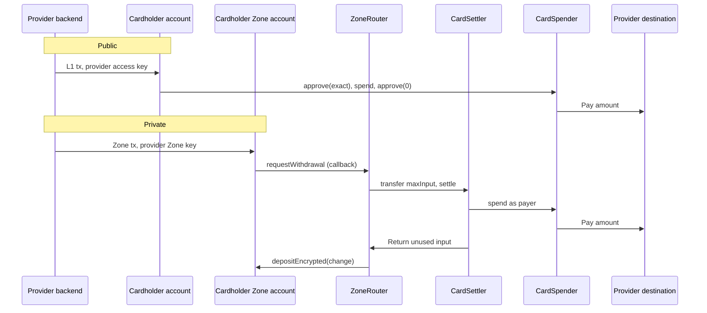

# Design

How a card from any provider pays from funds a cardholder keeps on Tempo, publicly or in a Zone, in
stablecoin or Tempo Earn shares, through two provider-agnostic contracts and one adapter per provider.
This page owns the agnostic design; [rain.md](rain.md) owns the Rain provider. The
[Bridge integration](../bridge/design.md) came first and runs on its own contracts inside Bridge's
spender factory; [Bridge on this design](#bridge-on-this-design) maps it onto the same seams.

## Components

| Contract                                                              | Admin                         | Function                                                                                                  |
| --------------------------------------------------------------------- | ----------------------------- | --------------------------------------------------------------------------------------------------------- |
| [`CardSpender`](../../cards/src/CardSpender.sol)                      | None                          | Pays a `CardSpend` to a destination its program authorizes, from stablecoin, Earn shares, or both.        |
| [`CardSettler`](../../cards/src/CardSettler.sol)                      | None                          | The Zone router's settler: spends the router's `maxInput` through the `CardSpender` and returns the rest. |
| [`ICardProgram`](../../cards/src/interfaces/ICardProgram.sol) adapter | Set by the provider's adapter | Decides which destinations, tokens and Earn vaults a program's spends may use.                            |
| [`ZoneRouter`](../../zone-router/src/ZoneRouter.sol) (Spend op)       | None                          | Receives the Zone withdrawal, hands `maxInput` to its listed settler, returns the change to the Zone.     |

One `CardSpender` and one `CardSettler` serve one program: the spender names its adapter
(`PROGRAM`) and every `CardSpend` must name the same one, so one program's approval never pays
through another's. A Zone's Spend-mode router lists the settlers of the programs it serves, as for
Bridge ([Zone router](../zone-router/zone-router.md)).

The provider seam is small on purpose. `ICardProgram` answers two questions:

- `isAuthorizedDestination(payer, destination, token, hint)`: may this payer's spend of this token pay
  this destination? `hint` is the provider's evidence about the destination, carried in
  `CardSpend.destinationHint`.
- `isAllowedVault(vault)`: may spends redeem this Earn vault's shares? A vault's `withdrawExact`
  decides where redeemed value goes, so allowing one is as strong as adding a destination.

Everything else (moving the funds, Earn redemption, the destination check, the change, privacy) is the
same for every provider. What happens to the money once it lands is the provider's own.

## Flows

- **Public.** The provider sends one L1 transaction from the cardholder's account, signed with an
  access key the cardholder scoped to `token.approve(recipient = spender)` and `spender.spend`, with a
  periodic limit. It approves the exact amount, spends and clears the approval; with Earn it approves
  the share quote too. The provider approves the card on the L1 receipt.
- **Private.** The provider sends one Zone transaction from the cardholder's Zone account, signed with
  a Zone key scoped to the outbox, that withdraws `maxInput` plus change to the router with Spend
  callback data. The provider approves the card on the Zone receipt; the L1 settles about a second
  later on a local Zone. If settlement reverts, the portal returns the whole withdrawal to the Zone and
  the provider's reserve covers the card.

The withdrawal parameters, fees, change and callback gas are those of the Bridge integration's
[private spend](../bridge/design.md#withdrawal-parameters); the `CardSpend` callback is 896 bytes of the
outbox's 1,024.

## What each contract checks

### CardSpender

- `CardSpend.program` is the spender's own adapter (`WrongProgram`); `amount` is above zero and
  `fromVault` at most `amount` (`InvalidAmount`).
- The adapter authorizes the destination for this payer and token (`DestinationNotAuthorized`).
- `amount - fromVault` comes from the payer in `token`. `fromVault` comes from an adapter-allowed vault
  whose asset is `token` (`VaultNotAllowed`, `IncorrectAssetForVault`); it burns at most `maxShares`
  (`ShareCostExceeded`; zero accepts the live price) and returns unused shares to the payer.
- The destination's balance of `token` rises by exactly `amount` (`DestinationNotCredited`).
- A transient lock stops reentry. It holds nothing between spends; its standing share approval to a
  vault is harmless for the same reason.
- `availableBalance(from, token, vault)` reports the stablecoin plus the value of shares in an allowed
  vault holding `token`.

### CardSettler

The checks of [`BridgeSettler`](../bridge/design.md#bridgesettler), with the program's `CardSpender`
in place of a Bridge clone: the spend names the settler's program, one input token per withdrawal
(the stablecoin, or the vault's EarnShare when Earn funds all of it), the input is at least
`maxInput`, the spend consumes some input and pays the destination exactly, and the settler returns the
unused input and ends at its baseline. It emits `SpendSettled(ref, inputToken, inputConsumed,
inputReturned)`, with no cardholder address or `senderTag`.

## Invariants

1. A spend pays only a destination its program's adapter authorizes for that payer and token.
2. The destination gets exactly `amount`.
3. A spend from Earn burns no more than `maxShares` when set; unused shares go back to the payer.
4. The spender, the settler and the router hold no input after a spend.
5. The settler uses at most `maxInput`, which the cardholder's Zone transaction sets.
6. No event from these contracts on the private path names the cardholder or the Zone `senderTag`.
7. One program's spend never pays through another program's spender or settler.

Tests: [`cards/test/unit/`](../../cards/test/unit/) against Rain's real contracts, a second provider
modeled on Bridge's settlement wallets ([`ProviderAgnostic.t.sol`](../../cards/test/unit/ProviderAgnostic.t.sol)),
and [`e2e/cards`](../../e2e/cards/) on a real L1 and Zone.

## Privacy

"Private" means the L1 settlement does not name the cardholder: the payer is the settler, the
destination is one the program shares across cardholders, and the change returns as an encrypted
deposit. The Zone's sequencer sees the cardholder's withdrawal, and the L1 shows each spend's amount,
token, destination and time. A provider whose adapter authorizes a cardholder-specific destination for
the settler would break this, so adapters authorize only pooled destinations for a settler payer
(Rain's: [rain.md](rain.md#destinations)).

## Accepted risks

The Bridge integration's [accepted risks](../bridge/design.md#accepted-risks) carry over: a leaked Zone
key can withdraw a cardholder's Zone balance outside the program; there is no on-chain idempotency, so
the provider dedupes spends off chain; the provider approves a private spend on the Zone receipt and its
reserve pays if settlement fails; spend events are not proof of payment. In addition:

- An adapter is as strong as what it reads. It decides every destination, so a provider whose own
  contracts can be upgraded (Rain's factory, Bridge's spender factory) is trusted for that.
- Adapters fix tokens and vaults at deployment. Changing them means deploying a new adapter, spender and
  settler, and a router that lists the new settler.

## Bridge on this design

| Seam                  | Bridge                                                                         | Rain                                                      |
| --------------------- | ------------------------------------------------------------------------------ | --------------------------------------------------------- |
| Pays a spend          | `SpenderTempoSpend` ("TS"), by delegatecall in the program's spender clone     | `CardSpender`                                             |
| Private settler       | `BridgeSettler`                                                                | `CardSettler`                                             |
| Destinations          | The spender factory's per-program allowlist (`isAuthorizedDestination`), pause | Rain collateral contracts (`RainCardProgram`)             |
| Earn vaults           | Factory governance (`governorCall "UV"`)                                       | Fixed in the adapter                                      |
| After the money lands | Bridge's settlement wallet                                                     | Rain's signed payment to its treasury, and signed refunds |

Bridge keeps its handler because its spender factory, roles and pause already govern every spend and
its clones are what its backend reconciles. A provider without such a system, like Rain, uses
`CardSpender` and writes only an adapter. `ProviderAgnostic.t.sol` runs the agnostic contracts with an
adapter shaped like Bridge's (a settlement-wallet allowlist and a pause).

## Adding a provider

1. Vendor the provider's contracts unmodified under `cards/vendor/<provider>/` and record their
   provenance in [VENDORED.md](../../cards/vendor/VENDORED.md).
2. Write its `ICardProgram` adapter in `cards/src/providers/<provider>/`, reading the provider's
   contracts as they are. Authorize only pooled destinations for a settler payer.
3. Add a provider to [`e2e/cards/src/providers/`](../../e2e/cards/src/providers/) implementing
   [`CardProvider`](../../e2e/cards/src/provider.ts): deploy, the three destinations, and its own settlement.
