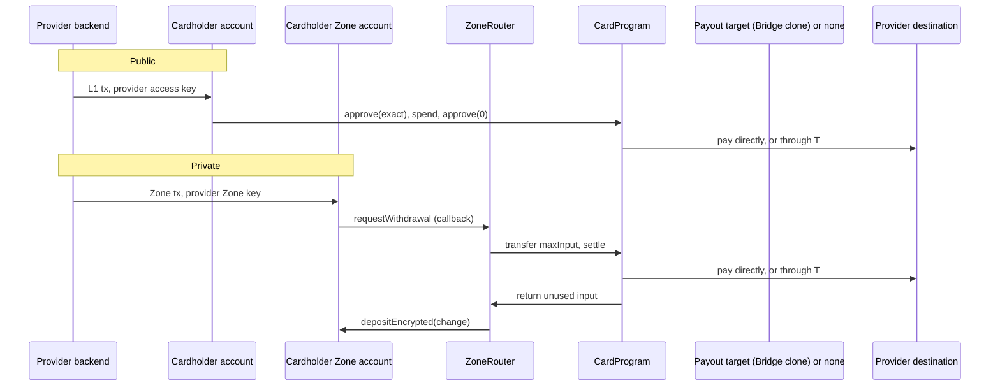

# Design

How a card from any provider pays from funds a cardholder keeps on Tempo, publicly or in a Zone, in
stablecoin or Tempo Earn shares. Every program is a `CardProgram` over one provider engine, its
`ICardIssuer`, deployed by a `CardFactory`. The shape follows Tempo Earn: a stable contract users
point at (Earn's `EarnVault`, here the program), over a provider-specific engine (Earn's
`IEarnEngine`, here the issuer) whose optional behavior is an ERC-165 capability. This page owns the
shared design; [bridge/](bridge/README.md) and [rain/](rain/README.md) own each provider.

## Components

| Contract                                                                | Admin                    | Function                                                                                                     |
| ----------------------------------------------------------------------- | ------------------------ | ------------------------------------------------------------------------------------------------------------ |
| [`CardProgram`](../../cards/src/core/CardProgram.sol)                   | Guardian (pause only)    | Pays a `CardSpend` to a destination its issuer authorizes; public entry point and the Zone router's settler. |
| [`CardFactory`](../../cards/src/core/CardFactory.sol)                   | None                     | Deploys a program at a CREATE2 address fixed by its ID, issuer and guardian.                                 |
| [`ICardIssuer`](../../cards/src/core/interfaces/ICardIssuer.sol) engine | The provider's contracts | Decides destinations, Earn vaults and the provider's pause; optionally names what the program pays through.  |
| [`ZoneRouter`](../../zone-router/src/ZoneRouter.sol) (Spend op)         | None                     | Receives the Zone withdrawal, hands `maxInput` to the program (its listed settler), returns the change.      |

| Provider | Issuer                                                              | How the program pays                                                                       |
| -------- | ------------------------------------------------------------------- | ------------------------------------------------------------------------------------------ |
| Rain     | [`RainIssuer`](../../cards/src/providers/rain/RainIssuer.sol)       | Directly, into a Rain collateral contract.                                                 |
| Bridge   | [`BridgeIssuer`](../../cards/src/providers/bridge/BridgeIssuer.sol) | Through the program's Bridge spender clone and the "TS" handler, into a settlement wallet. |

A program has one address for its life, and cardholders' access keys and the Zone's router name it. It
is never upgraded or migrated: its issuer and guardian are constructor arguments, and a provider
replaces a program by deploying a new one, which means cardholders authorize a new key and the Zone
admits a new router. That keeps the program ownerless apart from the guardian's pause, with no operator
key in the audit scope.

## The issuer

`ICardIssuer` answers three questions on every spend:

- `isAuthorizedDestination(payer, destination, token, hint, isPrivate)`: may this payer's spend of this
  token pay this destination? `hint` is the provider's evidence about the destination, carried in
  `CardSpend.destinationHint`. `isPrivate` comes from the program, true only for `settle`, so an issuer
  applies "a private spend must not name the cardholder" without inspecting the payer.
- `isAllowedVault(vault)`: may spends redeem this Earn vault's shares? A vault's `withdrawExact` decides
  where redeemed value goes, so allowing one is as strong as adding a destination.
- `paused()`: have the provider's own contracts stopped spends?

The optional `ICardIssuerPayout` capability names a `payoutTarget` and the `payoutData` for a spend. When
the issuer declares it (ERC-165, read once in the constructor), the program pays by approving the target
for the spend's input and calling it as the payer. Bridge needs this because its factory must govern
every spend through its own clone; a provider without such contracts, like Rain, lets the program pay
directly. Either way the program checks the destination got exactly the amount.

## Flows

- **Public.** The provider sends one L1 transaction from the cardholder's account, signed with an access
  key the cardholder scoped to `token.approve(recipient = program)` and `program.spend`, with a periodic
  limit. It approves the exact amount (and, for Earn, the share quote), spends and clears the approval.
  The provider approves the card on the L1 receipt.
- **Private.** The provider sends one Zone transaction from the cardholder's Zone account, signed with a
  Zone key scoped to the outbox, that withdraws `maxInput` plus change to the router with Spend callback
  data naming the program as settler. The provider approves the card on the Zone receipt; the L1 settles
  about a second later on a local Zone. If settlement reverts, the portal returns the whole withdrawal to
  the Zone and the provider's reserve covers the card.

The withdrawal parameters, fees, change and callback gas follow the Bridge design's
[private spend](bridge/design.md#withdrawal-parameters); the `CardSpend` callback is 896 bytes of the
outbox's 1,024.

## What the program checks

- `CardSpend.program` is this program (`WrongProgram`), and it is not paused by its guardian or its issuer
  (`ProgramPaused`); `amount` is above zero and `fromVault` at most `amount` (`InvalidAmount`).
- The issuer authorizes the destination for this payer, token and path (`DestinationNotAuthorized`); an
  Earn spend's vault is allowed and holds `token` (`VaultNotAllowed`, `IncorrectAssetForVault`), and burns at
  most `maxShares` (`ShareCostExceeded`; zero accepts the live price).
- The destination's balance of `token` rises by exactly `amount` (`DestinationNotCredited`).
- `settle`: the input is the stablecoin, or the vault's EarnShare when Earn funds all of it
  (`WrongInputToken`); the program holds at least `maxInput` (`InsufficientInput`) and spends from no more
  than it; the spend consumes some input (`NothingSettled`); the unused input goes back to the caller and
  the program ends at its baseline (`ResidualBalance`).
- A payout through the issuer's target can take at most the spend's input: what the payer approved
  (public) or `maxInput` (private). Anything more reverts.
- A transient lock stops reentry. Standing approvals (to an allowed vault, or to the payout target) are
  harmless because the program holds nothing between spends.
- Events: `CardSpent(ref, payer, destination, token, amount, fromVault, sharesUsed, isPrivate)`, and for a
  private spend `SpendSettled(ref, inputToken, inputConsumed, inputReturned)`. A private spend's payer is
  the router, so neither names a cardholder or the Zone `senderTag`.

## Invariants

1. A spend pays only a destination its issuer authorizes for that payer, token and path, and none while
   the program is paused.
2. The destination gets exactly `amount`.
3. A spend from Earn burns no more than `maxShares` when set; unused shares go back to the payer.
4. The program and the router hold no input after a spend.
5. A private spend uses at most `maxInput`, which the cardholder's Zone transaction sets; a payout target
   can take at most the spend's input.
6. No event from these contracts on the private path names the cardholder or the Zone `senderTag`.
7. One program's spend never pays through another program.
8. A program's issuer and guardian never change; its address commits to them.

Tests: [`cards/test/core/`](../../cards/test/core/) runs every program behavior twice, paying directly and
through a payout target, with mock issuers and no provider; each provider's tests run its issuer on a
real program ([bridge](bridge/harness.md), [rain](rain/README.md#evidence)), and
[`e2e/cards`](../../e2e/cards/) runs both on a real L1 and Zone.

## Privacy

"Private" means the L1 settlement does not name the cardholder: the payer is the router, the destination
is one the program shares across cardholders, and the change returns as an encrypted deposit. The Zone's
sequencer sees the cardholder's withdrawal, and the L1 shows each spend's amount, token, destination and
time. An issuer that authorized a cardholder-specific destination when `isPrivate` is true would break
this, so issuers authorize only pooled destinations for a private spend (Rain:
[destinations](rain/README.md#destinations)).

## Accepted risks

The Bridge design's [accepted risks](bridge/design.md#accepted-risks) carry over: a leaked Zone key can
withdraw a cardholder's Zone balance outside the program; there is no on-chain idempotency, so the
provider dedupes spends off chain; the provider approves a private spend on the Zone receipt and its
reserve pays if settlement fails; spend events are not proof of payment. In addition:

- An issuer is as strong as what it reads. It decides every destination, so a provider whose own
  contracts can be upgraded (Rain's factory, Bridge's spender factory) is trusted for that, and a payout
  target is trusted to pay the spend it is handed (the program bounds what it can take).
- Programs are immutable. Changing an issuer, its tokens or vaults, or the guardian means deploying a new
  program and a router that lists it, and cardholders authorizing a new key. The guardian (or the
  provider's own pause, through the issuer) stops spends meanwhile; a private spend while paused bounces
  back into the Zone in full.
- `settle` is permissionless, as the Bridge settler was: anyone can call it with their own funds, but only
  to pay a destination the issuer allows for a private spend.

## Adding a provider

1. Vendor the provider's contracts unmodified under `cards/vendor/<provider>/` and record their provenance
   in [VENDORED.md](../../cards/vendor/VENDORED.md).
2. Write its `ICardIssuer` in `cards/src/providers/<provider>/`, reading the provider's contracts as they
   are. Authorize only pooled destinations when `isPrivate` is true. Implement `ICardIssuerPayout` only if
   the provider's own contracts must move the funds.
3. Deploy a program with `CardFactory.deploy(programId, issuer, guardian)` and a Spend-mode router that
   lists it.
4. Add a provider to [`e2e/cards/src/providers/`](../../e2e/cards/src/providers/) implementing
   [`CardProvider`](../../e2e/cards/src/provider.ts): deploy, the three destinations, and its own
   settlement.
