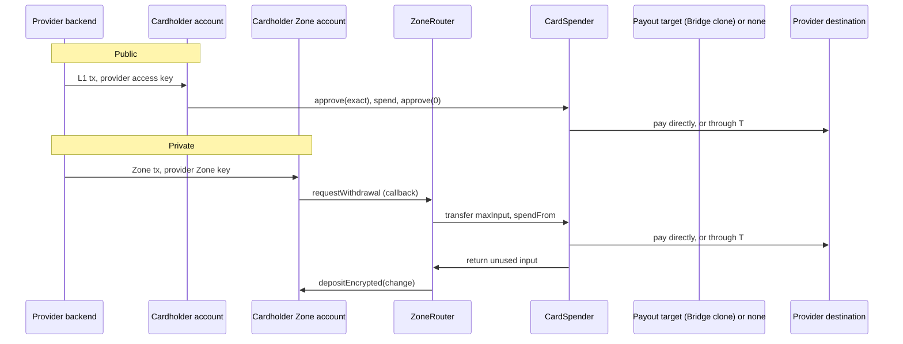

# Design

How a card from any provider pays from funds a cardholder keeps on Tempo, publicly or in a Zone, in
stablecoin or Tempo Earn shares. Every program is a `CardSpender` over one provider engine, its
`ICardProvider`, deployed by a `CardFactory`. The shape follows Tempo Earn: a stable contract users
point at (Earn's `EarnVault`, here the program), over a provider-specific engine (Earn's
`IEarnEngine`, here the provider contract) whose optional behavior is an ERC-165 capability. This page owns the
shared design; [bridge/](bridge/README.md) and [rain/](rain/README.md) own each provider.

## Components

| Contract                                                                    | Admin                    | Function                                                                                                       |
| --------------------------------------------------------------------------- | ------------------------ | -------------------------------------------------------------------------------------------------------------- |
| [`CardSpender`](../../cards/src/core/CardSpender.sol)                       | None                     | Pays a `CardSpend` to a destination its provider authorizes; public entry point and the Zone router's spender. |
| [`CardFactory`](../../cards/src/core/CardFactory.sol)                       | None                     | Deploys a program at a CREATE2 address fixed by its ID, provider and router factory.                           |
| [`ICardProvider`](../../cards/src/core/interfaces/ICardProvider.sol) engine | The provider's contracts | Decides destinations, Earn vaults and the provider's pause; optionally names what the program pays through.    |
| [`ZoneRouter`](../../zone-router/src/ZoneRouter.sol) (Spend op)             | None                     | Receives the Zone withdrawal, hands `maxInput` to the program (its listed spender), returns the change.        |
| [`SavingsFacility`](../../cards/src/core/SavingsFacility.sol)               | None (a fixed funder)    | Pays the issuer in cash for Earn shares a hold captured, then redeems them into its float.                     |

| Provider | Provider contract                                                       | How the program pays                                                                       |
| -------- | ----------------------------------------------------------------------- | ------------------------------------------------------------------------------------------ |
| Rain     | [`RainProvider`](../../cards/src/providers/rain/RainProvider.sol)       | Directly, into a Rain collateral contract.                                                 |
| Bridge   | [`BridgeProvider`](../../cards/src/providers/bridge/BridgeProvider.sol) | Through the program's Bridge spender clone and the "TS" handler, into a settlement wallet. |

A program has one address for its life, and cardholders' access keys and the Zone's router name it. It
is never upgraded or migrated: its constructor takes only its provider and the `ZoneRouterFactory` whose
routers may call `spendFrom` (its `CardFactory`'s), and a provider replaces a program by deploying a new one, which means cardholders authorize a new key and the Zone admits a new
router. The program is ownerless, with no setter, no pause of its own and no operator key in the audit
scope.

A program needs no pause of its own. Bridge's spender factory pause stops its programs through
`BridgeProvider.paused()`, which also reads as paused while the factory would not route the clone's "TS"
calls. Rain's contracts have no pause, so Rain has no on-chain stop: it stops a program by revoking its
access keys and Zone keys, the only senders of its spends, which can pay only destinations the provider
authorizes (for Rain, collateral Rain controls). Cardholders can revoke their keys, and a
fix to the core means a new program either way.

## The provider

`ICardProvider` answers three questions on every spend:

- `isAuthorizedDestination(payer, destination, token, hint, isPrivate)`: may this payer's spend of this
  token pay this destination? `hint` is the provider's evidence about the destination, carried in
  `CardSpend.destinationHint`. `isPrivate` comes from the program, true only for `spendFrom`, so a provider
  contract applies "a private spend must not name the cardholder" without inspecting the payer. A private
  spend has no payer: the program passes zero.
- `isAllowedVault(vault)`: may spends redeem this Earn vault's shares? A vault's `withdrawExact` decides
  where redeemed value goes, so allowing one is as strong as adding a destination.
- `paused()`: have the provider's own contracts stopped spends?

The optional `ICardProviderPayout` capability names a `payoutTarget` and the `payoutData` for a spend. When
the provider declares it (ERC-165, read once in the constructor), the program pays by approving the target
for the spend's input and calling it as the payer. Bridge needs this because its factory must govern
every spend through its own clone; a provider without such contracts, like Rain, lets the program pay
directly. Either way the program checks the destination got exactly the amount.

## Flows

- **Public.** The provider sends one L1 transaction from the cardholder's account, signed with an access
  key the cardholder scoped to `token.approve(recipient = program)` and `program.spend`, with a periodic
  limit. It approves the exact amount (and, for Earn, the share quote), spends and clears the approval.
  The provider approves the card on the L1 receipt.
- **Private.** The provider sends one Zone transaction from the cardholder's Zone account, signed with a
  Zone key scoped to the outbox, that withdraws `maxInput` plus change to the router with Spend callback
  data naming the program as spender. The provider approves the card on the Zone receipt; the L1 settles
  about a second later on a local Zone. If settlement reverts, the portal returns the whole withdrawal to
  the Zone and the provider's reserve covers the card.

The withdrawal parameters, fees, change and callback gas follow the Bridge design's
[private spend](bridge/design.md#withdrawal-parameters); the `CardSpend` callback is 896 bytes of the
outbox's 1,024. Bridge's callback gas figures were measured on its payout path. `warm` does nothing
for a program that pays directly (Rain); anyone calls `warmVault(vault)` instead, for a vault the provider
allows, so its first Earn spend does not create the standing approval to that vault (a new allowance slot,
TIP-1000). Anyone may also send a program one unit of each token it handles: `spendFrom` treats what the
program holds as its baseline and leaves it there, so a spend never creates the program's balance slot
(about 250k gas). The Rain E2E requests 3,000,000.

## Spend from savings

With account reservations (TIP-1153, from T15) a card authorization is a native hold rather than an
immediate spend, and a hold can span cash and Earn shares: the issuer's access key holds cash first, and
holds shares for the rest in favor of the program's [`SavingsFacility`](../../cards/src/core/SavingsFacility.sol).
Held shares stay in the cardholder's balance and keep earning. At capture the issuer captures cash first
and shares only for the shortfall, so the facility receives the shares, and the issuer calls
`settle(owner, id, minAssets)`:

- The hold must be on the vault's share with the facility as payee; it settles once, for what the
  precompile records as captured.
- The facility pays the settlement account `previewRedeem(shares)` in the base asset at once, then redeems
  the shares for at least that amount. When the vault quotes but cannot redeem at once (an illiquid
  venue), the shares stay in the facility, the float pays meanwhile, and the funder redeems them later
  with `redeemHeld`. Pricing needs a quote: while the vault cannot give one (an async-only engine, a
  paused or stale price), `settle` reverts and the captured shares wait in the facility until it can.
- A capture beyond the hold may be partly debt to the facility, which the precompile still counts as
  captured, so no hold of an owner in share debt to the facility settles until it is repaid.
- Share holds take no refunds; refunds go through the cash path.
- **Payouts.** A sweep of an account by the card records precompile (TIP-1169: closure, an estate or
  unclaimed property) may pay its shares into the facility and record the recipient. Anyone may then call
  `payOut(owner)`, which redeems the swept shares straight to the recipient, once per share, for at least
  their `previewRedeem` value. The float never pays a payout: while the vault cannot quote or redeem the
  shares, `payOut` reverts and they wait in the facility. The funder may redeem or withdraw only shares
  deferred settlements left (`heldShares`), never swept shares awaiting a payout.

The facility has no setter: its vault, issuer, settlement account and funder are fixed at deployment.
The funder supplies the float, bears redemption fees and price moves between capture and redemption, and
may withdraw what the float holds.

## What the program checks

- `CardSpend.program` is this program (`WrongProgram`); `amount` is above zero and `fromVault` at most
  `amount` (`InvalidAmount`).
- A program that pays directly asks its provider: it has not paused the program (`ProgramPaused`), it
  authorizes the destination for this payer, token and path (`DestinationNotAuthorized`), and an Earn
  spend's vault is allowed and holds `token` (`VaultNotAllowed`, `IncorrectAssetForVault`). A program
  that pays through a payout target leaves those rules to the target, which enforces them in the same call
  (`ICardProviderPayout`); asking the provider first would only repeat them. Either way a spend burns at
  most `maxShares` (`ShareCostExceeded`; zero accepts the live price).
- The destination's balance of `token` rises by exactly `amount` (`DestinationNotCredited`).
- A private destination may be neither the calling router nor an alias resolving to it
  (`DestinationNotAuthorized`): the router returns only unused input, not the redeemed asset.
- A public Earn refund increases the payer's share balance by exactly the unused amount
  (`RefundNotCredited`). A receive policy that redirects the refund reverts the entire spend, including
  the redemption and provider payment; allowing the program to refund shares permits a retry.
- A virtual destination (TIP-1022) is credited through its master, so the program checks the master's
  balance, and redeems Earn shares for one to itself first and transfers them on, since Earn's engines
  check the literal receiver.
- `spendFrom`: the caller is a router the program's `ROUTER_FACTORY` deployed whose mode lists the program
  (`NotRouter`), so `maxInput` is what a router measured and sent; the input is the stablecoin, or the
  vault's EarnShare when Earn funds all of it (`WrongInputToken`); the program holds at least `maxInput`
  (`InsufficientInput`) and spends from no more than it; the spend consumes some input (`NothingSpent`);
  the unused input goes back to the caller and the program ends at its baseline (`ResidualBalance`). On
  the direct path the vault prices the shares, capped by the lower of `maxInput` and `maxShares`.
- A payout through the provider's target uses exactly the stablecoin part, and for Earn at most the share
  cost the program quoted before the call (`InputNotConsumed`), so a replaced target can neither keep the
  rest of the input nor burn more shares than the amount costs and keep the surplus assets. Anything
  beyond the spend's input reverts.
- A transient lock stops reentry. Standing approvals (to an allowed vault, or to the payout target) are
  harmless because the program holds at most a one-unit seed between spends.
- Events: `CardSpent(ref, payer, destination, token, amount, fromVault, sharesUsed, isPrivate)`, and for a
  private spend `InputSpent(ref, inputToken, inputConsumed, inputReturned)`. A private spend's payer is
  the router, so neither names a cardholder or the Zone `senderTag`.

## Invariants

The [card spend threat model](../threat-models/card-spend.md#security-invariants) owns the invariants every program keeps.

Tests: [`cards/test/core/`](../../cards/test/core/) runs every program behavior twice, paying directly and
through a payout target, with mock provider contracts and no real provider; each provider's tests run its provider contract on a
real program ([bridge](bridge/harness.md), [rain](rain/README.md#evidence)), and
[`e2e/cards`](../../e2e/cards/) runs both on a real L1 and Zone.

## Privacy

"Private" means the L1 settlement does not name the cardholder: the payer is the router, the destination
is one the program shares across cardholders, and the change returns as an encrypted deposit. The Zone's
sequencer sees the cardholder's withdrawal, and the L1 shows each spend's amount, token, destination and
time. A provider contract that authorized a cardholder-specific destination when `isPrivate` is true would break
this, so providers authorize only pooled destinations for a private spend (Rain:
[destinations](rain/README.md#destinations)). `BridgeProvider` answers alike for both paths, so Bridge
governance must authorize only settlement wallets every cardholder shares. A spend's `ref` is public on
the L1: a provider uses a reference that cannot be linked to the cardholder for a private spend, such as
`keccak256(pullId, programSecret)` with a secret of its own per program.

### Reconciliation

Spend events are not proof of payment, and `ref` is advisory: it comes from callback data anyone can
write. A provider reconciles a spend by its transaction and log index, and binds a private spend's
`CardSpent` and `InputSpent` to the Portal's `WithdrawalProcessed` and the router's `Spent` in the same
transaction, a public one to its own access key's transaction. `availableBalance` is an upper bound on what
one spend can pay: it values shares with `previewRedeem`, while a spend pays at the `previewWithdraw`
cost, which rounds against the payer, and a private spend carries one token, so it never mixes the
stablecoin and shares.

## Accepted risks

The [card spend threat model](../threat-models/card-spend.md#accepted-risks) owns the risks the design accepts.

## Adding a provider

1. Vendor the provider's contracts unmodified under `cards/vendor/<provider>/` and record their provenance
   in [VENDORED.md](../../cards/vendor/VENDORED.md).
2. Write its `ICardProvider` in `cards/src/providers/<provider>/`, reading the provider's contracts as they
   are. Authorize only pooled destinations when `isPrivate` is true. Implement `ICardProviderPayout` only if
   the provider's own contracts must move the funds.
3. Deploy a program with `CardFactory.deploy(programId, provider)`, on the `CardFactory` for the
   `ZoneRouterFactory` whose routers may call it, and a Spend-mode router from that factory that lists it.
4. Add a provider to [`e2e/cards/src/providers/`](../../e2e/cards/src/providers/) implementing
   [`CardProvider`](../../e2e/cards/src/provider.ts): deploy, the three destinations, and its own
   settlement.
