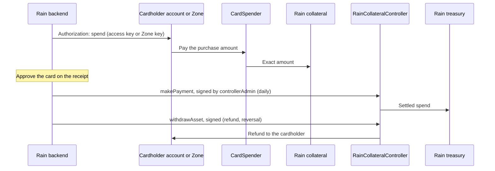

# Rain

Card spend on Tempo with Rain as the provider, against Rain's own collateral contracts, unchanged.
A Rain program is a `CardSpender` over a `RainProvider`, as [design.md](../design.md) describes, paying directly into Rain collateral. Rain does not run on Tempo yet; this is
what it would deploy and call.

## Rain's contracts

Rain issues Visa cards backed by stablecoins in a collateral contract. Its contracts
([`cards/vendor/rain`](../../../cards/vendor/rain/), verified on Polygon and built here to the same bytecode):

| Contract                   | Role                                                                                                                                                                                                                                                                      |
| -------------------------- | ------------------------------------------------------------------------------------------------------------------------------------------------------------------------------------------------------------------------------------------------------------------------- |
| `RainCollateralFactory`    | Rain-owned and upgradeable. Creates each collateral contract as a beacon proxy and appends it to its public `collateralProxies` array.                                                                                                                                    |
| `RainCollateral`           | Holds a cardholder's or program's collateral. Its owner (the user it was created for) manages its admins. Only the controller moves its tokens.                                                                                                                           |
| `RainCollateralController` | Moves collateral: `makePayment` to Rain's treasury and `withdrawAsset` by a collateral admin, each with an EIP-712 signature from Rain's `controllerAdmin`, bound to the caller, a per-collateral nonce and an expiry; `liquidateAsset` by the controller admin directly. |

Depositing is a plain token transfer into the collateral contract, which Rain's backend reads as the
card's spending power. That is where a Tempo spend lands.

## Destinations

[`RainProvider`](../../../cards/src/providers/rain/RainProvider.sol) authorizes a destination when
it is a collateral contract Rain's factory created and either:

- **the spend is public and the payer owns it and is one of its admins** (Rain-managed): the
  cardholder's account funds its own collateral. Another cardholder's collateral is refused, including
  one whose ownership was handed to the payer without admin rights (Rain's `transferOwnership` leaves
  the admins as they were); or
- **it is one of the program's pooled collateral contracts** (partner-managed, and the only
  destination of a private spend): fixed at deployment. Rain or the partner credits each cardholder off
  chain. The program tells the provider a spend is private (`isPrivate`), so a private spend never funds a
  cardholder's own collateral, even one handed to the program, and never names the cardholder.

Rain's factory records each collateral contract in its public `collateralProxies` array but keeps no
address lookup, so the spend's `destinationHint` is the collateral's index in that array, and the
provider requires `collateralProxies(hint)` to be the destination. One read of Rain's factory proves
provenance without trusting the destination's code. Rain's backend knows each index from the order of
the factory's `NewRainCollateral` events. The provider also fixes the accepted tokens, Earn vaults and pooled
collateral; it has no owner and reports no pause of its own. Rain pauses a program as its guardian: Rain's
pause key, set when the program is deployed, can stop every spend of the program and resume them, and
change nothing else.

## Card lifecycle

1. **Authorization.** Rain sends the spend for the purchase amount, as its
   [real-time funding](https://www.rain.xyz/resources/introducing-real-time-funding) commits it: public
   into the cardholder's collateral, private into the program's pooled collateral. From Earn, the
   program redeems exactly the amount of the vault's asset.
2. **Settlement.** Rain's daily `makePayment` moves the settled spend to its treasury, as today.
3. **Refunds and reversals.** A collateral admin calls `withdrawAsset` with Rain's signature; for a
   pooled collateral, the partner's admin pays the cardholder back (into the Zone with
   `depositEncrypted`, as Bridge's [refunds](../bridge/design.md#refunds) do).

Nothing leaves a collateral contract without Rain's signature or Rain's controller admin, so
committed collateral stays Rain's to settle; that is the guarantee its card program relies on.

## Accepted risks

- Rain's factory owner can upgrade the factory and the collateral implementation, and its controller
  admin can liquidate any collateral. The provider trusts Rain's factory for provenance, as Bridge's
  integration trusts its spender factory.
- A public spend into a cardholder's own collateral names the cardholder on the L1, as any public
  spend does.

## Evidence

- [`cards/test/rain/unit/`](../../../cards/test/rain/unit/): public spends into a cardholder's collateral
  from stablecoin and Earn; refusals for another cardholder's collateral, one handed over without admin
  rights, a collateral the factory did not create, the beacon, a wrong or out-of-range index and an
  unaccepted token; private settlement into the pooled collateral and refusal of a cardholder's own,
  even one handed to the program; Rain's pause key as the program's guardian; Rain's payment, refund, replay, expiry and
  liquidation against its real controller. The core's own checks run without Rain in
  [`cards/test/core/`](../../../cards/test/core/).
- [`e2e/cards`](../../../e2e/cards/) (`pnpm e2e:cards -- --earn`), on a disposable Tempo L1 and Zone:
  public spends with an access key, from stablecoin and Earn (one L1 transaction, about 490 ms to the
  receipt on a 500 ms local chain); private spends into the pooled collateral, from stablecoin and Earn,
  settled on the L1 about a second after the Zone receipt, with no L1 log naming the cardholder; a
  private spend into the cardholder's own collateral bouncing back into the Zone in full; Rain's pause
  key stopping and resuming spends; then Rain's signed refund and its daily payment of both collaterals
  to its treasury.
