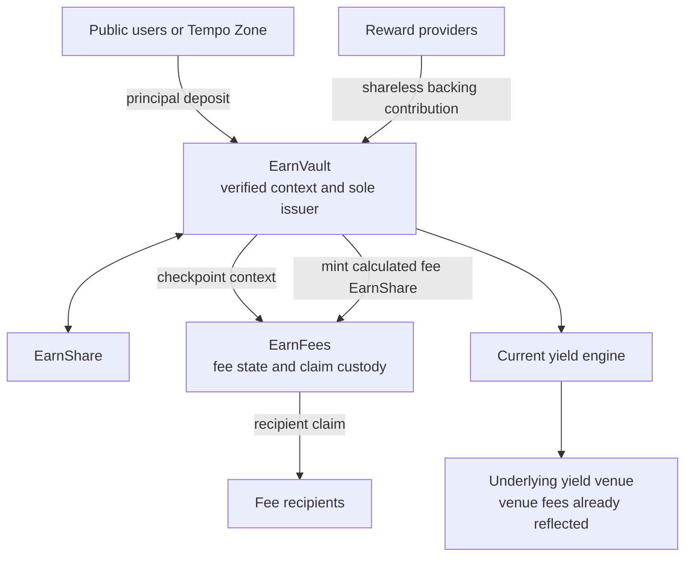

# Earn fees

This page specifies the fee model that `EarnVault` and its one `EarnFees` module implement:
economics, rounding, authority, checkpoints, claims, queued withdrawals, and worked examples.
Function signatures are in the [contract reference](../reference/contracts.md#earnfees), transaction
order in [fee accrual and claim](flows.md#fee-accrual-and-claim), and trust assumptions in
[security and privacy](security-and-privacy.md).

## Fee base

Earn-level fees apply only to **positive value accrual**: an increase in aggregate asset value per
EarnShare above a post-fee high-water mark. The source of the increase does not matter: venue yield
and permissionless contributions are charged alike once they reach the active pool. Deposited
principal is never a fee base, and if no positive value accrues, no fee is charged. A commercially
described management or infrastructure fee is therefore configured as a percentage of positive
accrual, not of assets under management.

Deposits increase backing and EarnShare supply proportionally, so they create no feeable growth.
Contributions increase backing without minting EarnShare, so they raise existing holders' redemption
value and are feeable like yield.

Fees charged inside a venue are outside this model: the engine reports value net of them, and Earn
applies only its own configured fees. Integrators must disclose the complete fee stack.

## Contract boundary



`EarnFees` is an ownerless clone initialized once with one EarnVault, one EarnShare, and an initial
configuration:

- only its EarnVault can checkpoint, configure, disable, ratchet baselines, or record and settle
  async-request snapshots;
- it reads active assets and valuation freshness from its EarnVault and never chooses an engine or
  moves backing;
- it has no issuer role: the EarnVault calls `EarnFees.accrueFees`, then mints the returned
  `totalFeeEarnShares` to `EarnFees`;
- it credits recipient ledgers and holds the fee EarnShare backing them; recipients claim directly;
- the EarnVault enforces operator and distributor authorization, so `EarnFees` offers no way around
  either; and
- replacing it requires a new Earn stack.

Neither contract identifies users, inspects Zone activity, or distinguishes the source of growth.

## Fee policies

A configuration has:

- up to four **fixed fees**, each a percentage of gross positive accrual paid to one recipient; and
- one optional **excess-return fee**, a percentage of value above an aggregate holder-return target
  paid to one recipient.

Rates are `uint16` basis points (`10_000` is 100%). A valid configuration has unique fixed
recipients, each with a nonzero rate; fixed rates summing to at most 10,000; when the excess fee is
enabled, a nonzero excess rate and an annual target rate each at most 10,000; and no recipient equal
to zero, `EarnFees`, or the EarnVault. Unused slots must be empty. The same address may receive a
fixed fee and the excess fee. These are structural bounds of the mechanism, not commercial caps.

A deployment may configure a `distributor` with a protected fixed-fee item. When the initial
configuration has fixed fees, the first is the distributor's item; otherwise the item starts at zero
and the distributor may activate it later. The item's slot stays reserved, leaving at most three
operator fixed fees. Without a distributor, the operator controls all four.

The holder target is an aggregate EarnShare exchange-rate benchmark, not a guaranteed or per-wallet
return. Entry and exit timing determine whether a holder takes part in later growth.

### Waterfall

At each checkpoint:

1. Compute gross positive accrual: value per EarnShare above the high-water mark, times supply.
2. Compute each fixed fee independently against that same gross accrual.
3. If carried remainders push fixed fees above the accrual, scale them down to it by largest
   remainder; the unpaid whole units return to each recipient's remainder.
4. Apply the excess-return fee to value retained after fixed fees above the time-grown holder
   target, limited to the accrual the fixed fees left.
5. Cap aggregate fees at gross positive accrual.
6. Convert aggregate fee assets once into dilution-correct EarnShare and allocate it to recipients.

Charging fixed fees against the same gross amount avoids ordering effects: rates of 0.25% and 5%
leave holders 94.75% of gross accrual before any excess fee. The excess-return step is:

```text
retained before excess fee = active assets - fixed fees
excess value               = max(retained before excess fee - target assets, 0)
feeable excess             = min(excess value, positive accrual - fixed fees)
excess fee                 = feeable excess × excess fee rate
```

The `min` binds only when the target sits below the high-water mark, which a
[drawdown](#depositing-during-a-drawdown) can produce. An excess rate of 100% lets holders keep
value up to the target and allocates everything above it. Rewards may close a target shortfall, but
nothing guarantees that enough value arrives.

## High-water mark and target

The high-water mark is the active pool's post-fee asset value per EarnShare. Deposits and exits
change assets and supply proportionally and leave it unchanged; a contribution raises assets without
supply and so creates positive accrual. After a loss, no fee accrues until value exceeds the prior
mark. A checkpoint with positive accrual advances the mark to the post-fee value.

The mark also survives the active pool emptying: a reopened pool charges no fee until value per
EarnShare exceeds the mark set before it emptied. A sole holder of a nearly empty pool can raise the
mark cheaply, for example with 1 wei of principal and a 99-wei contribution, which leaves it 100×
above par once the fee floors to zero EarnShare, and then exit. Later holders accrue no fees until
value grows past that mark. Without a distributor, the operator restores fees by disabling and
setting them again, which resets the mark; a stack with a distributor cannot disable fees.

The optional target starts at retained post-fee value and grows by simple annual interest, prorated
per second over a 365-day year and rounded down:

```text
target(t) = targetBase + targetBase × annualTargetRateBps / 10,000 × (t - targetStartedAt) / 365 days
```

Missed target growth carries forward. Whenever post-fee value exceeds the grown target, the target
base resets to that value and its clock restarts, so the same excess is never charged twice.

Stored baselines round up to the next representable per-EarnShare value. This treats an indivisible
value band as already checkpointed, so repeated permissionless checkpoints cannot charge it twice.
Each baseline advance may leave up to one per-EarnShare unit uncharged, and callers can compound
that by checkpointing sub-precision growth repeatedly; rounding never increases a holder's fee.

After a base-asset or in-kind deposit, `EarnFees.initializeBaselines` raises the high-water mark,
and an excess target, to the post-entry value when that is higher. Baselines never fall on entry.
This keeps venue precision that pooling makes representable, for example after a dust-sized first
position, classified as principal rather than accrual.

When a configuration starts fees from an inactive or disabled state, the module resets the
high-water mark, and any excess target, to the current value. When an active configuration is
replaced by another that charges fees, the high-water mark is kept; an existing excess target keeps
its grown value and restarts its clock there, a newly added excess target starts at the current
value, and a configuration without an excess fee clears the target. A configuration without fees
leaves the baselines unchanged.

## Fee-share accounting

Fees stay invested. The EarnVault withdraws nothing from the engine; it mints EarnShare representing
the fee to `EarnFees`. With active assets `A`, supply `S`, and total fee assets `F`, where
`0 < F < A`:

```text
fee EarnShare = floor(F × S / (A - F))
```

After the mint, that EarnShare redeems for `F` at the new exchange rate, preserving holders' net
value without a liquidity dependency.

Allocations are calculated in asset terms first. Each fee carries its sub-unit remainder in
`EarnFees` storage per configuration and slot, so checkpoint cadence cannot erase or increase fees
through rounding. The aggregate converts to EarnShare once, and each nonzero allocation receives its
proportional share rounded down, except the last nonzero allocation in configured order (the excess
fee follows the fixed fees), which receives the rounding residual.

Installing a new configuration waives the outgoing configuration's remainders and emits
`FeeDustWaived`, unless an open request snapshot references that configuration; its remainders are
then waived when its last such request closes. Disabling fees waives the current remainders
immediately.

If the fee assets convert to zero EarnShare, the checkpoint still advances the high-water mark and
target and the unrepresentable fee is waived. Advancing prevents a later deposit from multiplying a
stale per-share spread by new principal and turning that principal into apparent growth.

Claimable balances are backed by EarnShare held by `EarnFees`. EarnShare sent directly to `EarnFees`
joins no ledger, cannot be claimed, and makes its balance exceed `totalClaimableEarnShares`.

## Accrual checkpoints

The EarnVault checkpoints fees before every action that could mix holders or fee terms:

- `deposit`, `depositVenueShares`, `redeem`, and `withdrawExact`;
- `contribute` and `absorbEngineShareSurplus`, before and again after the new backing is recognized;
- `requestRedeem` and `cancelRedeem`; and
- `setFeeConfig` and `executeDistributorFeeUpdate`, which settle the old terms before installing new
  ones.

`disableFees` and `finalizeRedeem` do not checkpoint. Anyone may call `EarnVault.accrueFees()`.
`EarnFees.previewAccruedFees()` returns the current waterfall without changing state, and
`EarnVault.previewRedeem` and `previewWithdraw` include its pending fee dilution, so position values
do not overstate what an immediate exit returns.

A checkpoint returns no fee, without reading valuation, when fees are disabled, the configuration is
empty, or supply is zero. When fees are active and value per EarnShare has not exceeded the
high-water mark, it still ratchets the target but skips allocation and minting, leaving remainders
unchanged. Supply-changing actions always checkpoint first, so a depositor cannot inherit or dilute
an earlier fee liability and a redeemer cannot leave before it is settled.

An engine with an expiring NAV advertises `IEarnEngineFeeValuation`. While it reports its valuation
stale, `previewAccruedFees` and every checkpoint return zero without advancing baselines, changing
remainders, allocating claims, or minting. Exits stay available. Engines without the capability are
treated as non-expiring. `setFeeConfig` and `executeDistributorFeeUpdate` revert with
`FeeValuationStale` while the valuation is stale, so uncheckpointed growth cannot cross fee terms.

## Claims

A checkpoint increases `claimableEarnShares[recipient]`; the recipient then calls
`EarnFees.claim(to, earnShares)`. Only the recorded recipient can spend its ledger, and `to` cannot
be zero, `EarnFees`, or the EarnVault. Removing a recipient affects only future accrual; earned
EarnShare stays claimable.

Recipients are never called during accrual, so a blocked or reverting recipient cannot stop
deposits, exits, contributions, or other recipients; only its own claim fails. Claimed and unclaimed
fee EarnShare takes part in later yield, losses, contributions, and fees like any EarnShare.

## Configuration and authority

The operator sets ordinary fixed fees and the excess-return fee with `EarnVault.setFeeConfig`. On a
distributor-enabled stack, every operator configuration must keep the current distributor item
exactly. Without a distributor, the operator can allocate up to all future positive accrual,
including contribution value. With one, both authorities share the 10,000-bps fixed-fee bound: an
update from either side reverts if the combined configuration would exceed it. The excess fee is a
later waterfall step and does not count against that bound.

The bound reserves no headroom for an inactive distributor item. Operator fixed fees may use the
full bound, and a nonzero distributor schedule then reverts until the operator lowers them. While a
distributor update is pending, an operator configuration must stay valid with both the active and
the pending distributor item, so the operator cannot invalidate the pending update.

The distributor calls `scheduleDistributorFeeUpdate(recipient, rateBps)`. A nonzero rate needs a
valid nonzero recipient; `(address(0), 0)` disables only the distributor item. There is no rate cap
beyond the shared bound. Scheduling restarts the deployment-fixed delay. The distributor may cancel
while the update is pending; after the delay anyone may call `executeDistributorFeeUpdate`, which
revalidates the combined configuration, checkpoints the old terms, installs a new configuration
version, and clears the update.

The distributor hands off its role by nominating a nonzero successor other than itself, which must
accept; it may cancel before acceptance, and the operator can neither start nor cancel the handoff.
Acceptance cancels any update the previous distributor scheduled but keeps the active item.

Every installed configuration receives the next ID and stays readable through `feeConfig(configId)`.
Each change settles the old terms first and applies only prospectively, so new rates never reach
earlier uncheckpointed growth or deposited principal. Integrators must disclose and monitor both
authorities, their handoffs, and every pending update.

`disableFees` is the operator's emergency stop for stacks without a distributor. It does not read
valuation and waives uncrystallized active-pool and cancellation fees, so exits continue if NAV
becomes unavailable. Every request records the disable epoch at creation; a later disable
permanently waives its snapshot, even if fees are re-enabled. On a stack with a distributor,
including one whose item is zero, `disableFees` reverts with `GlobalFeeDisableUnavailable`, because
it would let one authority erase the other's items; each removes only its own items through its
prospective update path. A configuration installed after disablement needs a fresh valuation,
starts from fresh baselines, and charges nothing for the disabled period. A fee-free stack can enable
fees later under the same rules.

## Queued withdrawals

The request, finalization, and cancellation sequences are in
[async redemption](flows.md#async-redemption). At request time the EarnVault checkpoints the active
pool, burns the requester's EarnShare, moves the corresponding engine shares into the engine queue,
and records the claim. If fees are active and the valuation is fresh, `EarnFees` also stores a
snapshot: the burned EarnShare, the request's value, the high-water mark and current grown target
scaled to the burned EarnShare (rounded up), the configuration ID, the request time, and the disable
epoch.

Active holders keep earning and paying fees while the claim is open. Finalization pays the engine's
fixed result to the stored receiver and closes the claim and its snapshot with no burn and no fee
calculation.

Cancellation returns the queued position to the active pool. After checkpointing the active pool,
the EarnVault measures the returned engine shares. The snapshot is charged only if it exists, no
disable has occurred since the request, fees are not disabled, and the valuation is fresh. A charged
snapshot runs the waterfall under its own configuration against the returned value, using the
snapshot's high-water mark and a target grown from the request time, so only positive queued growth
pays. The re-entry is:

- into an empty active pool, the originally burned EarnShare;
- into a nonempty pool with a charged snapshot, the smaller of the returned value at the active
  pool's post-fee price and the EarnShare the returned engine shares represent at the anchor; and
- otherwise, the EarnShare the returned engine shares represent at the anchor, without valuation.

The fee portion of the re-entry, `floor(reentry × fee assets / returned value)`, is minted to
`EarnFees` and allocated like an active fee; the rest is minted to the stored receiver, which must
meet the caller's nonzero `minReceiverEarnShares`. A re-entry into a nonempty pool that leaves more
than one basis point of the returned engine shares unrepresented reverts. Losses pay no fee and
re-enter at their returned value. Queuing therefore never avoids fees on growth.

A request filed while the valuation is stale records no snapshot, and a stale cancellation charges
none, so either remains cancellable and finalizable without the expired NAV.

When a cancellation reopens an empty pool with fees active:

- a charged snapshot sets the high-water mark to the higher of the current value and the snapshot's
  mark, and, if the active configuration has an excess fee, the target to the higher of the current
  value and the snapshot target grown to now;
- an uncharged one sets both baselines to the current value; and
- a stale one sets `feeBaselinesPending`, and the next fresh checkpoint sets both baselines to the
  then-current value without charging it.

Later checkpoints therefore treat the returned position as principal.

## Privacy

Fee calculation uses only aggregate public state: engine NAV, EarnShare supply, checkpoint state, and
the public configuration. Observers see recipients, rates, accrual timing, allocations, and claims,
but the fee mechanism alone does not reveal which private Zone holder bore any part of a fee. The
wider model is in [privacy](security-and-privacy.md#privacy-model).

## Security and deployment requirements

Fee EarnShare is an irreversible claim on backing, so engine valuation is security-critical: a stale
or inflated NAV can over-mint fees even if the venue later returns to realizable value. Before
enabling fees against a production engine:

- verify `totalAssets()` and `previewRedeem()` include relevant venue and exit fees;
- define freshness and manipulation-resistance guarantees;
- verify any expiring-NAV engine advertises `IEarnEngineFeeValuation` and reports stale when its
  report timestamp is zero, in the future, or older than its policy;
- test realizable value under rate limits, illiquidity, and queued exits;
- assign the operator, and any distributor, to their intended durable accounts;
- verify the EarnVault–`EarnFees` binding, initial configuration, and claim recipients;
- verify that only the EarnVault holds EarnShare issuer authority; and
- complete independent security and economic review.

Contract tests and the `fees-waterfall` E2E case exercise the mechanism; they do not establish that a
specific venue's NAV is safe for irreversible fee crystallization.

## Worked examples

These examples show the active pool; amounts are in dollars of base asset. Onchain values are
integer token units with carried remainders. EarnShare amounts are rounded to six decimals here; the
per-EarnShare values they produce are exact.

### Fixed fee, checkpoint, and claim

One fixed fee of 1,000 bps and no excess fee. Backing grows from $100 to $120 while supply stays at
100 EarnShare and the high-water mark is $1.00:

```text
positiveAccrualAssets    = ($1.20 - $1.00) × 100       = $20
totalFeeAssets           = $20 × 1,000 / 10,000        = $2
totalFeeEarnShares       = $2 × 100 / ($120 - $2)      = 1.694915 EarnShare
postFeeValuePerEarnShare = $120 / 101.694915           = $1.18
```

Holders keep $118, the fee EarnShare is worth $2, and $1.18 becomes the high-water mark.

| Step                     | Engine backing | `EarnFees` EarnShare | Recipient claimable | Recipient EarnShare | Total supply | Value per EarnShare |
| ------------------------ | -------------: | -------------------: | ------------------: | ------------------: | -----------: | ------------------: |
| Initial deposit          |           $100 |                    0 |                   0 |                   0 |          100 |               $1.00 |
| Growth before checkpoint |           $120 |                    0 |                   0 |                   0 |          100 |               $1.20 |
| Fee checkpoint           |           $120 |             1.694915 |            1.694915 |                   0 |   101.694915 |               $1.18 |
| Recipient claims         |           $120 |                    0 |                   0 |            1.694915 |   101.694915 |               $1.18 |
| Recipient redeems        |           $118 |                    0 |                   0 |                   0 |          100 |               $1.18 |

The $1.20 row is a pre-fee valuation, not a redeemable price: `previewAccruedFees()` already reports
the $2 fee and `EarnVault.previewRedeem` converts at $1.18. The checkpoint changes custody and
supply, not holder value. A claim only transfers minted EarnShare; it changes neither backing,
supply, nor the high-water mark. Redemption is the separate action that pays the recipient $2.

### Excess-return fee only

No fixed fees; supply is 1,000 EarnShare, backing $1,050, the high-water mark and target base $1.000,
`annualTargetRateBps` 300, one year elapsed, and `excessFeeRateBps` 5,000:

```text
positiveAccrualAssets    = ($1.050 - $1.000) × 1,000     = $50
target assets            = $1.000 × (1 + 3%) × 1,000     = $1,030
excess value             = $1,050 - $1,030               = $20
feeable excess           = min($20, $50)                 = $20
excessFeeAssets          = $20 × 5,000 / 10,000          = $10
totalFeeEarnShares       = $10 × 1,000 / ($1,050 - $10)  = 9.615385 EarnShare
postFeeValuePerEarnShare = $1,050 / 1,009.615385         = $1.040
```

Holders keep the $1,030 target plus half of the $20 above it. The post-fee $1.040 becomes the
high-water mark and, being above the $1.030 target, the new target base with a restarted clock.

### Fixed and excess fees together

Adding 25-bps and 500-bps fixed fees to the previous example, with a 10,000-bps excess rate:

```text
fixed fees     = $50 × 25 / 10,000 + $50 × 500 / 10,000  = $0.125 + $2.500 = $2.625
excess value   = ($1,050 - $2.625) - $1,030               = $17.375
feeable excess = min($17.375, $50 - $2.625)               = $17.375
total fee      = $2.625 + $17.375                         = $20
```

Holders keep exactly the $1,030 target, which becomes the $1.030 high-water mark
(`testFixedAndExcessReturnFeesFollowWaterfall` in
[`EarnVaultFees.t.sol`](../../../earn/test/core/EarnVaultFees.t.sol)).

### Depositing during a drawdown

The high-water mark is pool-level. If it is $1.20 and value falls to $1.00, a new holder depositing at
$1.00 gets fee-free appreciation up to $1.20 while earlier holders recover their loss; fees resume
only above $1.20. The deposit changes assets and supply proportionally, so it does not lower the
mark.

A drawdown can also separate the two baselines. Replacing an active fixed-fee configuration at $1.00
with one that adds an excess-return fee keeps the $1.20 mark and starts the target at $1.00. With
1,000 EarnShare, no fixed fee in the new configuration, recovery to $1,250, and a 5,000-bps excess
rate, positive accrual is $50 and the $250 excess value is capped to $50, so the excess fee is $25
rather than the $50 that the aggregate cap alone would allow.
