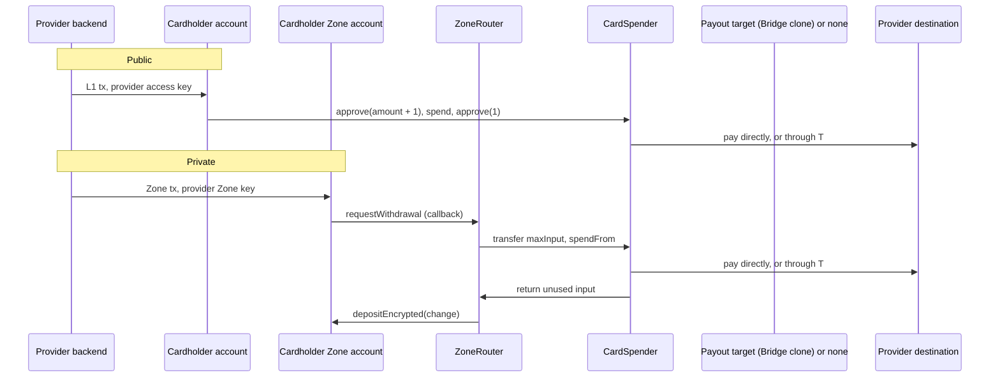

# Design

How a card from any provider pays from funds a cardholder keeps on Tempo, publicly or in a Zone, in
stablecoin or Tempo Earn shares. Every program is a `CardSpender` over one provider engine, its
`ICardProvider`, deployed by a `CardFactory`. The shape follows Tempo Earn: a stable contract users
point at (Earn's `EarnVault`, here the program), over a provider-specific engine (Earn's
`IEarnEngine`, here the provider contract) whose optional behavior is an ERC-165 capability. This page owns the
shared design; [bridge/](bridge/README.md) and [rain/](rain/README.md) own each provider.

## Components

| Contract                                                               | Admin                    | Function                                                                                                       |
| ---------------------------------------------------------------------- | ------------------------ | -------------------------------------------------------------------------------------------------------------- |
| [`CardSpender`](../../src/spend/CardSpender.sol)                       | None                     | Pays a `CardSpend` to a destination its provider authorizes; public entry point and the Zone router's spender. |
| [`CardFactory`](../../src/spend/CardFactory.sol)                       | None                     | Deploys a program at a CREATE2 address fixed by its ID, provider and router factory.                           |
| [`ICardProvider`](../../src/interfaces/spend/ICardProvider.sol) engine | The provider's contracts | Decides destinations, Earn vaults and the provider's pause; optionally names what the program pays through.    |
| [`ZoneRouter`](../../src/zone/ZoneRouter.sol) (Spend op)               | None                     | Receives the Zone withdrawal, hands `maxInput` to the program (its listed spender), returns the change.        |

| Provider | Provider contract                                                       | How the program pays                                                                       |
| -------- | ----------------------------------------------------------------------- | ------------------------------------------------------------------------------------------ |
| Rain     | [`RainProvider`](../../src/spend/providers/rain/RainProvider.sol)       | Directly, into a Rain collateral contract.                                                 |
| Bridge   | [`BridgeProvider`](../../src/spend/providers/bridge/BridgeProvider.sol) | Through the program's Bridge spender clone and the "TS" handler, into a settlement wallet. |

A program has one address for its life, and cardholders' access keys and the Zone's router name it. It
is never upgraded or migrated: its constructor takes only its provider and the `ZoneRouterFactory` whose
routers may call `spendFrom` (its `CardFactory`'s), and a provider replaces a program by deploying a new one, which means cardholders authorize a new key and the Zone admits a new
router. The program is ownerless, with no setter, no pause of its own and no operator key in the audit
scope.

A program needs no pause of its own. Bridge's spender factory pause stops its programs through
`BridgeProvider.paused()`, which also reads as paused while the factory would not route the clone's "TS"
calls. Rain's contracts have no pause, so Rain has no on-chain stop: it stops a program by revoking its
access keys and Zone keys, the only senders of its spends, which can pay only destinations the provider
authorizes (for Rain, collateral Rain controls). Cardholders can revoke their keys, and a
fix to the core means a new program either way.

## The provider

`ICardProvider` answers three questions on every spend:

- `isAuthorizedDestination(payer, destination, token, hint, isPrivate)`: may this payer's spend of this
  token pay this destination? `hint` is the provider's evidence about the destination, carried in
  `CardSpend.destinationHint`. `isPrivate` comes from the program, true only for `spendFrom`, so a provider
  contract applies "a private spend must not name the cardholder" without inspecting the payer. A private
  spend has no payer: the program passes zero.
- `isAllowedVault(vault)`: may spends redeem this Earn vault's shares? A vault's `withdrawExact` decides
  where redeemed value goes, so allowing one is as strong as adding a destination.
- `paused()`: have the provider's own contracts stopped spends?

The optional `ICardProviderPayout` capability names a `payoutTarget` and the `payoutData` for a spend. When
the provider declares it (ERC-165, read once in the constructor), the program pays by approving the target
for the spend's input and calling it as the payer. Bridge needs this because its factory must govern
every spend through its own clone; a provider without such contracts, like Rain, lets the program pay
directly. Either way the program checks the destination got exactly the amount.

## Flows

- **Public.** The provider sends one L1 transaction from the cardholder's account, signed with an access
  key the cardholder scoped to `token.approve(recipient = program)` and `program.spend`, with a periodic
  limit. It approves the amount plus 1 base unit (and, for Earn, the share quote plus 1), spends, and
  sets each approval back to 1 base unit. The provider approves the card on the L1 receipt.
- **Keep the public allowance nonzero.** `spend` pulls with `transferFrom`, so an approval of the exact
  amount, or a reset to 0 afterwards, clears the cardholder's TIP-20 allowance slot, and the next
  approval creates it again (250,000 gas unless a TIP-1060 storage credit covers it). After `spend`, set
  the allowance back to 1 base unit, never 0. The key's limit counts each approval's increase over the
  current allowance, so the first spend from a zero allowance needs headroom for the extra unit; without
  it, approve the exact amount for that spend. Never leave more than 1 unit approved: the key's limit
  counts only approvals, so anything left, such as an unused share tolerance, could be pulled by a later
  spend past the period's limit. Only `spend` can pull the 1 unit, from `msg.sender`: the cardholder's
  own account, in a transaction its key signs.
- **Private.** The provider sends one Zone transaction from the cardholder's Zone account, signed with a
  Zone key scoped to the outbox, that withdraws `maxInput` plus change to the router with Spend callback
  data naming the program as spender. The provider approves the card on the Zone receipt; the L1 settles
  about a second later on a local Zone. If settlement reverts, the portal returns the whole withdrawal to
  the Zone and the provider's reserve covers the card.

The withdrawal parameters, fees, change and callback gas follow the Bridge design's
[private spend](bridge/design.md#withdrawal-parameters); the `CardSpend` callback is 896 bytes of the
outbox's 1,024. Bridge's callback gas figures were measured on its payout path. `warm` does nothing
for a program that pays directly (Rain); anyone calls `warmVault(vault)` instead, for a vault the provider
allows, so its first Earn spend does not create the standing approval to that vault (a new allowance slot,
TIP-1000). Anyone may also send a program one unit of each token it handles: `spendFrom` treats what the
program holds as its baseline and leaves it there, so a spend never creates the program's balance slot
(about 250k gas). The Rain E2E requests 3,000,000.

## Card programs

On the reservation core (the precompile at `0x5245…`, gated at T15) a card authorization is a native hold
rather than an immediate spend. The core keeps only what must be atomic with TIP-20 balances: holds,
captures, charges, refunds, pledges and liens. Every payment out of an owner's balance comes from what a hold
backs or from the owner's free balance; the core keeps no debt and places no hold the owner cannot back in full.
Everything card-specific lives in holder contracts an owner
approves per token with `approveHolder`, whose allowance caps what the holder has outstanding even if
the program is wrong. Programs read the core through
[`IReservationCore`](../../src/interfaces/spend/programs/IReservationCore.sol); tests run them on a model
of it, [`MockReservationCore`](../../test/spend/programs/harness/MockReservationCore.sol).

| Contract                                                            | Admin                     | Function                                                                                                    |
| ------------------------------------------------------------------- | ------------------------- | ----------------------------------------------------------------------------------------------------------- |
| [`CardAuth`](../../src/spend/programs/CardAuth.sol)                 | The issuer, within owners | Cards, limits, mandates, operators, funding orders and purchases (one slot each); a waterfall over sources. |
| [`CashSource`](../../src/spend/programs/CashSource.sol)             | None                      | Cash legs: holds on a stablecoin, free cash past the hold, conversion at a locked rate.                     |
| [`SavingsSource`](../../src/spend/programs/SavingsSource.sol)       | None (a fixed funder)     | Savings legs: holds on Earn shares, redeemed at capture and paid to the settlement account.                 |
| [`CreditSource`](../../src/spend/programs/CreditSource.sol)         | Issuer-allowed lenders    | Credit legs: holds on the lender's balance, statements and autopay, optionally secured by locked shares.    |
| [`IssuerTreasury`](../../src/spend/programs/IssuerTreasury.sol)     | The issuer                | Issuer funds that advance payouts within the program's exposure; the settlement token change.               |
| [`IssuerDesk`](../../src/spend/programs/IssuerDesk.sol)             | The issuer                | Provisional credit while a dispute runs, and its recovery when the merchant wins.                           |
| [`MerchantReserves`](../../src/spend/programs/MerchantReserves.sol) | The issuer                | Reserves held back on merchants' balances as core pledges, collected to the settlement account.             |

- **Cards.** A card has an owner, a status (active, frozen, closed), an expiry, the source kinds it may
  draw on (cash, savings, credit) and limits per purchase, per day and per 30-day month. The owner
  and the issuer each freeze it and lift only their own freeze, so it is active once neither holds it; the
  owner closes it, lowers its limits and sets the ceiling the issuer may raise them to; the issuer issues,
  replaces and raises within that ceiling. Owners revoke merchants or cap a merchant's monthly spend: a
  purchase's increases, tips and late charges count toward its merchant's cap, and what a release, decrease
  or refund gives back returns to it. Late charges and booked stand-ins count toward the card and merchant
  limits without being refused by them; one at a merchant the owner revoked the issuer absorbs instead (see
  Authorize). Owners grant the program terms across their cards. Limits and operator caps are kept in the
  program's first settlement token, so they survive a change of settlement token. An issuer change ends the previous issuer's operator keys and the settings it
  proposed.
- **Funding order.** Each owner lists up to four entries, each a source the issuer approved and a
  position at it: for cash the token and the most a conversion may cost, for credit the line. Each
  `setFunding` writes a new version (32 bits, never rewritten), and a purchase keeps the order it was placed
  under for good: an ended purchase records its whole version, in place of its amount (which then equals what
  it captured), while an open one records the version's low 8 bits beside its amount. So the owner's open
  purchases are counted, with the version the oldest may date from, and `setFunding` refuses (`FundingInUse`)
  a version 256 past it until those purchases end (anyone may release one once it expired). A source implements
  [`ISource`](../../src/interfaces/spend/programs/ISource.sol) and places, captures, releases and
  refunds its own core holds (it is their placer and payee), paying what it takes to the settlement
  account in the same call.
- **Authorize.** `authorize(card, ref, amount, merchant, expiresAt, flags)` checks the card, its windows
  and the merchant's mandate (every new purchase names its merchant) on the amount the sources hold, asking each entry in order to hold what is still
  missing; with `PARTIAL` it approves less. Any failure reverts every leg. A purchase is one storage
  slot, never deleted, so a reference never repeats; a leg's id is `keccak256(ref, entry)`. A purchase the
  network approved without asking (a stand-in) is no authorization: the issuer books it after the fact with
  `bookStandIn(card, ref, amount, merchant)`, under a new reference or late on the purchase whose hold ended.
  The network approved within the issuer's offline policy and has already paid, so refusing it would only keep a
  debt the settlement account owes off the ledger. It is booked whatever the limits, the card's state (frozen,
  closed, expired), the account's lifecycle, the identity rules, the grant or the exposure guard say; only the
  authorize key's cap (and a card never issued) refuses it. It counts toward the card's and owner's limits and
  the merchant's mandate without being refused by them, and the owner's free cash pays what it can. A merchant
  the owner revoked is the one exception: the issuer absorbs that booking in full, uncounted toward the
  owner's limits. Under a new reference that is the merchant the call names; late on an ended purchase it is
  the merchant a mandate recorded for the purchase at authorization, whatever the call names, so the
  revocation reaches a late booking only when a mandate limit counted the purchase. A late `charge` books
  the same way. A force post with `charge` under a new reference is the issuer's choice: it is admitted like
  an authorization and refused by the limits, a revoked merchant and the exposure guard. Both share
  `charge`'s static four-word calldata, so a payment-call registry lists `bookStandIn` with `charge`'s gas
  cap.
- **What an authorize key can book.** Nothing on chain ties a stand-in or late booking to the network's
  approval, so for an authorize key `bookStandIn` is a charge no card limit, mandate limit, card state or
  revoked grant bounds: the key's cumulative operator cap is the bound, and a key can take that much of an
  owner's free cash. `revoke()` stops new purchases, not late bookings on purchases that ended. The issuer
  sizes each processor key's cap to what it trusts that key with; a separate stand-in role would not narrow
  this, since a late `charge` already books the same way under the authorize role.
- **Capture, release, refund.** `capture(ref, amount, isFinal)` takes each leg's hold in order, each source
  also taking the owner's free funds there (within the owner's budget for it); the issuer absorbs the rest, which
  counts in the settlement net and so in the program's exposure until acknowledged. A purchase's captures in all stay within its authorized amount plus the owner's
  capture tolerance on it; once a tip took them past the authorized amount, `adjust` no longer moves it.
  `release` frees every leg (the issuer at any time, anyone after expiry). `refund` pays credit legs back up
  to what each captured, in reverse order, and the cash or savings leg the rest, never past what the
  sources covered. `charge` and `bookStandIn` post with no hold: the owner's cash sources cover what the owner
  has free, and the issuer absorbs the rest. A tip past the hold is already paid by the network too, so the
  exposure guard never refuses a capture.
- **Conversion.** A cash leg in a stablecoin other than the settlement token locks the rate when placed,
  only while the `Conversion` quotes it against a fresh reference rate (`MAX_RATE_AGE`) within its slippage band
  and the owner's maximum cost. Its captures keep that rate for the whole leg, part captures included, and
  price what the owner pays against it (`FX_BAND_BPS`, 2%): within the band the owner pays the locked price,
  the issuer carrying an adverse difference and keeping a favourable one (the surplus tokens go to the
  settlement account); past it the owner pays the venue's price moved 2% in its favour (fewer tokens on an
  adverse move, more on a favourable one). The owner's tokens stop at the hold's capture limit (its payee
  tolerance) and take free balance past the hold as other captures do. When the capture limit stops them, the
  issuer pays the rest of what the hold was placed for (recorded as absorbed); when the owner runs out of tokens,
  they cover their share of the band price and the purchase's later legs pay the rest. A leg never reports
  more paid than covered: what a swap fetches past that stays with the settlement account. A trusted `CashSource` captures through the Conversion's anchored path
  (`quoteOutAnchored`, `swapExactInAnchored`, `swapExactOutAnchored`), which checks the venue against the locked rate
  within `FX_BAND_BPS` plus the owner's tolerance instead of the reference rate and its age, so a stale feed no
  longer stalls captures; a venue past that band captures only once the reference rate agrees with it. An
  untrusted source keeps the reference path. A hold that expires keeps its locked rate (in the same slot) for
  a late `charge`, which prices the same way and consumes it; a reversal of a live hold drops it. Refunds pay
  the token back at the rate its captures and charges paid.
- **Open converted value.** Each open converted hold's settlement value at its locked rate sits in the high half
  of the leg's lock slot, updated on hold, resize, capture and release, and `CashSource` keeps an exact running
  total of it per converted token in one slot per token (`openConvertedOf(token)`; `convertedTokens()` lists
  them with their totals, `openConverted()` sums them). A source keeps totals for at most
  `MAX_CONVERTED_TOKENS` (8) tokens: a token whose total is back to zero gives its place to the next, and with
  every place holding open value a leg in a ninth token is not placed (the purchase falls through to its next
  entry). A hold the core ends at expiry counts until someone releases the purchase (anyone may, after expiry),
  so a total drifts above the truth only by expired holds nobody released yet, the same lag as CardAuth's own
  held total. The lock slot also records its token's place (a token keeps its place while any leg counts value
  toward it), so a release after the core ended the hold takes the value off the leg's own token, and a live leg
  is captured, resized and released in its hold's token, never the token the program's position names. A lock an
  expired hold keeps for a late charge records its token's low 120 bits instead, and a late charge in another token
  drops it and prices at the venue within the position's maximum cost.
- **FX stress share.** `IssuerTreasury.stressedExposure()` adds to `exposure()`, for every converted token every
  cash source holds, that token's stress figure (`fxStressOf(token)`, in bps) of its open converted value, and
  the guard and collateral release check that. The issuer sets a figure per token (`setFxStress`, above zero and
  at most 10,000): raising one applies at once, since it only makes the guard stricter; lowering one waits the
  program's settings delay once it granted anyone. A token without a figure counts at `DEFAULT_FX_STRESS_BPS`
  (10%), which with a 10% payee tolerance covers an overnight move of about 18%; a figure s covers up to
  1 - (1 - s) / 1.1 (40% covers about 45%). The sources are the program's own list (`CardAuth.cashSources()`):
  approving a cash source lists it, so its converted holds count from the moment it can place any, with no
  separate step. A stopped source stays listed (and counted) until its open converted value is back to zero and
  another approval needs its place; the list holds at most eight, so approving another cash source while each of
  the eight is approved or still holds converted value reverts. An approved source that stops answering `convertedTokens` makes the guard refuse until the
  issuer stops it; once stopped, it no longer counts.
- **Settlement log.** Every step emits one event with the purchase reference and a sequence number;
  captures, charges and refunds carry what the sources covered, and a won dispute counts as a
  refund of its chargeback (`creditBack`, registered companions only, which paid the cardholder
  themselves), leaving out what merchant reserves paid the issuer; what its credit backs add back to
  settlement never passes what the purchase refunded, which leaves out what the issuer absorbed (recorded per
  purchase beside what credit backs added back, in a slot only an absorbed amount or a negative credit back
  creates). The settlement net counts the whole of every capture
  and charge, what the issuer absorbed included, since the network settles all of it. A purchase's refunds and what the issuer
  absorbed only rise and together never pass what it captured. `acknowledgeSettlement(throughSeq)` moves a
  settled-through cursor, so what is owed rebuilds from events: the issuer acknowledges until an exposure guard
  is set, then only the guard, and the issuer treasury forwards it only from the sponsor that is owed it.
  `exposure()` reports what open purchases hold and the unacknowledged net, which the issuer treasury keeps
  funds behind where the settlement account's free balance falls short of it. With the treasury registered as its exposure guard
  (`setExposureGuard`, after the settings delay), CardAuth refuses an authorization, increase or force post
  (`charge` under a new reference) that takes held plus unsettled past the sponsor collateral. What the network
  already paid (every capture, booked stand-ins, late charges) is never refused, so it always enters the net the
  guard and the sponsor's seize count; decreases and releases go through too. Once a guard is set only the guard replaces or clears it, at once,
  so the issuer never takes back acknowledging what the sponsor is owed. The treasury hands the guard on
  (`handOffGuard`): the sponsor at any time, the issuer before a sponsor is named or once no collateral is
  live and nothing is seized or exposed. So that a sponsor that stops acting (gone, insolvent, keys lost) cannot
  hold the program and the issuer's committed funds forever, the issuer may also hand it on while the program is
  still exposed once the sponsor has not acknowledged, checkpointed, seized or released through the treasury for
  `SPONSOR_SILENCE` (180 days, past the dispute horizon and a pledge's `COVER_TERM`), no collateral is live and
  nothing is seized; the next guard, or the issuer with none, then acknowledges the settlement. A sponsor keeps the
  guard by acting at least that often (`checkpointSettlement` when it has nothing to settle), and its live
  collateral or an outstanding seizure keeps it whatever the silence.
  A pledge counts toward that collateral only while it stands `COVER_TERM` more (the longest hold plus a week
  to seize what is still unsettled), and its slot is free again once it ends. Earn-vault shares count only for a
  sponsor that accepted that vault (`acceptCollateral`), and the sponsor and the asset change only while no
  pledge is live and nothing is seized or exposed. When the settlement account lacks funds for `payOut`, the
  account's free balance moves to the treasury and the treasury pays the whole amount; the advance joins what
  the account owes the treasury (`advanceOf`), a receivable of the treasury itself rather than anything on the
  core, which never lapses and comes back only through `repayAdvance` (the account, the issuer or a treasury
  key, from the account's free balance). `issuerFunds` counts it out, so the issuer's funds never advance
  twice; a settlement token change carries it into the new token at the venue's price, rounded up. A dispute
  the merchant wins takes provisional credit back from the cardholder's free cash and free savings shares; what
  they lack, what a revoked desk cannot take, or what the savings vault cannot redeem at once (the shares go back
  to the cardholder) is the desk's receivable (`receivables`), collected later from free funds, so the win
  always closes.
- **Savings.** The savings source captures only its own legs, never beyond what the hold reserves plus
  the owner's free shares within its budget; it keeps standing approvals to its vault. When the vault
  quotes but cannot redeem, the float pays and the shares wait for the funder.
- **Secured credit.** A line secured by Earn shares locks shares worth what it owes at its loan-to-value in a
  30-day core hold. Anything that touches the line in the last half of that term (`RENEW_WINDOW`), including
  anyone's `relock`, renews it for a full term; once it lapses, `relock` locks again whatever of those shares
  is still there while the line owes anything, and frees them once it owes nothing. Past its loan-to-value the
  lender `liquidate`s just enough to restore it. Autopay (`collect`, which anyone may call) pays every unpaid
  statement that has fallen due, oldest first and past-due ones included, until the borrower's sources run short;
  a partial payment lowers what is owed but keeps the statement's due date. Once a statement stays unpaid
  `CHARGE_OFF_GRACE` (60 days, fixed for every line, so part of what each borrower accepts) past its due date,
  the lender `chargeOff`s the line: it closes, and locked shares worth what it owes (principal and simple
  interest) sell at the price used to size the sale; the lender takes what is owed, the borrower any surplus,
  and what is still owed after every locked share sold stays owed.
- **Out of scope.** Interest beyond credit lines' simple rate, fees, rewards, escheat and estates are
  issuer services, built from plain transfers, holds and charges.

## What the program checks

- `CardSpend.program` is this program (`WrongProgram`); `amount` is above zero and `fromVault` at most
  `amount` (`InvalidAmount`).
- `token` is a TIP-20 (`UnsupportedToken`), so no transfer callback, fee or rebase can upset the
  exact-credit checks. An Earn spend's vault holds `token`, so its asset is a TIP-20 too. A private
  stablecoin spend's `token` is the router's input, which its Zone Portal withdrew; a Portal enables only
  TIP-20s (`enableToken` checks, and the Zone factory checks the initial token), so the program does not
  ask again.
- A program that pays directly asks its provider: it has not paused the program (`ProgramPaused`), it
  authorizes the destination for this payer, token and path (`DestinationNotAuthorized`), and an Earn
  spend's vault is allowed and holds `token` (`VaultNotAllowed`, `IncorrectAssetForVault`). A program
  that pays through a payout target leaves those rules to the target, which enforces them in the same call
  (`ICardProviderPayout`); asking the provider first would only repeat them. Either way a spend burns at
  most `maxShares` (`ShareCostExceeded`; zero accepts the live price).
- The destination's balance of `token` rises by exactly `amount` (`DestinationNotCredited`).
- A private destination may be neither the calling router nor an alias resolving to it
  (`DestinationNotAuthorized`): the router returns only unused input, not the redeemed asset.
- A direct public Earn spend from an EarnVault with `withdrawExactWithCallback` (`IEarnVaultWithdrawCallback`)
  pulls no shares up front: the vault quotes the burn once and calls the program's `earnWithdrawCallback`,
  which moves exactly that many shares from the payer to the vault. Any quoted shares the vault does not
  burn come back to the program, which refunds what it measurably received to the payer. Only the vault
  of the spend in progress may call it, once (`NotVault`), and never above a nonzero `maxShares`
  (`ShareCostExceeded`). A vault without it is paid as below.
- A public Earn refund is what the program measurably still holds of the shares it pulled, not what the
  vault reports burning, so a vault that under-reports cannot make it refund its own balance
  (`ShareCostExceeded` if the vault took more). The refund increases the payer's share balance by
  exactly the unused amount (`RefundNotCredited`). A receive policy that redirects the refund reverts the entire spend, including
  the redemption and provider payment; allowing the program to refund shares permits a retry.
- A virtual destination (TIP-1022) is credited through its master, so the program checks the master's
  balance, and redeems Earn shares for one to itself first and transfers them on, since Earn's engines
  check the literal receiver.
- `spendFrom`: the caller is a router the program's `ROUTER_FACTORY` deployed whose mode lists the program
  (`NotRouter`), so `maxInput` is what a router measured and sent; the input is the stablecoin, or the
  vault's EarnShare when Earn funds all of it (`WrongInputToken`); the program holds at least `maxInput`
  (`InsufficientInput`) and spends from no more than it; the spend consumes some input (`NothingSpent`);
  the unused input goes back to the caller, which leaves the program at its baseline, since a TIP-20
  transfer debits the sender exactly. On
  the direct path the vault prices the shares, capped by the lower of `maxInput` and `maxShares`.
- A payout through the provider's target uses exactly the stablecoin part, and for Earn at most the share
  cost the program quoted before the call (`InputNotConsumed`), so a replaced target can neither keep the
  rest of the input nor burn more shares than the amount costs and keep the surplus assets. Anything
  beyond the spend's input reverts.
- A transient lock stops reentry. Standing approvals (to an allowed vault, or to the payout target) are
  harmless because the program holds at most a one-unit seed between spends.
- Events: `CardSpent(ref, payer, destination, token, amount, fromVault, sharesUsed, isPrivate)`, and for a
  private spend `InputSpent(ref, inputToken, inputConsumed, inputReturned)`. A private spend's payer is
  the router, so neither names a cardholder or the Zone `senderTag`.

## Invariants

The [card spend threat model](../threat-models/card-spend.md#security-invariants) owns the invariants every program keeps.

Tests: [`test/spend/core/`](../../test/spend/core/) runs every program behavior twice, paying directly and
through a payout target, with mock provider contracts and no real provider; each provider's tests run its provider contract on a
real program ([bridge](bridge/harness.md), [rain](rain/README.md#evidence)), and
[`e2e/spend`](../../e2e/spend/) runs both on a real L1 and Zone.

## Privacy

"Private" means the L1 settlement does not name the cardholder: the payer is the router, the destination
is one the program shares across cardholders, and the change returns as an encrypted deposit. The Zone's
sequencer sees the cardholder's withdrawal, and the L1 shows each spend's amount, token, destination and
time. A provider contract that authorized a cardholder-specific destination when `isPrivate` is true would break
this, so providers authorize only pooled destinations for a private spend (Rain:
[destinations](rain/README.md#destinations)). `BridgeProvider` answers alike for both paths, so Bridge
governance must authorize only settlement wallets every cardholder shares. A spend's `ref` is public on
the L1: a provider uses a reference that cannot be linked to the cardholder for a private spend, such as
`keccak256(pullId, programSecret)` with a secret of its own per program.

### Reconciliation

Spend events are not proof of payment, and `ref` is advisory: it comes from callback data anyone can
write. A provider reconciles a spend by its transaction and log index, and binds a private spend's
`CardSpent` and `InputSpent` to the Portal's `WithdrawalProcessed` and the router's `Spent` in the same
transaction, a public one to its own access key's transaction. `availableBalance` is an upper bound on what
one spend can pay: it values shares with `previewRedeem`, while a spend pays at the `previewWithdraw`
cost, which rounds against the payer, and a private spend carries one token, so it never mixes the
stablecoin and shares.

## Accepted risks

The [card spend threat model](../threat-models/card-spend.md#accepted-risks) owns the risks the design accepts.

## Adding a provider

1. Vendor the provider's contracts unmodified under `vendor/<provider>/` and record their provenance
   in [VENDORED.md](../../vendor/VENDORED.md).
2. Write its `ICardProvider` in `src/spend/providers/<provider>/`, reading the provider's contracts as they
   are. Authorize only pooled destinations when `isPrivate` is true. Implement `ICardProviderPayout` only if
   the provider's own contracts must move the funds.
3. Deploy a program with `CardFactory.deploy(programId, provider)`, on the `CardFactory` for the
   `ZoneRouterFactory` whose routers may call it, and a Spend-mode router from that factory that lists it.
4. Add a provider to [`e2e/spend/src/providers/`](../../e2e/spend/src/providers/) implementing
   [`CardProvider`](../../e2e/spend/src/provider.ts): deploy, the three destinations, and its own
   settlement.
