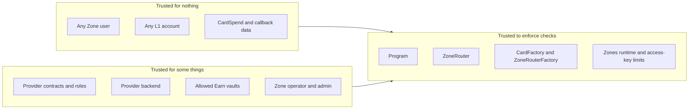
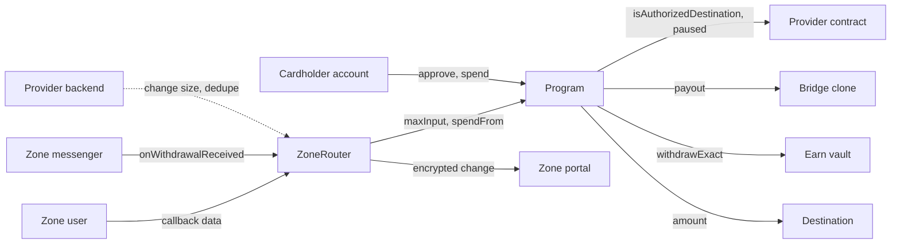
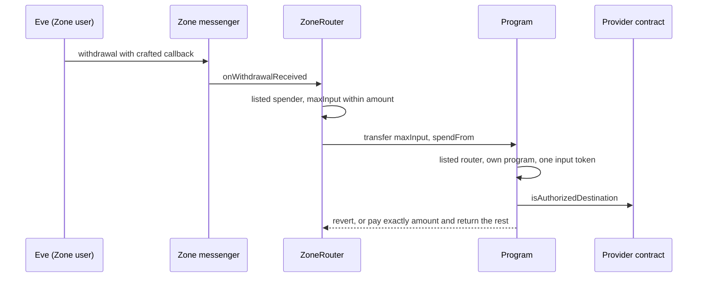

# Card spend threat model

Who can attack card spend on Tempo, where its trust boundaries are, and the invariants that must hold.
[Design](../cards/design.md) owns how card spend works, and [Bridge](../cards/bridge/design.md) and
[Rain](../cards/rain/README.md) own each provider. This page owns card spend's trust boundaries,
invariants and accepted risks, and the design pages link here for them.

**Covers**

- `cards/src/**`
- `cards/script/**`
- `zone-router/src/ZoneRouter.sol` (Spend op), `zone-router/src/ZoneRouterFactory.sol`,
  `zone-router/src/interfaces/ISpender.sol`, `zone-router/src/spenders/SpenderAuth.sol`
- `cards/vendor/**`, as code the covered contracts trust, not as code this model checks

## Problem

A card spend moves a cardholder's money to a provider's destination with no signature from the
cardholder. The provider holds an access key for each cardholder and sends every spend. A private spend
reaches the L1 as a Zone withdrawal whose callback data any Zone user can write. And every program asks
a provider contract which destinations and vaults it may use.

So the contracts must keep three properties on their own: money goes only where the provider allows,
only from the payer's own funds, and only up to what the payer allowed. The provider approves the card
before the L1 settles, so a break pays the wrong party with the card already approved.

## Methodology

We follow Trail of Bits' TRAIL method
([Threat modeling the TRAIL of Bits way](https://blog.trailofbits.com/2025/02/28/threat-modeling-the-trail-of-bits-way/)):
goals, components, actors, trust domains, trust boundaries, the consequences of crossing each boundary,
and threat scenarios. From the boundaries we state [security invariants](#security-invariants), each
with the code that enforces it.

Every claim cites the code as `path`: `symbol`. Where a doc disagrees with the code, the model
follows the code. [Outside this repository](#outside-this-repository) lists the controls this model
assumes but cannot check, such as access-key limits and who holds each provider's roles.

We focus on seven risks:

1. A Zone user abuses the Spend path
2. A leaked provider key spends cardholders' funds
3. A provider's own contracts turn hostile
4. A hostile or broken Earn vault
5. The Zone operator withholds or bounces settlement
6. A rogue program or router reaches a Zone
7. A private spend reveals the cardholder

The first is the root risk. Callback data is untrusted, and risks 2, 5 and 6 reach the contracts
through the same path.

## State of the model

This model describes the code on `main`. Nothing in this repository detects or alerts on card spend
events.

## Goals

- **Custody.** Funds move only when a spend pays a destination its provider authorizes, from the
  payer's own funds.
- **Bounded input.** A private spend uses at most the `maxInput` the cardholder's Zone transaction
  set, and the rest goes back to that Zone.
- **Exact payment.** The destination receives exactly the spend's amount, or the spend reverts.
- **Immutability.** A program's provider and the routers that may call it never change.
- **Provider control.** The provider's contracts alone decide destinations, vaults and pause.
- **Privacy.** The L1 settlement of a private spend does not name the cardholder.

### Non-goals

- Duplicate protection. The provider removes duplicate spends off chain.
- Safety of a leaked access key, which spends up to its protocol limit.
- Settlement before approval. The provider's reserve covers a private spend that bounces.
- The providers' and the Zones runtime's own contracts, vendored unmodified. This model states what card
  spend assumes from them.
- Tempo Earn's accounting, which has its own [security model](../earn/architecture/security-and-privacy.md).

## Risks at a glance

| Threat                                            | Scenario                                                  | Invariants at stake                                                                                                                                                                                   |
| :------------------------------------------------ | :-------------------------------------------------------- | :---------------------------------------------------------------------------------------------------------------------------------------------------------------------------------------------------- |
| A Zone user abuses the Spend path                 | [1](#1-a-zone-user-abuses-the-spend-path)                 | `CARDSPEND-ROUTER-MESSENGER-ONLY`, `CARDSPEND-ROUTER-LISTED-SPENDER`, `CARDSPEND-PRIVATE-ROUTER-ONLY`, `CARDSPEND-PRIVATE-MAX-INPUT`, `CARDSPEND-PROGRAM-DESTINATION`, `CARDSPEND-PRIVATE-BASELINE`   |
| A leaked provider key spends cardholders' funds   | [2](#2-a-leaked-provider-key-spends-cardholders-funds)    | `CARDSPEND-PROGRAM-DESTINATION`, `CARDSPEND-PAY-PAYER-FUNDS`, `CARDSPEND-PROGRAM-PAUSE`                                                                                                               |
| A provider's own contracts turn hostile           | [3](#3-a-providers-own-contracts-turn-hostile)            | `CARDSPEND-PAYOUT-EXACT-INPUT`, `CARDSPEND-PAY-EXACT-AMOUNT`, `CARDSPEND-PRIVATE-MAX-INPUT`, `CARDSPEND-BRIDGE-CANONICAL-ID`, `CARDSPEND-BRIDGE-STORAGE-ISOLATED`, `CARDSPEND-PROGRAM-FIXED-PROVIDER` |
| A hostile or broken Earn vault                    | [4](#4-a-hostile-or-broken-earn-vault)                    | `CARDSPEND-PROGRAM-VAULT`, `CARDSPEND-EARN-MAX-SHARES`, `CARDSPEND-EARN-UNUSED-SHARES`, `CARDSPEND-PAY-EXACT-AMOUNT`                                                                                  |
| The Zone operator withholds or bounces settlement | [5](#5-the-zone-operator-withholds-or-bounces-settlement) | `CARDSPEND-ROUTER-SOURCE-ZONE`, `CARDSPEND-ROUTER-FEE-CAP`, `CARDSPEND-ROUTER-CHANGE-TO-ZONE`                                                                                                         |
| A rogue program or router reaches a Zone          | [6](#6-a-rogue-program-or-router-reaches-a-zone)          | `CARDSPEND-PROGRAM-NO-OWNER`, `CARDSPEND-PROGRAM-ADDRESS-COMMITS`, `CARDSPEND-PRIVATE-ROUTER-ONLY`, `CARDSPEND-ROUTER-LISTED-SPENDER`                                                                 |
| A private spend reveals the cardholder            | [7](#7-a-private-spend-reveals-the-cardholder)            | `CARDSPEND-PRIVACY-NO-HOLDER`, `CARDSPEND-PRIVACY-POOLED-DESTINATION`, `CARDSPEND-RAIN-PRIVATE-POOLED`                                                                                                |

## Components

[Design](../cards/design.md#components) lists the components. This model adds the parts they trust:

| Component                     | Role in this model                                                                          | Code                                                                                                                                                             |
| :---------------------------- | :------------------------------------------------------------------------------------------ | :--------------------------------------------------------------------------------------------------------------------------------------------------------------- |
| Program (`CardSpender`)       | Enforces every program invariant. Holds only a seed between spends.                         | `cards/src/core/CardSpender.sol`: `spend`, `spendFrom`, `_check`                                                                                                 |
| `CardFactory`                 | Deploys programs at addresses fixed by ID, provider and router factory. Anyone can call it. | `cards/src/core/CardFactory.sol`: `deploy`, `predict`                                                                                                            |
| Provider contract             | Answers destination, vault and pause questions. Bridge's also names a payout target.        | `cards/src/providers/bridge/BridgeProvider.sol`: `isAuthorizedDestination`, `payoutData`, `cards/src/providers/rain/RainProvider.sol`: `isAuthorizedDestination` |
| Bridge clone and "TS" handler | The payout target for Bridge programs. Enforces Bridge's destinations, vaults and pause.    | `cards/src/providers/bridge/SpenderTempoSpend.sol`: `_spend`, `cards/vendor/bridge/src/SpenderDelegator.sol`: `publicCall`                                       |
| `ZoneRouter`                  | Takes one Zone's withdrawals, sends `maxInput` to a listed spender, returns the change.     | `zone-router/src/ZoneRouter.sol`: `onWithdrawalReceived`, `_handleSpend`                                                                                         |
| Vendored provider contracts   | Bridge's `SpenderFactory` and Rain's collateral factory, both upgradeable by their owners.  | `cards/vendor/bridge/src/SpenderFactory.sol`, `cards/vendor/rain/contracts/RainCollateralFactory.sol`                                                            |

## Actors

| Actor              | Capabilities                                                                                                    | Authority                                                                                                                                                                                             |
| :----------------- | :-------------------------------------------------------------------------------------------------------------- | :---------------------------------------------------------------------------------------------------------------------------------------------------------------------------------------------------- |
| Cardholder         | Owns the funds. Grants the provider access keys and can revoke them.                                            | Tempo's access-key rules, outside this repository                                                                                                                                                     |
| Provider backend   | Holds the keys, sends every spend, pays gas, removes duplicates, sizes the change.                              | Each key's scope and limit, outside this repository                                                                                                                                                   |
| Bridge admin       | Sets the handler for any prefix, which runs in every clone. Upgrades the factory. Grants governance and pauser. | `cards/vendor/bridge/src/SpenderFactory.sol`: `setSpenderHandler`, `_authorizeUpgrade`, `initialize`                                                                                                  |
| Bridge governance  | Adds and removes destinations, allows Earn vaults, enables or gates handlers, unpauses, grants manager.         | `cards/vendor/bridge/src/SpenderFactory.sol`: `updateSpenderDestination`, `governorCall`, `updateSpenderHandlerStatus`, `unpause`, `cards/src/providers/bridge/SpenderTempoSpend.sol`: `governorCall` |
| Bridge manager     | Creates programs, registers spender IDs on new or existing clones, grants debitor.                              | `cards/vendor/bridge/src/SpenderFactory.sol`: `createSpender`, `createSpenderWithExistingContract`                                                                                                    |
| Bridge debitor     | Runs the pull pipeline through a handler that supports it, with a `from` it names. TS refuses it.               | `cards/vendor/bridge/src/SpenderFactory.sol`: `transferToDestination`, `cards/src/providers/bridge/SpenderTempoSpend.sol`: `transferToDestination`                                                    |
| Rain factory owner | Upgrades every Rain collateral contract through the beacon.                                                     | `cards/vendor/rain/contracts/RainCollateralFactory.sol`: `beacon`                                                                                                                                     |
| Earn vault         | Prices and redeems shares for a spend. The provider must allow it.                                              | `cards/src/core/CardSpender.sol`: `_redeem`, `cards/src/providers/bridge/SpenderTempoSpend.sol`: `_withdrawFromEarn`                                                                                  |
| Zone operator      | Orders Zone transactions, posts batches, sets portal fees, can move or freeze Zone balances.                    | The Zone, outside this repository                                                                                                                                                                     |
| Zone admin         | Admits a router and the accounts a closed-loop Zone allows.                                                     | The Zone, outside this repository                                                                                                                                                                     |
| Any Zone user      | Sends a withdrawal to a router with any callback data.                                                          | `zone-router/src/ZoneRouter.sol`: `onWithdrawalReceived`                                                                                                                                              |
| Any L1 account     | Calls `spend`, `warm` and `warmVault` on a program, `deploy` on both factories, and `warm` on a router.         | `cards/src/core/CardSpender.sol`: `spend`, `warm`, `warmVault`, `cards/src/core/CardFactory.sol`: `deploy`, `zone-router/src/ZoneRouterFactory.sol`: `deploy`                                         |

## Trust domains and boundaries

### Trust domains



| Domain                  | Components                                                                        | Trusted to                                                                                            |
| :---------------------- | :-------------------------------------------------------------------------------- | :---------------------------------------------------------------------------------------------------- |
| Covered contracts       | Program, `CardFactory`, `ZoneRouter`, `ZoneRouterFactory`, provider contracts     | Enforce the invariants that cite them                                                                 |
| Tempo and Zones runtime | Access-key limits, Zone messenger, Zone portal, TIP-1022 registry                 | Deliver only real withdrawals from their Zone's portal, enforce key limits, resolve virtual addresses |
| Provider                | Bridge's factory and roles, Rain's factories, the provider backend                | Authorize only the provider's own destinations and vaults, and send only authorized spends            |
| Allowed Earn vaults     | Vaults a provider allows                                                          | Burn no more than the shares asked and send exactly the assets asked                                  |
| Zone operator and admin | Sequencer, fees, admissions                                                       | Post batches, and admit only routers whose spenders are released programs                             |
| Untrusted               | Any Zone user or L1 account, `CardSpend`, callback data, `ref`, `destinationHint` | Nothing                                                                                               |

### Trust boundaries



A solid arrow is a crossing the covered code checks. The dotted one only the provider's backend checks.

| Boundary                     | What happens                                                                                                      | Enforced by                                                                                  | Consequences                                                                           |
| :--------------------------- | :---------------------------------------------------------------------------------------------------------------- | :------------------------------------------------------------------------------------------- | :------------------------------------------------------------------------------------- |
| Messenger to router          | The messenger delivers a withdrawal and its callback.                                                             | `CARDSPEND-ROUTER-MESSENGER-ONLY`, `CARDSPEND-ROUTER-SOURCE-ZONE`                            | A forged callback pays out tokens no Zone sent.                                        |
| Zone user to router          | Any Zone user picks the spender, `maxInput`, the spend and the change return.                                     | `CARDSPEND-ROUTER-LISTED-SPENDER`, `CARDSPEND-PRIVATE-MAX-INPUT`                             | An unlisted spender or uncapped input takes the whole withdrawal.                      |
| Router to program            | The router transfers `maxInput` and calls `spendFrom`.                                                            | `CARDSPEND-PRIVATE-ROUTER-ONLY`, `CARDSPEND-PRIVATE-BASELINE`, `CARDSPEND-PRIVATE-ONE-INPUT` | A caller that is not a router spends the program's seed or claims input it never sent. |
| Cardholder to program        | The cardholder's account approves and calls `spend`.                                                              | `CARDSPEND-PAY-PAYER-FUNDS`, `CARDSPEND-PROGRAM-OWN-SPEND`                                   | A spend draws on funds that are not the caller's.                                      |
| Program to provider contract | The program asks about the destination, vault and pause.                                                          | `CARDSPEND-PROGRAM-DESTINATION`, `CARDSPEND-PROGRAM-VAULT`, `CARDSPEND-PROGRAM-PAUSE`        | A wrong answer pays a destination the provider never meant.                            |
| Program to payout target     | The program approves the clone and calls it as the payer.                                                         | `CARDSPEND-PAYOUT-EXACT-INPUT`, `CARDSPEND-PAY-EXACT-AMOUNT`                                 | A replaced target keeps input or pays short.                                           |
| Program to vault             | The program, or the TS handler, redeems shares with `withdrawExact`.                                              | `CARDSPEND-EARN-MAX-SHARES`, `CARDSPEND-EARN-UNUSED-SHARES`                                  | The payer loses more shares than they allowed.                                         |
| Router to portal             | The router returns the change as an encrypted deposit.                                                            | `CARDSPEND-ROUTER-CHANGE-TO-ZONE`, `CARDSPEND-ROUTER-FEE-CAP`                                | Change leaves the Zone or a raised fee eats it.                                        |
| Vault to provider backend    | `availableBalance` adds the vault's `previewRedeem` quote (`cards/src/core/CardSpender.sol`: `availableBalance`). | No code checks the quote                                                                     | An overstated value makes the provider approve spends the funds cannot cover.          |

### Some dangerous assumptions

| This observation                             | Does not guarantee                                                                                                                                                                               |
| :------------------------------------------- | :----------------------------------------------------------------------------------------------------------------------------------------------------------------------------------------------- |
| A `CardSpent`, `InputSpent` or `Spent` event | That a spend was authorized or is not a duplicate. Anyone can emit one with any `ref`.                                                                                                           |
| The Zone receipt for a withdrawal            | That the spend settles on the L1. It can still bounce.                                                                                                                                           |
| A program at a `CardFactory` address         | That its provider is legitimate. Anyone can deploy a program over any provider.                                                                                                                  |
| `BridgeProvider` authorizes a destination    | That it is pooled. It ignores `isPrivate`, so privacy rests on Bridge governance.                                                                                                                |
| The provider's contracts today               | Their behavior tomorrow. Bridge's factory and Rain's collateral beacon are upgradeable.                                                                                                          |
| The factory is paused                        | That Bridge governance can remove a destination or disallow a vault. Those calls revert while paused (`cards/vendor/bridge/src/SpenderFactory.sol`: `updateSpenderDestination`, `governorCall`). |

## Security invariants

_What must always be true?_

IDs follow the `<SYSTEM>-<AREA>-<NAME>` scheme as `CARDSPEND-<AREA>-<NAME>`. IDs are stable: tests and
monitors refer to them, so rename one only with every reference. **Enforced at** names the code that
enforces each invariant, or where it must. It describes the control, not whether it works.

| Criticality | Meaning                                                                                            |
| :---------- | :------------------------------------------------------------------------------------------------- |
| 🔴 **CRIT** | One break pays an outsider from any cardholder's funds, or changes a program's provider or callers |
| 🟡 **HIGH** | One spend's value or change is lost, or one cardholder's funds or privacy are exposed              |
| 🟢 **MED**  | A spend fails or costs more, but no value moves to the wrong party                                 |

### Program

| ID                                  | Assertion                                                                                              | Crit | Enforced at                                                                                                                                                                                                                                                              | Impact                                                                      |
| :---------------------------------- | :----------------------------------------------------------------------------------------------------- | :--- | :----------------------------------------------------------------------------------------------------------------------------------------------------------------------------------------------------------------------------------------------------------------------- | :-------------------------------------------------------------------------- |
| `CARDSPEND-PROGRAM-OWN-SPEND`       | A program pays only a spend that names it.                                                             | 🟡   | `cards/src/core/CardSpender.sol`: `_check`                                                                                                                                                                                                                               | One program's signed spend pays through another.                            |
| `CARDSPEND-PROGRAM-FIXED-PROVIDER`  | A program's provider and router factory never change.                                                  | 🔴   | `cards/src/core/CardSpender.sol`: `constructor`                                                                                                                                                                                                                          | Someone swaps the rules under live cardholder keys.                         |
| `CARDSPEND-PROGRAM-ADDRESS-COMMITS` | A program's address commits to its ID, provider and router factory.                                    | 🟡   | `cards/src/core/CardFactory.sol`: `predict`, `deploy`                                                                                                                                                                                                                    | A program with another provider takes a known address.                      |
| `CARDSPEND-PROGRAM-DESTINATION`     | A spend pays only a destination its provider authorizes for that payer, token and path.                | 🔴   | `cards/src/core/CardSpender.sol`: `_check`, `cards/src/providers/bridge/SpenderTempoSpend.sol`: `_spend`                                                                                                                                                                 | Any caller pays any address.                                                |
| `CARDSPEND-PROGRAM-PAUSE`           | A spend pays nothing while the provider reports paused.                                                | 🟡   | `cards/src/core/CardSpender.sol`: `_check`, `paused`, `cards/src/providers/bridge/BridgeProvider.sol`: `paused`, `cards/vendor/bridge/src/SpenderDelegator.sol`: `publicCall`                                                                                            | The provider cannot stop spends in an incident.                             |
| `CARDSPEND-PROGRAM-VAULT`           | A spend redeems only from a vault the provider allows, and only into that vault's asset.               | 🔴   | `cards/src/core/CardSpender.sol`: `_check`, `cards/src/providers/bridge/SpenderTempoSpend.sol`: `_spend`                                                                                                                                                                 | A vault of the caller's choice decides where value goes.                    |
| `CARDSPEND-PROGRAM-NOT-SELF`        | A program never pays itself.                                                                           | 🟢   | `cards/src/core/CardSpender.sol`: `_check`                                                                                                                                                                                                                               | A spend inflates the baseline it measures input against.                    |
| `CARDSPEND-PRIVATE-NOT-ROUTER`      | A private spend never pays its calling router, including through a virtual alias.                      | 🟡   | `cards/src/core/CardSpender.sol`: `_check`                                                                                                                                                                                                                               | Redeemed assets stay outside the router's input-token cleanup.              |
| `CARDSPEND-PROGRAM-NO-OWNER`        | No account can change, pause or sweep a program, its provider contract, the `CardFactory` or a router. | 🔴   | `cards/src/core/CardSpender.sol`: `constructor`, `cards/src/core/CardFactory.sol`: `deploy`, `cards/src/providers/rain/RainProvider.sol`: `constructor`, `cards/src/providers/bridge/BridgeProvider.sol`: `constructor`, `zone-router/src/ZoneRouter.sol`: `constructor` | One key changes the rules or takes the balance of every program it reaches. |

### Providers

| ID                                  | Assertion                                                                                           | Crit | Enforced at                                                                                                                           | Impact                                                                  |
| :---------------------------------- | :-------------------------------------------------------------------------------------------------- | :--- | :------------------------------------------------------------------------------------------------------------------------------------ | :---------------------------------------------------------------------- |
| `CARDSPEND-BRIDGE-CANONICAL-ID`     | The TS handler pays only for the spender ID its clone was created with.                             | 🔴   | `cards/src/providers/bridge/SpenderTempoSpend.sol`: `_isCanonical`, `_spend`                                                          | A manager adds destinations to a live program with a second ID.         |
| `CARDSPEND-BRIDGE-VAULT-GOVERNANCE` | Only Bridge governance allows a vault for TS.                                                       | 🔴   | `cards/src/providers/bridge/SpenderTempoSpend.sol`: `governorCall`, `cards/vendor/bridge/src/spenders/SpenderBase.sol`: `managerCall` | A manager routes redeemed value through any vault.                      |
| `CARDSPEND-BRIDGE-PIPELINE-OFF`     | TS moves nothing through Bridge's pull pipeline.                                                    | 🟡   | `cards/src/providers/bridge/SpenderTempoSpend.sol`: `transferToDestination`, `transferToDestinationStrict`                            | A debitor pulls without a per-spend approval.                           |
| `CARDSPEND-BRIDGE-STORAGE-ISOLATED` | The TS handler's storage cannot collide with the clone's storage.                                   | 🟡   | `cards/src/providers/bridge/SpenderTempoSpend.sol`: `SpenderTempoSpendStorageLib`                                                     | A handler write corrupts the clone's beacon or another handler's state. |
| `CARDSPEND-RAIN-COLLATERAL`         | A Rain spend pays only a collateral contract Rain's factory created.                                | 🔴   | `cards/src/providers/rain/RainProvider.sol`: `isRainCollateral`                                                                       | A spend pays a contract that only looks like collateral.                |
| `CARDSPEND-RAIN-OWN-COLLATERAL`     | A public Rain spend to a non-pooled collateral pays only one the payer owns and solely administers. | 🟡   | `cards/src/providers/rain/RainProvider.sol`: `isAuthorizedDestination`, `_isSoleAdmin`                                                | A cardholder funds collateral someone else can withdraw.                |
| `CARDSPEND-RAIN-PRIVATE-POOLED`     | A private Rain spend pays only the program's pooled collateral.                                     | 🟡   | `cards/src/providers/rain/RainProvider.sol`: `isAuthorizedDestination`                                                                | A private spend funds, and names, one cardholder's collateral.          |

### Payment

| ID                             | Assertion                                                                                                    | Crit | Enforced at                                                                                                                    | Impact                                                                            |
| :----------------------------- | :----------------------------------------------------------------------------------------------------------- | :--- | :----------------------------------------------------------------------------------------------------------------------------- | :-------------------------------------------------------------------------------- |
| `CARDSPEND-PAY-EXACT-AMOUNT`   | The account a transfer to the destination credits receives exactly the amount.                               | 🔴   | `cards/src/core/CardSpender.sol`: `spend`, `spendFrom`, `_payee`, `cards/src/providers/bridge/SpenderTempoSpend.sol`: `_spend` | A short payment looks settled.                                                    |
| `CARDSPEND-PAY-PAYER-FUNDS`    | A public spend pays only from its caller's tokens and shares.                                                | 🔴   | `cards/src/core/CardSpender.sol`: `_payDirect`, `_payThroughPublic`                                                            | One cardholder's spend draws on another's funds.                                  |
| `CARDSPEND-PAYOUT-EXACT-INPUT` | A payout target uses exactly the stablecoin part and at most the share cost the program quoted.              | 🔴   | `cards/src/core/CardSpender.sol`: `_payThroughPublic`, `spendFrom`                                                             | A replaced target keeps the rest of the input.                                    |
| `CARDSPEND-EARN-MAX-SHARES`    | A spend from Earn takes no more than `maxShares` from the payer when it is set.                              | 🟡   | `cards/src/core/CardSpender.sol`: `_payDirect`, `_payThroughPublic`, `_spendDirect`                                            | A price move costs more shares than allowed.                                      |
| `CARDSPEND-EARN-UNUSED-SHARES` | Unused shares return to the payer; a public refund must credit the payer exactly or the whole spend reverts. | 🟡   | `cards/src/core/CardSpender.sol`: `_payDirect`, `_payThroughPublic`, `_refund`, `spendFrom`                                    | A receive policy diverts a public refund into custody the program cannot recover. |
| `CARDSPEND-NO-REENTRY`         | Neither `spend` nor `spendFrom` can be entered again while it runs.                                          | 🟡   | `cards/src/core/CardSpender.sol`: `nonReentrant`                                                                               | A token or vault callback pays twice from one input.                              |

### Private spend

| ID                              | Assertion                                                                                              | Crit | Enforced at                                                                                                 | Impact                                       |
| :------------------------------ | :----------------------------------------------------------------------------------------------------- | :--- | :---------------------------------------------------------------------------------------------------------- | :------------------------------------------- |
| `CARDSPEND-PRIVATE-ROUTER-ONLY` | Only a router the program's router factory deployed, whose mode lists the program, calls `spendFrom`.  | 🔴   | `cards/src/core/CardSpender.sol`: `spendFrom`, `zone-router/src/spenders/SpenderAuth.sol`: `isListedRouter` | Anyone claims input they never sent.         |
| `CARDSPEND-PRIVATE-MAX-INPUT`   | A private spend uses at most `maxInput`.                                                               | 🔴   | `zone-router/src/ZoneRouter.sol`: `_handleSpend`, `cards/src/core/CardSpender.sol`: `spendFrom`             | The spender takes the cardholder's change.   |
| `CARDSPEND-PRIVATE-BASELINE`    | A program ends a private spend holding exactly what it held before the router's transfer.              | 🟡   | `cards/src/core/CardSpender.sol`: `spendFrom`                                                               | Input stays behind, or the seed is spent.    |
| `CARDSPEND-PRIVATE-ONE-INPUT`   | `spendFrom` takes one input token: the stablecoin, or the EarnShare of the vault that funds all of it. | 🟢   | `cards/src/core/CardSpender.sol`: `spendFrom`                                                               | A mismatched token passes through unchecked. |
| `CARDSPEND-PRIVATE-MUST-SPEND`  | A private spend whose spender consumes nothing, or hands back more than it was sent, does not settle.  | 🟢   | `cards/src/core/CardSpender.sol`: `spendFrom`, `zone-router/src/ZoneRouter.sol`: `_handleSpend`             | A spend looks settled when nothing paid.     |

### Router

| ID                                | Assertion                                                                            | Crit | Enforced at                                                                                    | Impact                                            |
| :-------------------------------- | :----------------------------------------------------------------------------------- | :--- | :--------------------------------------------------------------------------------------------- | :------------------------------------------------ |
| `CARDSPEND-ROUTER-MESSENGER-ONLY` | Only the Zone messenger starts a callback.                                           | 🔴   | `zone-router/src/ZoneRouter.sol`: `_validateWithdrawal`                                        | Anyone forges a withdrawal.                       |
| `CARDSPEND-ROUTER-SOURCE-ZONE`    | A callback settles only from the router's Zone, through that Zone's portal.          | 🔴   | `zone-router/src/ZoneRouter.sol`: `constructor`, `onWithdrawalReceived`, `_validateWithdrawal` | Another Zone's users spend through this router.   |
| `CARDSPEND-ROUTER-LISTED-SPENDER` | A Spend reaches only a spender fixed when the router was deployed.                   | 🔴   | `zone-router/src/ZoneRouter.sol`: `constructor`, `_handleSpend`                                | A Zone user names a spender that keeps the input. |
| `CARDSPEND-ROUTER-CHANGE-TO-ZONE` | The change goes back only through the source Zone's portal, as an encrypted deposit. | 🔴   | `zone-router/src/ZoneRouter.sol`: `_handleSpend`                                               | The change leaves the Zone.                       |
| `CARDSPEND-ROUTER-FEE-CAP`        | The portal keeps no more deposit fee than `maxDepositFee`.                           | 🟢   | `zone-router/src/ZoneRouter.sol`: `_checkDepositFee`                                           | A raised fee eats the change.                     |
| `CARDSPEND-ROUTER-EMPTY`          | The router holds no more input after a callback than before it.                      | 🟡   | `zone-router/src/ZoneRouter.sol`: `onWithdrawalReceived`, `_requireBalance`                    | Input left in the router is lost.                 |

### Privacy

| ID                                     | Assertion                                                                                   | Crit | Enforced at                                                                                                           | Impact                                        |
| :------------------------------------- | :------------------------------------------------------------------------------------------ | :--- | :-------------------------------------------------------------------------------------------------------------------- | :-------------------------------------------- |
| `CARDSPEND-PRIVACY-NO-HOLDER`          | No event or storage write on the private path names the cardholder or the Zone `senderTag`. | 🟡   | `cards/src/core/CardSpender.sol`: `CardSpent`, `InputSpent`, `zone-router/src/ZoneRouter.sol`: `Spent`                | Private spends link to cardholders on the L1. |
| `CARDSPEND-PRIVACY-POOLED-DESTINATION` | A private spend pays only a destination the program shares across cardholders.              | 🟡   | `cards/src/providers/rain/RainProvider.sol`: `isAuthorizedDestination`, and Bridge governance outside this repository | The destination names the cardholder.         |

## Accepted risks

The design accepts these risks. They are decisions, not gaps.

- **A leaked Zone key.** It can withdraw a cardholder's Zone balance, up to the key's limit, to any
  address in an open Zone or any admitted account in a closed-loop Zone, and it chooses where the change
  goes. Bridge uses one key per program, so one leak reaches every cardholder of that program.
- **A leaked public key.** It can spend a cardholder's funds, up to the key's limit, only to the
  program's destinations: its scope names the program's `spend`.
- **No on-chain idempotency.** The provider removes duplicate spends off chain, by its own reference.
- **Approval before settlement.** The provider approves a private spend on the Zone receipt. If L1
  settlement fails, the provider's reserve pays.
- **Events are not proof of payment.** Anyone can emit a spend event with any `ref`. The provider
  reconciles by transaction and log index, binding a private spend's `CardSpent` and `InputSpent` to the
  portal's `WithdrawalProcessed` and the router's `Spent` in the same transaction, and a public spend to
  its own access key's transaction. A private spend's `ref` is public, so the provider uses one nobody
  can link to the cardholder, such as `keccak256(pullId, programSecret)`.
- **Stray tokens.** Tokens sent to a router outside a callback cannot be recovered. Tokens sent to a
  program outside a spend stay there as its baseline, which no spend touches.
- **Immutable programs.** A program has no pause of its own and never changes. A new provider contract,
  clone, token or vault means a new program, a router that lists it and new cardholder keys. Until then
  the provider's own pause stops spends where it has one (Bridge), and a private spend while paused
  bounces back into the Zone in full.
- **Providers are trusted for what they decide.** A provider contract decides every destination, so a
  provider whose own contracts can be upgraded (Bridge's spender factory, Rain's factory and collateral
  beacon) is trusted for that. Rain's controller admin can liquidate any collateral. A payout target is
  trusted to pay the spend it is handed, and the program bounds what it can take.
- **Bridge privacy rests on governance.** `BridgeProvider` ignores `isPrivate`, so Bridge governance
  must authorize only settlement wallets every cardholder shares.
- **Rain public spends.** A public spend into a cardholder's own collateral names the cardholder, as any
  public spend does. With `POOLED_ACCEPTS_PUBLIC` set, anyone may fund pooled collateral, which costs
  them and credits nobody until Rain or the partner attributes it off chain.
- **No Rain pause.** Rain stops a program by revoking its access keys and Zone keys.
- **Unreadable vaults.** A vault that cannot report its asset, shares or redemption value makes
  `availableBalance` report the stablecoin alone.

## Threat scenarios

### 1. A Zone user abuses the Spend path

**What it means.** Any Zone user sends a withdrawal to a router with callback data they wrote, trying to
pay an address the provider never authorized, take more than they put in, or spend the program's seed.

**How it can happen**

```
Zone user writes callback data
    → the messenger delivers it to the router
    → the router sends maxInput to a listed spender
    → the program asks its provider and pays a destination
```

- The user names any listed spender and any `CardSpend`: another program, an unauthorized destination,
  a vault the provider does not allow, or `maxInput` above the amount (`zone-router/src/ZoneRouter.sol`: `_handleSpend`).
- The user names `SendSpender` where a router lists it. It pays any address, from the user's own
  withdrawal (`zone-router/src/spenders/SendSpender.sol`: `spendFrom`).
- The user sets `refundRecipient` to any nonzero L1 address. The portal sends change the Zone rejects
  there (`zone-router/src/ZoneRouter.sol`: `_handleSpend`, `cards/vendor/tempo-zones/src/runtime/tempo/ZonePortal.sol`: `_processDepositBounceBack`).



**What limits it today.** The router takes callbacks only from the messenger for its own Zone and only to
listed spenders, and caps input by balance. The program accepts only its own routers, pays only what its
provider authorizes, and ends at its baseline.

**Key insight.** The callback data is attacker-controlled, so every check that matters sits in code. Through
a program, a Zone user's own withdrawal can pay only a provider destination, from their own funds. The
leaked-key and rogue-router scenarios inherit these limits and nothing more.

### 2. A leaked provider key spends cardholders' funds

**What it means.** Someone gets a provider's access key or Zone key for a program and spends from every
cardholder who granted it.

**How it can happen**

- The Zone key's scope names the outbox, which cannot pin a recipient, so it withdraws to any L1 address
  in an open Zone, or any admitted account in a closed-loop Zone. It never touches the program.
- The public key's scope names `program.spend`, so it pays only destinations the provider authorizes,
  up to each key's limit (`cards/src/core/CardSpender.sol`: `spend`, `_check`).
- Bridge uses one key per program, so one leak reaches every cardholder of that program.

**What limits it today.** Tempo enforces each key's limit and expiry, and cardholders can revoke keys.
Public spends pay only provider destinations. Bridge can pause its programs. Rain has no pause and
revokes keys instead.

**Key insight.** A leaked Zone key bypasses every contract in this model, so the key's limit is the only
bound. A leaked public key is bounded by the provider's destination list.

### 3. A provider's own contracts turn hostile

**What it means.** A provider's roles, upgradeable contracts or payout target change what a program pays,
or where.

**How it can happen**

- **Bridge admin.** Replaces the "TS" handler or registers another prefix. The new code runs in the clone
  with the program's standing approval to it (`cards/vendor/bridge/src/SpenderFactory.sol`: `setSpenderHandler`, `cards/src/core/CardSpender.sol`: `_payout`).
- **Bridge governance.** Authorizes a destination it controls, or allows a vault whose `withdrawExact`
  sends value elsewhere (`cards/vendor/bridge/src/SpenderFactory.sol`: `updateSpenderDestination`, `cards/src/providers/bridge/SpenderTempoSpend.sol`: `governorCall`).
- **Bridge manager.** Registers a second spender ID on a live clone, or grants a debitor that pulls
  through a sibling handler from any account that approved the clone, the program's seed included
  (`cards/vendor/bridge/src/SpenderFactory.sol`: `createSpenderWithExistingContract`, `cards/vendor/bridge/src/spenders/SpenderTempoEarnWithFallback.sol`: `transferToDestination`).
- **Rain factory owner.** Upgrades every collateral contract through the beacon, including pooled
  collateral and its admin and owner answers.

**What limits it today.** The program checks the outcome of every payout: the destination got exactly
the amount, and the target used exactly the stablecoin and at most the quoted share cost. So a replaced
target can make a spend revert but cannot keep input. TS pays only its clone's own ID, and only Bridge
governance allows vaults. The program's provider never changes. Who holds each role, and whether a
timelock guards it, is outside this repository.

**Key insight.** The program bounds what a provider can take, not where the provider sends it. Bridge
governance and Rain's factory owner can each redirect future spends to a destination they choose, and the
program pays it because the provider says so.

### 4. A hostile or broken Earn vault

**What it means.** A vault the provider allows misprices shares, misreports what it burned, or overstates
a balance.

**How it can happen**

- The vault quotes a high `previewWithdraw`, so a spend takes more shares (`cards/src/core/CardSpender.sol`: `_payDirect`).
- On a direct public spend, the vault reports burning more than it did. The program returns
  `required - burned` from that report, and the rest stays in the program under the vault's standing
  approval (`cards/src/core/CardSpender.sol`: `_payDirect`, `_redeem`).
- The vault overstates `previewRedeem`, so `availableBalance` overstates what a cardholder can spend.

**What limits it today.** `maxShares` caps the share cost when the provider sets it. The destination
balance check catches a vault that pays short or elsewhere. A private spend measures its input by balance,
so a misreport there reverts. Bridge's deploy scripts check that a vault's engine supports exact
withdrawals and redeem previews (`cards/script/bridge/deploy/ProgramCalls.s.sol`: `run`).

**Key insight.** The covered code bounds what the destination gets by balance. On the public path it bounds
what the payer loses by the vault's own quote and report.

### 5. The Zone operator withholds or bounces settlement

**What it means.** After the provider approves cards on Zone receipts, the operator delays batches, raises
fees or turns off deposits.

**How it can happen**

- A deposit fee above `maxDepositFee`, deposits turned off, or change below the fee plus the bounce-back
  reserve reverts the callback (`zone-router/src/ZoneRouter.sol`: `_handleSpend`, `_checkChangeReturn`).
- The operator moves or freezes Zone balances before the batch.

**What limits it today.** The router accepts only its Zone's portal, caps the fee, and returns change only
to that portal. A bounce returns the whole withdrawal to the cardholder in the Zone. The provider's change
margin and reserve are outside this repository.

**Key insight.** Approval on the Zone receipt makes the operator part of the provider's credit risk. The
contracts return the cardholder's funds in a bounce but cannot make a bounced spend pay.

### 6. A rogue program or router reaches a Zone

**What it means.** Someone deploys a program over a hostile provider, or a router listing a hostile
spender, and gets a Zone to admit it.

**How it can happen**

- `CardFactory.deploy` and `ZoneRouterFactory.deploy` are permissionless (`cards/src/core/CardFactory.sol`: `deploy`,
  `zone-router/src/ZoneRouterFactory.sol`: `deploy`).
- A program over a provider that authorizes everything pays any address from the input it gets.

**What limits it today.** A program's address commits to its provider, so the address a key or router
names fixes its rules. A program accepts `spendFrom` only from routers that list it. A router serves
only the Zone that admits it. Which routers a Zone admits is outside this repository.

**Key insight.** The factories prove provenance, not legitimacy. The Zone admin's check of each router's
spenders, and of each program's provider, is the gate.

### 7. A private spend reveals the cardholder

**What it means.** L1 data from a private spend links a card payment to a cardholder.

**How it can happen**

- A provider authorizes a cardholder-specific destination for a private spend. `BridgeProvider` ignores
  `isPrivate` (`cards/src/providers/bridge/BridgeProvider.sol`: `isAuthorizedDestination`).
- The callback's `refundRecipient` and the spend's `ref` are public on the L1.
- The portal's `WithdrawalProcessed` event carries the `senderTag` (`cards/vendor/tempo-zones/src/runtime/tempo/ZonePortal.sol`: `_processWithdrawal`).

**What limits it today.** The program and the router never emit or store the cardholder or the
`senderTag`, and a private spend's payer is the router. Rain authorizes only pooled collateral for a
private spend. The change goes back encrypted.

**Key insight.** The covered contracts hide who paid, not what was paid. Privacy also depends on the
provider choosing pooled destinations, unlinkable references and its own refund recipient.

## Outside this repository

Check these. This model assumes them and does not verify them.

- Tempo enforces each access key's scope, limit and expiry.
- Bridge's admin sits behind a timelock, and the right parties hold governance, manager, pauser and
  debitor.
- Bridge governance authorizes only settlement wallets every cardholder shares.
- Rain's factory and beacon owners are who Rain says they are.
- A Zone admits only routers from the released `ZoneRouterFactory` whose spenders are programs from the
  released `CardFactory`, over the expected provider.
- The provider removes duplicates, sizes change for portal fees, uses unlinkable references and its own
  refund recipient for private spends, and keeps a reserve.
- The Zone messenger is the only caller of `onWithdrawalReceived` and passes the true source Zone and
  portal.
- An allowed vault's `withdrawExact` burns at most the shares asked and sends exactly the assets asked.
- Bridge's spender factory authorizes destinations per program, pauses every clone, and routes
  `publicCall` to a handler by its 2-byte prefix.
- TIP-20 tokens revert on failure.
- The vendored contracts match the provenance in [`VENDORED.md`](../../cards/vendor/VENDORED.md).

## Keeping this model current

Update this model in the same pull request as the change when you:

- add a provider, a payout path, a spender or a Zone op card spend uses,
- change who can call a covered function, or what a provider's answer controls,
- add a standing approval, or a balance that stays between spends,
- change a control an **Enforced by** or **Enforced at** column cites.

When you update it:

1. Walk the seven steps for the part you changed: goals, components, actors, domains, boundaries,
   consequences, scenarios.
2. Cite the code for every new claim.
3. Add an invariant for each new property the change must keep, and update **Enforced at** for every
   invariant whose control moved.
4. Check that every citation you touch still names code that holds the claim.
