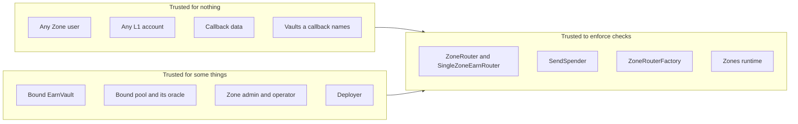
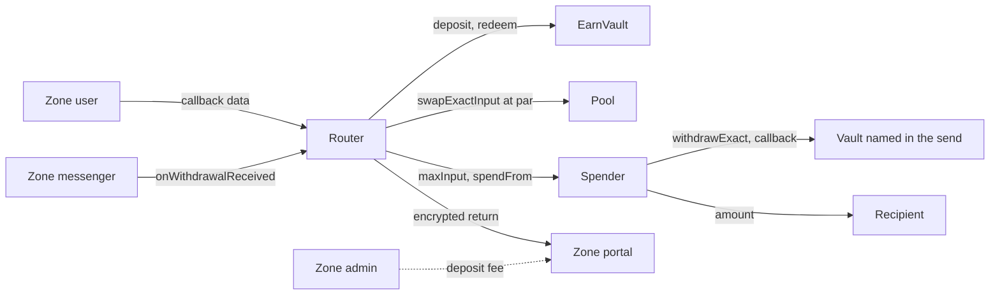

# Zone router threat model

Who can attack the Zone router, where its trust boundaries are, and the invariants that must hold.
The [Zone router design](../zone/zone-router.md) owns how the router, its factory and its spenders
work, and [Earn's Zone router](../earn/modules/zone-router.md) owns the Earn callback. This page owns
the router's trust boundaries, invariants and accepted risks for all three ops, `SendSpender`, the
routers' standing approvals and their deployment seeds. The [card spend model](card-spend.md) owns
what a card program does with a Spend.

**Covers**

- `src/zone/ZoneRouter.sol` (ops 0 Deposit, 1 Redeem and 2 Spend), `src/zone/ZoneRouterFactory.sol`
- `src/zone/spenders/**`, `src/interfaces/zone/**`
- `src/earn/router/SingleZoneEarnRouter.sol`, which runs ops 0 and 1 with the same callback layout
- `script/zone/**`, `deployments/modules/zone-router/**`, `deployments/modules/earn/zone-router/**`
- `vendor/tempo-zones/**`, as code the covered contracts trust, not as code this model checks

## Problem

A Zone user moves funds out of a private Zone by withdrawing them to a router with callback data
they wrote. The router turns that withdrawal into an Earn deposit or redemption, or hands part of it
to a spender, and sends what is left back into the same Zone as an encrypted deposit
(`src/zone/ZoneRouter.sol`: `onWithdrawalReceived`, `_handleDeposit`, `_handleRedeem`, `_handleSpend`).
Nobody signs the callback but the Zone user, and the router has no owner to step in.

So the contracts must keep three properties on their own: a callback moves only the withdrawal it
came with, everything it does not spend goes back to its own Zone, and a conversion or payment
delivers exactly what the callback asked for or reverts. A revert is safe: the Portal bounces the whole
withdrawal back into the Zone.

## Methodology

We follow Trail of Bits' TRAIL method
([Threat modeling the TRAIL of Bits way](https://blog.trailofbits.com/2025/02/28/threat-modeling-the-trail-of-bits-way/)):
goals, components, actors, trust domains, trust boundaries, the consequences of crossing each boundary,
and threat scenarios. From the boundaries we state [security invariants](#security-invariants), each
with the code that enforces it.

Every claim cites the code as `path`: `symbol`. Where a doc disagrees with the code, the model
follows the code. [Outside this repository](#outside-this-repository) lists the controls this model
assumes but cannot check, such as the Portal's own rules and who holds each Zone role.

We focus on seven risks:

1. A Zone user abuses an Earn op
2. A Zone user abuses the Spend op through `SendSpender`
3. The Zone admin takes an Earn return through the deposit fee
4. A hostile or broken vault or pool
5. A standing approval or seed is used outside a callback
6. A rogue router or spender reaches a Zone
7. A callback reveals the Zone account

The first two are the root risks: callback data is untrusted, and every other risk reaches the
contracts through a callback or through what deployment leaves behind.

## State of the model

This model describes the code on `main`. Nothing in this repository detects or alerts on router
events.

## Goals

- **Custody.** A callback moves only the tokens its withdrawal brought, and the router keeps none.
- **Return to the source Zone.** Every unit a callback does not spend goes back to the Zone it came
  from, through that Zone's Portal.
- **Exact conversion.** Earn deposits and redemptions convert only at the pool's exact par price, with
  measured 1:1 output, and meet the minimums the sender set.
- **Bounded spend.** A spender gets at most the `maxInput` the sender set, and a `SendSpender` pays
  exactly the amount named.
- **Immutability.** A router's Zone, ops, vault, pool and spenders never change.
- **Privacy.** No router or spender event or storage names the Zone account or its `senderTag`.

### Non-goals

- The Zones runtime's own contracts, vendored unmodified. This model states what the router assumes
  from them.
- Tempo Earn's accounting, which has its own [security model](../earn/architecture/security-and-privacy.md).
- A card program's checks, in the [card spend model](card-spend.md).
- Protection from the Zone admin's fee and pause controls on ops 0 and 1, which the router does not
  bound (see [accepted risks](#accepted-risks)).

## Risks at a glance

| Threat                                                      | Scenario                                                            | Invariants at stake                                                                                                                                                |
| :---------------------------------------------------------- | :------------------------------------------------------------------ | :----------------------------------------------------------------------------------------------------------------------------------------------------------------- |
| A Zone user abuses an Earn op                               | [1](#1-a-zone-user-abuses-an-earn-op)                               | `ZONEROUTER-ROUTER-MESSENGER-ONLY`, `ZONEROUTER-EARN-INPUT-TOKEN`, `ZONEROUTER-EARN-RETURN-TO-ZONE`, `ZONEROUTER-EARN-MIN-OUTPUT`, `ZONEROUTER-ROUTER-EMPTY`       |
| A Zone user abuses the Spend op through `SendSpender`       | [2](#2-a-zone-user-abuses-the-spend-op-through-sendspender)         | `ZONEROUTER-SPEND-LISTED-SPENDER`, `ZONEROUTER-SPEND-MAX-INPUT`, `ZONEROUTER-SEND-EXACT-PAYMENT`, `ZONEROUTER-SEND-BOUND-CONVERSION`, `ZONEROUTER-SEND-NO-RESIDUE` |
| The Zone admin takes an Earn return through the deposit fee | [3](#3-the-zone-admin-takes-an-earn-return-through-the-deposit-fee) | `ZONEROUTER-SPEND-FEE-CAP` (Spend only); none for ops 0 and 1                                                                                                      |
| A hostile or broken vault or pool                           | [4](#4-a-hostile-or-broken-vault-or-pool)                           | `ZONEROUTER-EARN-PAR`, `ZONEROUTER-EARN-MIN-OUTPUT`, `ZONEROUTER-SEND-CALLBACK-VAULT`, `ZONEROUTER-SEND-EXACT-PAYMENT`                                             |
| A standing approval or seed is used outside a callback      | [5](#5-a-standing-approval-or-seed-is-used-outside-a-callback)      | `ZONEROUTER-APPROVAL-FIXED-SPENDERS`, `ZONEROUTER-APPROVAL-CALLER-ONLY`, `ZONEROUTER-SEED-NEVER-SPENT`                                                             |
| A rogue router or spender reaches a Zone                    | [6](#6-a-rogue-router-or-spender-reaches-a-zone)                    | `ZONEROUTER-ROUTER-FIXED-MODE`, `ZONEROUTER-SEND-ROUTER-ONLY`, `ZONEROUTER-DEPLOY-RUNTIME-MATCH`                                                                   |
| A callback reveals the Zone account                         | [7](#7-a-callback-reveals-the-zone-account)                         | `ZONEROUTER-PRIVACY-NO-SENDER`                                                                                                                                     |

## Components

[The design](../zone/zone-router.md) describes the components. This model adds what they trust:

| Component                 | Role in this model                                                                                       | Code                                                                                                                          |
| :------------------------ | :------------------------------------------------------------------------------------------------------- | :---------------------------------------------------------------------------------------------------------------------------- |
| `ZoneRouter`              | Takes one Zone's withdrawals, runs the op, returns the rest to that Zone. Holds seeds between callbacks. | `src/zone/ZoneRouter.sol`: `onWithdrawalReceived`, `_handleDeposit`, `_handleRedeem`, `_handleSpend`, `warm`                  |
| `SingleZoneEarnRouter`    | Runs ops 0 and 1 with the same callback layout and checks.                                               | `src/earn/router/SingleZoneEarnRouter.sol`: `onWithdrawalReceived`, `_handleDepositToSourceZone`, `_handleRedeemToSourceZone` |
| `ZoneRouterFactory`       | Deploys a router at an address fixed by its mode. Anyone can call it.                                    | `src/zone/ZoneRouterFactory.sol`: `deploy`, `predict`, `isRouter`                                                             |
| `SendSpender`             | Pays a public address from a Spend's input, optionally redeeming from Earn and converting at par.        | `src/zone/spenders/SendSpender.sol`: `spendFrom`, `_spendFrom`, `earnWithdrawCallback`                                        |
| `SpenderAuth`             | Lets a spender accept only routers its factory deployed that list it.                                    | `src/zone/spenders/SpenderAuth.sol`: `isListedRouter`                                                                         |
| EarnVault                 | Mints and redeems EarnShare for Earn ops; an immutable standing spender of the router.                   | `src/earn/core/EarnVault.sol`: `deposit`, `redeem`                                                                            |
| PropAMM pool              | Converts between the private asset and the vault asset at par; an immutable standing spender.            | `src/interfaces/external/propamm/IPropAMMVenue.sol`: `swapExactInput`                                                         |
| Zone Portal and messenger | Deliver withdrawals with their callback; take encrypted deposits back into the Zone.                     | `vendor/tempo-zones/src/runtime/tempo/ZonePortal.sol`: `processWithdrawals`, `depositEncrypted`                               |
| Deployment lifecycle      | Deploys, admits and seeds routers; replaces a router whose runtime changed.                              | `deployments/modules/zone-router/steps.ts`: `deployZoneRouter`, `seedZoneRouter`, `requireModeProvenance`                     |

## Actors

| Actor              | Capabilities                                                                                                            | Authority                                                                                                                                                               |
| :----------------- | :---------------------------------------------------------------------------------------------------------------------- | :---------------------------------------------------------------------------------------------------------------------------------------------------------------------- |
| Any Zone user      | Sends a withdrawal to a router with any callback data: op, minimums, spender, `maxInput`, return payload.               | `src/zone/ZoneRouter.sol`: `onWithdrawalReceived`                                                                                                                       |
| Any L1 account     | Calls `warm` on a router, `deploy` on the factory, and sends tokens to a router or spender.                             | `src/zone/ZoneRouter.sol`: `warm`, `src/zone/ZoneRouterFactory.sol`: `deploy`                                                                                           |
| Zone admin         | Admits gateways and accounts, sets the deposit fee and bounce-back gas, enables tokens, pauses deposits and the Portal. | `vendor/tempo-zones/src/runtime/tempo/ZonePortal.sol`: `setGateway`, `setAllowedAccount`, `setZoneGasRate`, `setBouncebackGas`, `enableToken`, `pauseDeposits`, `pause` |
| Zone operator      | Posts batches and decides when queued withdrawals are processed.                                                        | `vendor/tempo-zones/src/runtime/tempo/ZonePortal.sol`: `submitBatch`, `processWithdrawals`                                                                              |
| Pool owner         | Admits the router and `SendSpender` as taker and recipient, sets the oracle, pauses the pool.                           | Outside this repository                                                                                                                                                 |
| EarnVault operator | Pauses deposits, changes fees and engine.                                                                               | `src/earn/core/EarnVault.sol`: `setDepositsPaused`, `setFeeConfig`, `migrateEngine`                                                                                     |
| Deployer           | Deploys factories and routers, sends seeds, and grants pool and Portal roles when it deployed the factory itself.       | `deployments/modules/zone-router/steps.ts`: `seedZoneRouter`, `authorizeZoneRouter`, `registerZoneRouterGateway`                                                        |
| Listed spender     | Receives a Spend's `maxInput` and must hand back what it does not use.                                                  | `src/interfaces/zone/ISpender.sol`: `spendFrom`                                                                                                                         |

## Trust domains and boundaries

### Trust domains



| Domain                  | Components                                                      | Trusted to                                                                                       |
| :---------------------- | :-------------------------------------------------------------- | :----------------------------------------------------------------------------------------------- |
| Covered contracts       | Routers, `ZoneRouterFactory`, `SendSpender`                     | Enforce the invariants that cite them                                                            |
| Zones runtime           | Messenger, Portal, TIP-1022 registry                            | Deliver only real withdrawals from their Zone, move router tokens only inside `depositEncrypted` |
| Bound EarnVault         | The vault a router or `SendSpender` binds at deployment         | Price and mint or redeem EarnShare correctly, and pull only from its caller                      |
| Bound pool              | The PropAMM pool and oracle a mode binds                        | Pay what it reports at the oracle price, and pull only from its caller                           |
| Zone admin and operator | Fees, admissions, pause, processing                             | Keep fees reasonable, admit only verified routers, and keep processing withdrawals               |
| Deployer                | Lifecycle signer                                                | Grant roles only to a router whose runtime matches the reviewed build                            |
| Untrusted               | Any Zone user or L1 account, callback data, vaults a send names | Nothing                                                                                          |

### Trust boundaries



A solid arrow is a crossing the covered code checks. The dotted one no covered code checks for ops 0
and 1.

| Boundary               | What happens                                                                         | Enforced by                                                                                      | Consequences                                                       |
| :--------------------- | :----------------------------------------------------------------------------------- | :----------------------------------------------------------------------------------------------- | :----------------------------------------------------------------- |
| Messenger to router    | The messenger delivers a withdrawal and its callback.                                | `ZONEROUTER-ROUTER-MESSENGER-ONLY`, `ZONEROUTER-ROUTER-SOURCE-ZONE`                              | A forged callback moves tokens no Zone sent.                       |
| Zone user to router    | Any Zone user picks the op, minimums, spender, `maxInput` and return payload.        | `ZONEROUTER-ROUTER-OP-ENABLED`, `ZONEROUTER-EARN-INPUT-TOKEN`, `ZONEROUTER-SPEND-LISTED-SPENDER` | A disabled op or unlisted spender runs.                            |
| Router to EarnVault    | The router deposits the vault asset or redeems EarnShare through standing approvals. | `ZONEROUTER-EARN-MIN-OUTPUT`, `ZONEROUTER-APPROVAL-CALLER-ONLY`                                  | The sender gets less than the minimum they set.                    |
| Router to pool         | The router converts at par through a standing approval.                              | `ZONEROUTER-EARN-PAR`                                                                            | A conversion off par takes part of the withdrawal.                 |
| Router to spender      | The router transfers `maxInput` and calls `spendFrom`.                               | `ZONEROUTER-SPEND-MAX-INPUT`, `ZONEROUTER-SPEND-MUST-SPEND`                                      | A spender keeps more than the sender allowed.                      |
| Spender to named vault | `SendSpender` redeems from the vault the send names.                                 | `ZONEROUTER-SEND-CALLBACK-VAULT`, `ZONEROUTER-SEND-MAX-SHARES`, `ZONEROUTER-SEND-EXACT-PAYMENT`  | A fake vault burns more than `maxInput` or reports a false payout. |
| Router to Portal       | The router returns output or change as an encrypted deposit.                         | `ZONEROUTER-EARN-RETURN-TO-ZONE`, `ZONEROUTER-SPEND-CHANGE-TO-ZONE`, `ZONEROUTER-SPEND-FEE-CAP`  | Output leaves the Zone, or a raised fee eats it.                   |

### Some dangerous assumptions

| This observation                                        | Does not guarantee                                                                                              |
| :------------------------------------------------------ | :-------------------------------------------------------------------------------------------------------------- |
| An `EarnDeposit`, `EarnRedeem`, `Spent` or `Sent` event | That a Zone user sent it. Bind it to the Portal's `WithdrawalProcessed` for the router in the same transaction. |
| `minEarnShares` or `minOutputAmount` met                | That the Zone credits that much: the Portal's deposit fee comes off after the check.                            |
| A router at a `ZoneRouterFactory` address               | That its mode is the one expected, or that its spenders are safe. Anyone can deploy any mode.                   |
| A router was replaced by the lifecycle                  | That the old one lost its rights. Its pool admission and Portal gateway stay until their owners revoke them.    |
| A `SendSpender` send named a vault                      | That it is an Earn vault. Any contract that reports the input token as its `earnShare` passes.                  |

## Security invariants

_What must always be true?_

IDs follow the `<SYSTEM>-<AREA>-<NAME>` scheme as `ZONEROUTER-<AREA>-<NAME>`. IDs are stable: tests
and monitors refer to them, so rename one only with every reference. **Enforced at** names the code
that enforces each invariant, or where it must. It describes the control, not whether it works.
Where a `ZoneRouter` symbol is cited for ops 0 and 1, `SingleZoneEarnRouter`'s counterpart enforces
the same invariant.

| Criticality | Meaning                                                                                           |
| :---------- | :------------------------------------------------------------------------------------------------ |
| 🔴 **CRIT** | One break moves any Zone user's withdrawal to an outsider, or changes a router's Zone or spenders |
| 🟡 **HIGH** | One callback's value is lost or stranded, or one Zone user's funds or privacy are exposed         |
| 🟢 **MED**  | A callback fails or costs more, but no value moves to the wrong party                             |

### Router

| ID                                  | Assertion                                                                           | Crit | Enforced at                                                                                                      | Impact                                         |
| :---------------------------------- | :---------------------------------------------------------------------------------- | :--- | :--------------------------------------------------------------------------------------------------------------- | :--------------------------------------------- |
| `ZONEROUTER-ROUTER-MESSENGER-ONLY`  | Only the Zone messenger starts a callback.                                          | 🔴   | `src/zone/ZoneRouter.sol`: `_validateWithdrawal`                                                                 | Anyone forges a withdrawal.                    |
| `ZONEROUTER-ROUTER-SOURCE-ZONE`     | A callback runs only from the router's Zone, through that Zone's registered Portal. | 🔴   | `src/zone/ZoneRouter.sol`: `constructor`, `onWithdrawalReceived`, `_validateWithdrawal`                          | Another Zone's users use this router.          |
| `ZONEROUTER-ROUTER-FIXED-MODE`      | No account can change a router's Zone, ops, vault, pool, customer ID or spenders.   | 🔴   | `src/zone/ZoneRouter.sol`: `constructor`, `src/zone/ZoneRouterFactory.sol`: `deploy`, `predict`                  | One key changes what every callback does.      |
| `ZONEROUTER-ROUTER-OP-ENABLED`      | A callback runs only an op its mode enables.                                        | 🟡   | `src/zone/ZoneRouter.sol`: `onWithdrawalReceived` (`OpDisabled`, `BadFlow`)                                      | A closed-loop router pays out through Earn.    |
| `ZONEROUTER-ROUTER-EMPTY`           | A callback leaves every token balance it touched where it was before.               | 🟡   | `src/zone/ZoneRouter.sol`: `onWithdrawalReceived`, `_handleDeposit`, `_handleRedeem`, `_swap`, `_requireBalance` | Value stays in the router, and is lost.        |
| `ZONEROUTER-ROUTER-CALLDATA-BOUNDS` | Every callback read stays inside the callback data.                                 | 🟢   | `src/zone/ZoneRouter.sol`: `_tupleStart`, `_decodeRawOp`                                                         | A read runs past the data and decodes garbage. |
| `ZONEROUTER-ROUTER-NO-REENTRY`      | A callback cannot be entered again while it runs.                                   | 🟡   | `src/zone/ZoneRouter.sol`: `nonReentrant`                                                                        | A token or vault hook runs a second op.        |

### Earn ops

| ID                               | Assertion                                                                                                   | Crit | Enforced at                                                                                                  | Impact                                       |
| :------------------------------- | :---------------------------------------------------------------------------------------------------------- | :--- | :----------------------------------------------------------------------------------------------------------- | :------------------------------------------- |
| `ZONEROUTER-EARN-INPUT-TOKEN`    | Op 0 takes only the private asset, and op 1 only the vault's EarnShare.                                     | 🟡   | `src/zone/ZoneRouter.sol`: `onWithdrawalReceived` (`WrongInputToken`)                                        | A wrong token reaches the vault or pool.     |
| `ZONEROUTER-EARN-RETURN-TO-ZONE` | All output returns only through the source Portal, as an encrypted deposit with a nonzero refund recipient. | 🔴   | `src/zone/ZoneRouter.sol`: `_depositEncrypted`, `_validateSourceReturn`                                      | Output leaves the Zone.                      |
| `ZONEROUTER-EARN-MIN-OUTPUT`     | Vault assets, EarnShare and final output meet the sender's nonzero minimums, before the Portal's fee.       | 🟡   | `src/zone/ZoneRouter.sol`: `_handleDeposit`, `_handleRedeem`, `_swap`                                        | A price move costs the sender more than set. |
| `ZONEROUTER-EARN-PAR`            | A conversion runs only between the bound pair, at the oracle's exact par price, with measured 1:1 output.   | 🔴   | `src/zone/ZoneRouter.sol`: `_validateEarn`, `_swap`, `_requireRoutePair`                                     | The pool takes part of each conversion.      |
| `ZONEROUTER-EARN-SAME-LAYOUT`    | Ops 0 and 1 accept `SingleZoneEarnRouter`'s callback bytes and apply the same checks.                       | 🟢   | `src/zone/ZoneRouter.sol`: `CallbackData`, `_callbackData`, `test/zone/earn/ZoneRouterEarnEquivalence.t.sol` | A client's callback bounces on one router.   |

### Spend op

| ID                                | Assertion                                                                             | Crit | Enforced at                                                           | Impact                                         |
| :-------------------------------- | :------------------------------------------------------------------------------------ | :--- | :-------------------------------------------------------------------- | :--------------------------------------------- |
| `ZONEROUTER-SPEND-LISTED-SPENDER` | A Spend reaches only a spender fixed when the router was deployed.                    | 🔴   | `src/zone/ZoneRouter.sol`: `constructor`, `isSpender`, `_handleSpend` | A Zone user names a spender that keeps it all. |
| `ZONEROUTER-SPEND-MAX-INPUT`      | A spender receives exactly `maxInput`, at most the withdrawal, and uses at most that. | 🔴   | `src/zone/ZoneRouter.sol`: `_handleSpend`                             | The spender takes the sender's change.         |
| `ZONEROUTER-SPEND-MUST-SPEND`     | A Spend whose spender uses nothing, or hands back more than it got, does not settle.  | 🟢   | `src/zone/ZoneRouter.sol`: `_handleSpend` (`InvalidSpend`)            | A spend looks settled when nothing paid.       |
| `ZONEROUTER-SPEND-CHANGE-TO-ZONE` | The change goes back only through the source Portal, as an encrypted deposit.         | 🔴   | `src/zone/ZoneRouter.sol`: `_handleSpend`                             | The change leaves the Zone.                    |
| `ZONEROUTER-SPEND-FEE-CAP`        | On a Spend, the Portal keeps no more deposit fee than `maxDepositFee`.                | 🟢   | `src/zone/ZoneRouter.sol`: `_checkDepositFee`                         | A raised fee eats the change.                  |

### SendSpender

| ID                                 | Assertion                                                                                          | Crit | Enforced at                                                                                                | Impact                                             |
| :--------------------------------- | :------------------------------------------------------------------------------------------------- | :--- | :--------------------------------------------------------------------------------------------------------- | :------------------------------------------------- |
| `ZONEROUTER-SEND-ROUTER-ONLY`      | Only a router its factory deployed, whose mode lists it, calls `spendFrom`.                        | 🔴   | `src/zone/spenders/SendSpender.sol`: `spendFrom`, `src/zone/spenders/SpenderAuth.sol`: `isListedRouter`    | Anyone spends a seed or drives the pool.           |
| `ZONEROUTER-SEND-EXACT-PAYMENT`    | The account a transfer to `to` credits receives exactly `amount` of `token`.                       | 🔴   | `src/zone/spenders/SendSpender.sol`: `_spendFrom` (`DestinationNotPaid`), `_payee`, `_convertAtPar`        | A vault or pool reports a payment it never made.   |
| `ZONEROUTER-SEND-NO-RESIDUE`       | A send ends holding exactly its baseline of the input, the vault asset and the par stablecoin.     | 🟡   | `src/zone/spenders/SendSpender.sol`: `_spendFrom` (`ResidualBalance`, `NothingSpent`)                      | Input stays behind, or the seed is spent.          |
| `ZONEROUTER-SEND-BOUND-CONVERSION` | A send converts only from its bound vault's asset into its par stablecoin, through its bound pool. | 🔴   | `src/zone/spenders/SendSpender.sol`: `constructor`, `_spendFrom` (`ConversionNotAllowed`), `_convertAtPar` | A made-up vault trades through the pool at par.    |
| `ZONEROUTER-SEND-NOT-ROUTER`       | A send never pays itself or its calling router, including through a virtual address.               | 🟢   | `src/zone/spenders/SendSpender.sol`: `_spendFrom` (`InvalidRecipient`)                                     | Output is stranded where nothing returns it.       |
| `ZONEROUTER-SEND-CALLBACK-VAULT`   | `earnWithdrawCallback` answers only the vault being redeemed, once, for at most `maxInput`.        | 🟡   | `src/zone/spenders/SendSpender.sol`: `earnWithdrawCallback`, `_withdraw`                                   | Any contract pulls the spender's EarnShare.        |
| `ZONEROUTER-SEND-MAX-SHARES`       | A redemption burns at most `maxInput`, and leaves no allowance to the named vault.                 | 🟡   | `src/zone/spenders/SendSpender.sol`: `_withdraw`, `_safeApprove`                                           | A vault the send names keeps a standing allowance. |

### Approvals and seeds

| ID                                   | Assertion                                                                                                                                 | Crit | Enforced at                                                                                                                                                                       | Impact                                                 |
| :----------------------------------- | :---------------------------------------------------------------------------------------------------------------------------------------- | :--- | :-------------------------------------------------------------------------------------------------------------------------------------------------------------------------------- | :----------------------------------------------------- |
| `ZONEROUTER-APPROVAL-FIXED-SPENDERS` | A router keeps standing allowances only to its immutable EarnVault, pool and source Portal, and `SendSpender` only to its immutable pool. | 🔴   | `src/zone/ZoneRouter.sol`: `constructor`, `warm`, `_approvePortal`, `src/earn/router/SingleZoneEarnRouter.sol`: `constructor`, `src/zone/spenders/SendSpender.sol`: `constructor` | A replaceable spender pulls a router's tokens.         |
| `ZONEROUTER-APPROVAL-CALLER-ONLY`    | Each standing spender moves a router's tokens only inside a call that router makes.                                                       | 🔴   | `src/earn/core/EarnVault.sol`: `deposit`, `redeem` (pull from `msg.sender`); the pool and Portal, outside this repository                                                         | Anyone moves a router's balance through its allowance. |
| `ZONEROUTER-SEED-NEVER-SPENT`        | A unit a router or `SendSpender` holds before a callback never pays it, and stays after it.                                               | 🟢   | `src/zone/ZoneRouter.sol`: `onWithdrawalReceived`, `_requireBalance`, `src/zone/spenders/SendSpender.sol`: `_spendFrom`                                                           | A callback spends value the sender never sent.         |
| `ZONEROUTER-DEPLOY-RUNTIME-MATCH`    | The lifecycle grants pool admission and Portal roles to a router only when its factory and runtime match this checkout's build and mode.  | 🟡   | `deployments/modules/zone-router/steps.ts`: `requireModeProvenance`, `authorizeZoneRouter`, `registerZoneRouterGateway`, `admitZoneRouterAccount`                                 | A router with other code gets a Zone's gateway.        |

### Privacy

| ID                             | Assertion                                                                          | Crit | Enforced at                                                                                                                          | Impact                                  |
| :----------------------------- | :--------------------------------------------------------------------------------- | :--- | :----------------------------------------------------------------------------------------------------------------------------------- | :-------------------------------------- |
| `ZONEROUTER-PRIVACY-NO-SENDER` | No router or spender event or storage write names the Zone account or `senderTag`. | 🟡   | `src/zone/ZoneRouter.sol`: `onWithdrawalReceived`, `EarnDeposit`, `EarnRedeem`, `Spent`, `src/zone/spenders/SendSpender.sol`: `Sent` | Router activity links to Zone accounts. |

## Accepted risks

The design accepts these risks. They are decisions, not gaps.

- **No deposit-fee cap on ops 0 and 1.** The Earn ops hand their whole output to `depositEncrypted`
  with no `maxDepositFee`, so the Zone admin is trusted on the deposit fee for Earn deposits and
  redemptions. The Portal charges `FIXED_DEPOSIT_GAS` times `zoneGasRate`, which the admin sets up to
  `MAX_GAS_FEE_RATE` and receives, and refuses the deposit only when the amount is below the fee plus
  the bounce-back reserve (`vendor/tempo-zones/src/runtime/tempo/ZonePortal.sol`: `setZoneGasRate`,
  `calculateDepositFee`, `_collectDepositFunds`). An admin, or a stolen admin key, that raises the rate
  just before processing an Earn withdrawal keeps nearly all of its return. `minEarnShares` and
  `minOutputAmount` bound the output before the fee, so they do not help. Only Spend's `SpendReturn`
  carries a cap (`ZONEROUTER-SPEND-FEE-CAP`). Ops 0 and 1 keep `SingleZoneEarnRouter`'s callback
  layout byte for byte, so a cap needs new op codes, not a change to these.
- **Spenders are trusted up to `maxInput`.** A listed spender that keeps its input without paying looks
  settled. The router bounds what it gets, and the Zone admin checks every listed spender's code before
  admitting a router.
- **`SendSpender` pays anyone.** A mode that lists it lets any Zone user pay any public address, or any
  admitted account in a closed-loop Zone, from their own withdrawal. List it only where sends are meant
  to leave the Zone.
- **Vaults a send names are untrusted.** A `SendSpender` send may name any contract that reports the
  input token as its `earnShare`. It can burn at most `maxInput` of the sender's own input, and the
  payee check still requires exact payment, so a fake vault harms only the sender who named it.
- **Standing allowances.** Routers keep maximum allowances to their immutable EarnVault, pool and
  Portal, and `SendSpender` to its pool, so no callback writes an allowance slot, which Tempo charges
  250,000 gas. Between callbacks a router holds only its seeds, so the allowances reach at most those
  units. A pool or Portal that broke `ZONEROUTER-APPROVAL-CALLER-ONLY` could take them.
- **Seed units held between callbacks.** Deployment sends 1 base unit of each token a router and its
  release `SendSpender`s handle, and warms the router's Portal allowances
  (`deployments/modules/zone-router/seeds.ts`: `zoneRouterSeedPlan`,
  `deployments/modules/zone-router/steps.ts`: `seedZoneRouter`). Anyone can send more or call `warm`.
  A seed is never spent (`ZONEROUTER-SEED-NEVER-SPENT`); at worst it is lost, and later callbacks pay to
  create the slot again.
- **Stray tokens.** Tokens sent to a router or `SendSpender` outside a callback cannot be recovered;
  only `SendSpender`'s pool could pull its stranded `convertAsset`.
- **Replaced routers keep their rights.** The lifecycle replaces a router whose runtime differs from
  this checkout's build but does not revoke the old one's pool admission or Portal gateway
  ([replaced Zone routers](../deployment/deployment.md#replaced-zone-routers)). The old router still
  serves callbacks to it; its owners revoke it once nothing uses it.
- **Approval before settlement belongs to the integrator.** A Zone receipt shows only that a
  withdrawal was queued. Liquidity, pool admission, pause, fees and token enablement can all change
  before the L1 runs the callback; any of them bounces the whole withdrawal back into the Zone.
- **Events are not proof.** Anyone can emit events that look like router events from another
  contract. Bind each to the Portal's `WithdrawalProcessed` for the router in the same transaction.

## Threat scenarios

### 1. A Zone user abuses an Earn op

**What it means.** A Zone user writes Deposit or Redeem callback data to take more than their
withdrawal, send output outside the Zone, or convert off par.

**How it can happen**

```
Zone user writes callback data
    → the messenger delivers it to the router
    → the router converts at par, deposits or redeems
    → the router returns the output to the source Zone
```

- The user sends the wrong token for the op, or names op 0 on a router whose mode has only Spend
  (`src/zone/ZoneRouter.sol`: `onWithdrawalReceived`).
- The user sets minimums of zero, or a zero refund recipient (`_validateSourceReturn`).
- The user pads the callback data so a read runs past it (`_tupleStart`).

**What limits it today.** The router accepts only its messenger and Zone, runs only enabled ops,
takes only the op's input token, converts only at par with 1:1 output, rejects zero output, and
requires every touched balance back at its baseline. All output returns through the source Portal.

**Key insight.** The callback data controls only the sender's own withdrawal. A bad callback reverts,
and the Portal bounces the withdrawal back into the Zone.

### 2. A Zone user abuses the Spend op through `SendSpender`

**What it means.** A Zone user writes Spend callback data naming `SendSpender` to take input it never
sent, convert through the pool with a vault it made up, or strand value.

**How it can happen**

- The user names an unlisted spender, or `maxInput` above the withdrawal
  (`src/zone/ZoneRouter.sol`: `_handleSpend`).
- The user names a vault it deployed that reports the input token as its `earnShare`, and asks for a
  conversion (`src/zone/spenders/SendSpender.sol`: `_spendFrom`).
- The user names the router, the spender, or a virtual address that resolves to either, as `to`.

**What limits it today.** The router transfers exactly `maxInput` to a listed spender and measures
what came back. `SendSpender` accepts only listed routers of its factory, converts only through its
bound vault and pool, checks the payee's balance, refuses itself and the router as payee, and ends at
its baseline.

**Key insight.** `SendSpender` is a public exit from the Zone by design. It bounds what a send
consumes, not where it goes.

### 3. The Zone admin takes an Earn return through the deposit fee

**What it means.** The Zone admin raises `zoneGasRate` in the same block it processes an Earn
withdrawal, and keeps most of the returned EarnShare or private asset as the deposit fee.

**How it can happen**

- The admin calls `setZoneGasRate`, up to `MAX_GAS_FEE_RATE`, then processes the withdrawal
  (`vendor/tempo-zones/src/runtime/tempo/ZonePortal.sol`: `setZoneGasRate`, `processWithdrawals`).
- The router hands the whole output to `depositEncrypted` without a fee check
  (`src/zone/ZoneRouter.sol`: `_depositEncrypted`, `src/earn/router/SingleZoneEarnRouter.sol`:
  `_depositEncryptedToSourceZone`).

**What limits it today.** Nothing in the router for ops 0 and 1. The Portal refuses only a return
below its fee plus bounce-back reserve. Spend's change is capped by `maxDepositFee`.

**Key insight.** The privacy model trusts the sequencer to see activity; here the Zone admin is also
trusted not to take funds. A Zone admin that serves Earn routers puts `setZoneGasRate` behind a
timelock (see [Outside this repository](#outside-this-repository)).

### 4. A hostile or broken vault or pool

**What it means.** The bound EarnVault or pool misprices or misreports, or a vault a send names lies.

**How it can happen**

- The pool's oracle moves off par, or the pool reports output it did not pay
  (`src/zone/ZoneRouter.sol`: `_swap`).
- The EarnVault mints fewer EarnShare or redeems fewer assets than expected.
- A vault a send names skips the callback, or burns more than quoted
  (`src/zone/spenders/SendSpender.sol`: `_withdraw`).

**What limits it today.** Conversion requires the oracle's par price and measures a 1:1 output.
Earn outputs meet the sender's minimums. `SendSpender` measures the payee and its own balances, and
a vault that skips the callback cannot settle (`NothingSpent`).

**Key insight.** The bound vault and pool are trusted to pull only from their caller; everything they
pay is measured.

### 5. A standing approval or seed is used outside a callback

**What it means.** Someone uses a router's standing allowance, or a seed it holds, between callbacks.

**How it can happen**

- A standing spender pulls a router's balance in a call the router did not make.
- A callback counts a seed as part of its input.

**What limits it today.** Standing allowances go only to the immutable EarnVault, pool and Portal,
each of which pulls only from its caller. Each callback measures its input against the balance before
the withdrawal arrived, so a seed is neither spent nor removed.

**Key insight.** Allowances are standing to save gas, so their safety rests on the router holding
nothing but seeds between callbacks.

### 6. A rogue router or spender reaches a Zone

**What it means.** Someone deploys a router listing a hostile spender, or the lifecycle grants roles
to a router whose code differs from the reviewed build.

**How it can happen**

- `ZoneRouterFactory.deploy` is permissionless (`src/zone/ZoneRouterFactory.sol`: `deploy`).
- A replaced router keeps its pool admission and gateway
  ([replaced Zone routers](../deployment/deployment.md#replaced-zone-routers)).

**What limits it today.** A router's address commits to its mode, and `isRouter` proves it came from
the factory. Spenders accept only their factory's routers that list them. The lifecycle grants roles
only after the deployed runtime matches this checkout's build and mode
(`deployments/modules/zone-router/steps.ts`: `requireModeProvenance`).

**Key insight.** The factory proves provenance, not legitimacy. The Zone admin's check of each router's
mode and spenders is the gate.

### 7. A callback reveals the Zone account

**What it means.** L1 data from a router callback links an Earn deposit, redemption or send to a Zone
account.

**How it can happen**

- The Portal's `WithdrawalProcessed` event carries the `senderTag`
  (`vendor/tempo-zones/src/runtime/tempo/ZonePortal.sol`: `_processWithdrawal`).
- The refund recipient, `actionId`, `ref` and `to` are public on the L1.

**What limits it today.** The router ignores its `senderTag` argument and emits no Zone account
(`src/zone/ZoneRouter.sol`: `onWithdrawalReceived`). Returns go through `depositEncrypted`.

**Key insight.** Privacy concerns L1 observers, not the sequencer. Amounts and timing stay public on
the L1, and a send's recipient is public by design.

## Outside this repository

Check these. This model assumes them and does not verify them.

- The Zone messenger is the only caller of `onWithdrawalReceived` and passes the true source Zone and
  Portal.
- The Portal moves a router's tokens only inside a `depositEncrypted` call the router makes, pulling
  exactly that deposit's amount.
- A Portal enables only TIP-20s, which revert on failure and debit the sender exactly.
- The pool pulls only from its caller, pays what it reports, and enforces its oracle's freshness.
- The Zone admin keeps the deposit fee reasonable, ideally with `setZoneGasRate` behind a timelock, and
  admits only routers from the released `ZoneRouterFactory` whose spenders are released builds.
- The pool owner admits only verified routers and spenders, and revokes replaced ones.
- The vendored contracts match the provenance in [`VENDORED.md`](../../vendor/VENDORED.md).

## Keeping this model current

Update this model in the same pull request as the change when you:

- add an op, a spender, or a field to a callback,
- change who can call a covered function,
- add a standing approval, or a balance that stays between callbacks,
- change how deployment seeds, grants or replaces a router,
- change a control an **Enforced by** or **Enforced at** column cites.

When you update it:

1. Walk the seven steps for the part you changed: goals, components, actors, domains, boundaries,
   consequences, scenarios.
2. Cite the code for every new claim.
3. Add an invariant for each new property the change must keep, and update **Enforced at** for every
   invariant whose control moved.
4. Check that every citation you touch still names code that holds the claim.
